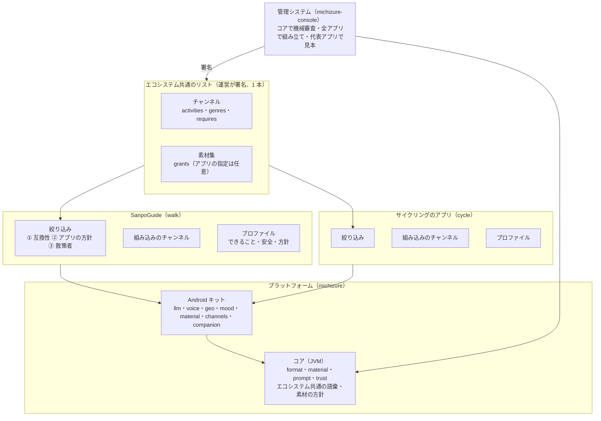

# ADR-003 散策ガイドの共通部分を切り出し、付き添いアプリのエコシステムにする

## 文書情報

| 項目 | 内容 |
|---|---|
| 文書ID | ADR-003 |
| ドキュメント種別 | ADR |
| 対象システム/機能 | SanpoGuide と sanpo-channel-console の全体。共通部分の切り出し、チャンネル・素材集のアプリをまたいだ扱い |
| 関連Skill | architecture-decision-record |
| 作成日 | 2026-10-12 |
| 作成者 | Claude（開発者との検討） |
| 承認者 | 開発者（1.0・1.1: 2026-10-12） |
| ステータス | 承認済（方針。詳細は追従タスクの契約書・計画書で決める） |
| 版 | 1.1 |

## 目的・背景

SanpoGuide は散策向けのアプリだが、今の仕組み（チャンネル・素材提供者・審査と署名・話しかけの判断・声・雰囲気）は、散歩に限らず「場所と状況に応じて AI が語りかける付き添いアプリ」（以下、付き添いアプリ）一般に使える。開発者から「要望に応じてアプリを作れるよう、共通部分を切り出して共通化し、エコシステムとして発展させたい」という方針が示された。

今の作りには、次の問題がある。

1. **形式に散歩の言葉が混ざっている**: `:station-format` は形式の仕組み（スロット、選択肢しか書けない `channel.json`、署名、ZIP の確認、素材・きっかけ、地域）としては汎用だが、語彙（`SpotKind`・`TalkEventKind`・止められない出来事・プロンプトの中身）は散歩専用になっている
2. **話す判断がサービスに直接書かれている**: 優先順位、頻度とチャンネルでは止められない安全の判定、話す間隔、読み上げ中は判定しないこと（`WalkService.maybeTalk()`）は、どの付き添いアプリにも要る仕組みだが、散歩の判定と混ざっている
3. **端末の部品がアプリの中にある**: 声（TTS・オーディオフォーカス・背景音）、AI の接続、位置・地図・天気、雰囲気、チャンネルの取り込み・素材の見せ方が、アプリのパッケージに置かれている
4. **管理システムは SanpoGuide 1 本を前提にしている**: リスト（API-002）にも審査基準にも、アプリを区別する考え方がない

本書は、共通部分の切り出し方と、チャンネル・素材集をアプリをまたいでどう扱うかの方針を記録する。

## スコープ・非スコープ

スコープ:
- 層の分け方（コア・Android キット・アプリ）と、各層に置くもの
- アプリのプロファイル（できることの宣言・安全・絞り込みの方針）
- チャンネル・素材集のアプリをまたいだ扱い、アプリによる絞り込み
- 語彙の置き場所と、知らない値の扱い
- 管理システム（リスト・審査）への影響の大枠
- リポジトリの構成と進め方

非スコープ（別途決める）:
- `channel.json` format 2 の項目・値の詳細（API-003 2.0。T-4）
- リスト・素材集の形式の改訂の詳細（API-002・API-004。T-5・T-6）
- 段階 1 の切り出しの手順と保証（RFC-002。T-1）
- 話す判断のエンジンの設計（T-3）

## 対応元ID（トレーサビリティ）

| 対応元ID | 内容 | 対応状況 |
|---|---|---|
| RFC-001 | プロンプトと組み込みのチャンネルを `:station-format` に移す。動きを変えずに切り出す進め方 | 同じ進め方で、さらに分ける |
| ADR-001 | C-4（チャンネル提供者の署名）、C-7（アプリが強制すること）、C-8（機械で確かめる項目） | 変えない。アプリが変わっても必ず守らせる（E-13） |
| ADR-002 | D-3（共通の IF）、D-4・D-5（属性と方針）、D-9（利用許諾）、D-25（タグ） | 素材集をアプリ共通にする（E-14〜E-16） |
| API-002 | 承認済みチャンネル・リスト | エコシステムで 1 本のまま、互換性の宣言を載せる（E-17。T-5） |
| API-003 | F-1〜F-7（スロット・選択肢・止められない出来事・ファイルの許可・署名） | format 2 で `activities`・`genres`・`requires` を足し、F-5 の当て方を変える（E-8・E-12。T-4） |
| API-004 | 題材・タグ・利用許諾 | 題材の「出来事」の扱い、タグの共通化、`grants` のアプリ指定（T-6） |
| sanpo-channel-console ADR-001 | 管理システムの構成 | 互換性の判定・審査の見本の作り方を変える（T-7） |

## 方針・決定事項

2026-10-12 に、Claude の提案を開発者が承認した。チャンネルの扱い（E-8〜E-12）は、Claude の最初の提案（1 チャンネルを 1 アプリに結びつける）を、開発者の指摘（今の SanpoGuide のように 1 アプリが複数のチャンネルを持ち、アプリが絞り込む形にする）で改めたもの。

### 全体と層

| No. | 論点 | 決定 |
|---|---|---|
| E-1 | 目的 | 付き添いアプリを、要望に応じて作れるプラットフォームにする。SanpoGuide はその最初のアプリ。チャンネル提供者・素材提供者・運営はアプリをまたいで共通 |
| E-2 | 層 | 3 層に分ける。**コア**（JVM、Android に依存しない。アプリと管理システムが同じコードを使う）、**Android キット**（AAR）、**アプリ**。下の層は上の層を知らない |
| E-3 | コア | `core-format`（チャンネルの形式の骨格・スロット・署名・ZIP の確認・きっかけ・エコシステム共通の語彙）、`core-material`（素材提供者の記述と方針・素材集・素材・地域・タグの一覧）、`core-prompt`（`PromptTemplates`・スロットの差し込み・審査の見本の組み立て）、`core-trust`（リストの検証。`ChannelSync` から Android に依存しない部分を移す） |
| E-4 | Android キット | `kit-llm`（`LlmClient`・Claude／OpenAI 互換・`KeyCipher`・変えた値だけの保存）、`kit-voice`（`Speaker`・オーディオフォーカス・`AmbientPlayer`・`Voices`）、`kit-geo`（Overpass・`Poi`・`Shape`・ルート・`SpotPhotos`・地図タイル・`SpotMap`・方位・天気と天気の急変・日の入り）、`kit-mood`（`Mood`・`MoodSource`・`MoodTheme`・`MoodScene`）、`kit-material`（`Producer` の IF・同梱と素材集の素材提供者・基準で選ぶ素材提供者・候補の順番・前もっての取得・見せ方とその安全）、`kit-channels`（`StationRepository`・チャンネルの取り込みと保存・試用チケット・チャンネルの画面）、`kit-companion`（話す判断のエンジン・記録） |
| E-5 | アプリが持つもの | プロファイル（E-6）、判定のルール（散歩なら施設の案内・スポットの選び方）、プロンプトの固定部分の中身と定型文、組み込みのチャンネル、画面と常駐サービスのつなぎ込み |
| E-6 | アプリのプロファイル | アプリごとに 1 つ持ち、次を宣言する。① **できること**: 過ごし方（`activities` の値）、実装している出来事・スロット・題材の種類・見せ方。② **安全**: 止められない出来事（散歩なら天気の急変・日の入り・施設の案内）と共通の指示。③ **絞り込みの方針**（E-10 の②）。④ **素材の方針**: コアの方針より厳しくするだけ（宣伝の素材を出さない、映像を出さない、など） |
| E-7 | 話す判断のエンジン | `maybeTalk()` の判定を「ルールの並び」（優先順位・安全かどうか・どの間隔を守るか・判定）として表し、調停（読み上げ中は判定しない、1 件ずつ、切り替えの直後は控える、間隔）を `kit-companion` が受け持つ。アプリはルールを並べるだけにする。安全のルールは頻度とチャンネルを無視する（今と同じ） |

### チャンネル

| No. | 論点 | 決定 |
|---|---|---|
| E-8 | チャンネルとアプリの関係 | チャンネルは**エコシステム共通**にし、特定のアプリには結びつけない（`channel.json` にアプリの ID を持たせない）。1 つのアプリは、今の SanpoGuide と同じく複数のチャンネルを並べる。チャンネルは何を前提にしているかを宣言する: `activities`（合う過ごし方。共通の一覧から選ぶ。例: walk・cycle）、`genres`（散策者が探すときの分類。共通の一覧から）、`requires`（これがないアプリでは成り立たないもの: スロット・題材の種類・見せ方） |
| E-9 | 語彙の置き場所 | 出来事・スロット・スポットの種類・過ごし方・ジャンルの語彙は、**エコシステム共通の一覧**としてコア（`core-format`）に置く。アプリはその一部を実装し、どこまで実装しているかをプロファイルで宣言する。値を足すときはコアの版を上げる |
| E-10 | アプリの絞り込み | 3 段で行う。① **互換性**（自動）: チャンネルの `activities` にアプリの過ごし方が入っていて、`requires` をアプリが満たす。② **アプリの方針**（プロファイル）: 言語・ジャンル・宣伝の有無、特定のチャンネルを除く・推す。③ **散策者の絞り込み**（画面）: ジャンル・チャンネル提供者・宣伝の有無 |
| E-11 | 組み込みのチャンネル | アプリごとに持つ（今の 6 本は SanpoGuide の組み込み）。組み込みのチャンネルを、審査を経てエコシステムのリストに出すこともできる（任意） |
| E-12 | 知らない値の扱い（API-003 F-5 の当て方） | 確かめる場所で分ける。**管理システム**: 今どおり厳しく、エコシステム共通の語彙にない値は拒む。**アプリ**: `requires` と制限の項目（`skip` など）に知らない値があれば、そのチャンネルを出さない（制限を読み落とすと、チャンネル提供者の意図より緩くなるため）。任意の項目（実装していない出来事のきっかけ・スロットなど）に知らない値があれば、その部分だけ使わない（使わなくても安全側に倒れるだけのため） |
| E-13 | 安全 | 止められない出来事、共通の指示（`shared/guard`）、見せ方の安全（API-003 F-8）、素材の方針（API-004 P-1・P-2）は、**今と同じくアプリ側の固定部分**のままにする。チャンネルにはこれらを書く項目がないので、どのアプリで使われても、そのアプリの安全の決まりが必ずかかる（ADR-001 C-7 は変わらない） |

### 素材集

| No. | 論点 | 決定 |
|---|---|---|
| E-14 | 素材集とアプリの関係 | 素材集は**既定でどのアプリでも使える**。素材提供者は、利用許諾（`grants`）に使ってよいアプリを任意で書ける（書かなければ全アプリ）。素材集の審査はアプリをまたいで 1 回にする |
| E-15 | タグの一覧 | エコシステム共通の 1 つにし、コア（`core-material`）に置く。アプリごとの拡張は認めない（同じ素材集が、アプリによって当たったり当たらなかったりするのを避けるため） |
| E-16 | 素材の方針 | `ProducerPolicy`（第三者は前もって取得するだけ・題材を外に伝えない・生成しない）はコアに置き、アプリは緩められない（厳しくするだけ。E-6 ④）。素材提供者には「どのアプリに出しても扱いが同じ」こと、散策者には「どのアプリでも位置が漏れない」ことを保証する。素材の要求の文脈（`MaterialContext`）は汎用にし、散歩の情報（`WalkSession`・天気など）はアプリが組み込みの素材提供者に渡す。題材の「出来事」はプロファイルが実装する出来事に限る（素材集の `about` はスポット・地点だけなので、素材集の形式は変わらない） |

### 管理システム

| No. | 論点 | 決定 |
|---|---|---|
| E-17 | リスト | **エコシステムで 1 本**のままにし、チャンネルの `activities`・`genres`・`requires` を載せる。アプリが端末で絞り込む。取り下げ・鍵の移し替え（`publisherChange`・`producerChange`）は今のまま |
| E-18 | 審査 | 機械審査は、コアのエコシステム共通の語彙だけで確かめる（アプリごとのプロファイルを読まない）。審査の見本は 2 段に分ける（E-26）。そのため、各アプリはプロンプトの固定部分を「プロンプト・パック」として公開する。チャンネル提供者の画面には「このチャンネルが出るアプリ」を出す（互換性の判定はコアの同じコードで行う）。素材提供者の画面には、自分の素材集を使っているチャンネルとアプリを出す（ADR-002 D-18 の拡張） |

### 構成と進め方

| No. | 論点 | 決定 |
|---|---|---|
| E-19 | リポジトリ | Kotlin 側は 1 つの Gradle モノレポにする（SanpoGuide のリポジトリを育てる）。`platform/`（コアとキット）、`apps/`（SanpoGuide と次のアプリ）、`templates/`（新しいアプリの雛形）。コアとアプリを同じ PR で直せるようにするため。管理システム（sanpo-channel-console）は別リポジトリのまま、公開したコアとプロンプト・パックを版で固定して使う（今の station-format と同じ関係） |
| E-20 | 進め方 | 段階 1（動きを変えない切り出し）はすぐに進めてよい。話す判断のエンジン（段階 2）と format 2（段階 3）は、2 本目のアプリを具体的に決めてから詰める（散歩だけに合わせた抽象を固めないため）。段階は[追従タスク](#影響範囲追従タスク)の順 |
| E-21 | 互換 | format 1 のチャンネルは「`activities: ["walk"]`・`requires` は今の SanpoGuide が実装しているもの」として読む。今の組み込みのチャンネル・第三者のチャンネル・素材集は書き換えなくてよい |

### 未決事項の解決（1.1）

2026-10-12 に、1.0 の未決事項 No.1〜6 について Claude の推奨を開発者が承認した。

| No. | 論点 | 決定 |
|---|---|---|
| E-22 | エコシステムの名前 | **michizure**（道連れ。「旅は道連れ」の、移動に付き添う相手）。プラットフォームの Kotlin のパッケージと公開の座標は `io.github.duwenji.michizure`（例: `io.github.duwenji.michizure.core.format`）。管理システムは `michizure-console` に改める（時期は T-7）。変えないもの: SanpoGuide の `applicationId`・パッケージ名（Google Play の ID で、アプリ自身の名前のため）、アカウントIDの `sg1…`・リストIDの `sc1…` の接頭辞（署名と照合に使っているため、互換を優先する） |
| E-23 | 2 本目のアプリ | **サイクリングの伴走**（`cycle`）。地図・天気・日の入りの部品をそのまま使え、速度の違いで距離・間隔・判定の抽象を試せ、歴史探訪などのチャンネルを散歩と共有できるため。多くの都道府県で、周りの音が聞こえない状態での自転車の運転が規則で禁じられていることから、プロファイルは次を前提にする: 既定はスピーカーで流す（イヤホンだけにしない）、背景音は使わない、走行中は画面を出さない。この前提で成り立たないと分かったときの次点は、乗り物の車窓ガイド |
| E-24 | `activities` の最初の一覧 | `walk`・`cycle` の 2 つだけで始める。値は、そのアプリを作ると決めたときにコアのマイナー版で足す（実装しているアプリのない値は、どのアプリでも確かめられない宣言になるため） |
| E-25 | チャンネル提供者によるアプリの除外 | format 2 では入れない。出す範囲は `activities`・`requires` で絞る。アプリ単位の除外を認めると、互換性の判定と審査の見本がアプリごとに戻るため。要望が出たら `excludeApps` を足すことを検討する（見直しの条件） |
| E-26 | 審査の見本 | 2 段に分ける。① **組み立ての確認**は、互換性のあるすべてのアプリのプロンプト・パックで行う（AI を呼ばず、組み立てとスロット・上限の確認だけなので費用がかからない）。② **AI に話させる見本**は、`activities` の値ごとに代表のアプリ 1 つで作る（費用と運営の確認の量を、アプリの数ではなく過ごし方の数に比例させる）。最初の代表は `walk` が SanpoGuide、`cycle` がサイクリングのアプリ |
| E-27 | 利用者の呼び方 | エコシステム全体の文書では「**利用者**」と呼び、各アプリの画面と文書ではアプリの呼び方を使う（SanpoGuide は「散策者」）。stakeholders.md に対応を書く（T-10）。チャンネル提供者・素材提供者・運営は今の呼び方のまま |

## 判断テーマ

付き添いアプリを要望に応じて作れるようにするために、何を共通にし、チャンネル・素材集をアプリとどう結びつけるか。

## 検討した代替案と比較軸

比較軸: ①新しいアプリを作る速さ ②チャンネル・素材集の再利用（チャンネル提供者・素材提供者にとっての届く範囲） ③安全の保証が崩れないか ④審査・運用の費用 ⑤変更の費用

| 案 | 内容 | 評価 |
|---|---|---|
| 案 A | 今のまま。新しいアプリは SanpoGuide を写して作る | ①○ 最初は速い ②× ③△ 写したアプリごとに守り方がずれる ④× 管理システムもアプリごと ⑤◎ |
| 案 B | 共通部分をライブラリに切り出す。チャンネルは 1 つのアプリに結びつけ（`channel.json` にアプリの ID）、リストもアプリごとに分ける。語彙はアプリのプロファイルが定める | ①◎ ②△ 素材集は共通にできるがチャンネルは共通にならない ③◎ ④△ リストと機械審査がアプリごとに要る ⑤○ |
| **案 C（採用）** | 共通部分をライブラリに切り出す。チャンネルも素材集もエコシステム共通にし、チャンネルは前提を宣言、アプリが絞り込む。語彙はエコシステム共通 | ①◎ ②◎ ③◎ 安全はアプリの固定部分のまま ④○ リスト・機械審査は 1 つ、見本だけ過ごし方ごと ⑤△ format 2 と知らない値の扱いの見直しが要る |
| 案 D | 1 つのアプリに「散歩」「サイクリング」などのモードを入れていく | ①△ 入れるたびにアプリが重くなる ②◎ ③○ ④◎ ⑤○ 要望ごとに別のアプリを出すことができない |

## 採用案と採否理由

案 C を採用する。

- 要望ごとに別のアプリを作れ（案 D ではできない）、作るたびに安全と信頼の仕組みを作り直さずに済む（案 A の問題）
- チャンネル提供者・素材提供者が一度申請すれば、合うすべてのアプリに届く。エコシステムが育つ理由になる
- 安全に関わることは、もともとチャンネルに書けない形（API-003 F-4・ADR-001 C-7）なので、チャンネルを共通にしても弱まらない
- リスト・機械審査がエコシステムで 1 つで済み、案 B より管理システムが単純になる

却下した理由:
- 案 A: 写したアプリが増えるほど、守り方と管理システムがばらばらになる
- 案 B: 同じチャンネルを別のアプリに出すには、申請し直しになる。開発者の方針（1 アプリが複数のチャンネルを持ち、アプリが絞り込む）と合わない
- 案 D: アプリごとに異なる要望（画面・常駐の仕方・権限）に応えにくい

利点:
- 新しいアプリは、プロファイル・ルール・プロンプト・組み込みのチャンネル・画面を書くだけで作れる。雛形と Claude Code のスキルで、要望から生成できる
- チャンネル・素材集の審査が、アプリが増えても増えない
- 散策者は、どのアプリでも同じ安全とプライバシーの扱いを受ける

注意点:
- チャンネルの語り手の文章が、宣言した過ごし方に合っているかは人の審査に頼る（「一緒に歩きましょう」を cycle に宣言する、など）
- 語彙を足すたびにコアの版が上がり、古いアプリでは、その値を `requires` に書いたチャンネルが出なくなる
- AI に話させる見本は代表のアプリでしか作らないので、代表でないアプリの固定部分との組み合わせで、意図と違う話し方になるおそれがある（組み立ての確認は全アプリで行う。E-26）
- 共通部分を先に作り込みすぎると、散歩だけに合った抽象が固まる（E-20 で抑える）

## 影響範囲・追従タスク

| 観点 | 影響 |
|---|---|
| 実装（アプリ） | パッケージをコア・キットのモジュールに移す。`WalkService.maybeTalk()` をルールの並びにする。プロファイルを足し、チャンネルの絞り込みを実装する |
| 実装（station-format） | `core-format`・`core-material`・`core-prompt` に分ける。`SpotKind`・`TalkEventKind` などの語彙をエコシステム共通の一覧として整理する。公開の座標が変わる |
| 実装（管理システム） | validator を新しいコアに切り替える。互換性の判定と「このチャンネルが出るアプリ」の表示、`activities` ごとの見本、`grants` のアプリ指定 |
| 運用 | 審査で、チャンネルの宣言した過ごし方と語り手の文章が合っているかを確かめる。アプリが増えるたびに代表のアプリを決める |
| テスト | 段階ごとに、今の動きが変わらないこと（プロンプトの組み立て結果、API-004 の確認観点 W-01〜W-19、判定順の場面テスト、エミュレータでの散策） |
| 移行 | 散策者のデータへの影響はない。format 1 はそのまま読める（E-21） |
| 文書 | architecture.md・README・channels.md・stakeholders.md・sanpo-tutorial 第 5 部の書き直し |

| ID | 追従タスク | 担当 | 時期 |
|---|---|---|---|
| T-1 | [RFC-002](../refactoring/RFC-002-platform-stage1.md)（2026-10-12 承認・実施済）: 段階 1（動きを変えない切り出し）の計画書。依存を調べた結果、`core-material`・`core-trust` は段階 1 では `core-format` の中のパッケージとし、`kit-material`・`kit-channels` は段階 2・3 に回す提案（RFC-002 R-2・R-5）。プラットフォームのパッケージは `io.github.duwenji.michizure`（E-22）。station-format を `core-*` に分け、依存の少ない順（`kit-voice`・`kit-llm`・`kit-geo` → `kit-mood`・`kit-material` → `kit-channels`）にモジュールへ移す。保証は RFC-001 と同じ（プロンプトの組み立て結果が 1 文字も変わらない、既存のテストが通る、エミュレータで散策できる） | Claude | 本書の承認後すぐ |
| T-2 | 判定順の場面テスト: `maybeTalk()` の判定を、場面ごとに期待する発言を並べた表のテストにする（T-3 の前に作り、置き換え前後で一致させる） | Claude | T-1 と並行 |
| T-3 | 話す判断のエンジン（`kit-companion`）の設計と実装（[RFC-003](../refactoring/RFC-003-talk-decision.md)、2026-10-12 実施済）。サイクリング（E-23）の判定も表せることを確かめる | 開発者・Claude | T-1・T-2 の後 |
| T-4 | API-003 2.0: format 2（`activities`（最初は `walk`・`cycle`。E-24）・`genres`・`requires`、エコシステム共通の語彙、知らない値の扱い E-12、format 1 の読み方 E-21） | Claude | T-3 と並行 |
| T-5 | API-002 の改訂: チャンネルの `activities`・`genres`・`requires` をリストに載せる | Claude | T-4 と同時 |
| T-6 | API-004 の改訂: タグの一覧のコアへの移動（E-15）、`grants` のアプリ指定（E-14）、題材の「出来事」の扱い（E-16） | Claude | T-4 と同時 |
| T-7 | sanpo-channel-console: 新しいコアへの切り替え、互換性の判定と表示、プロンプト・パックでの組み立ての確認と `activities` ごとの見本（E-26）、`grants` のアプリ指定。ADR・DM-001・API-001 の改訂。`michizure-console` への改名（E-22） | Claude | T-4〜T-6 の後 |
| T-8 | 新しいアプリの雛形（`templates/`）と、要望からプロファイル・ルール・プロンプト・組み込みのチャンネルを生成する Claude Code のスキル | Claude | T-3・T-4 の後 |
| T-9 | サイクリングのアプリ（E-23）を作り、合わなかった抽象を直す。代表のアプリとして `cycle` の見本に使う | 開発者・Claude | T-8 の後 |
| T-10 | 文書の更新: architecture.md・README・channels.md・stakeholders.md（利用者の呼び方。E-27）、sanpo-tutorial 第 5 部 | Claude | 段階ごと |

見直しの条件:
- 2 本目のアプリで、プロファイル・エコシステム共通の語彙の形が合わなかったとき
- 屋内など、位置を使わない付き添いアプリの要望が出たとき（`kit-geo` と題材の前提が変わる）
- チャンネル提供者から、特定のアプリにだけ出したい・出したくないという要望が出たとき（E-25）
- 代表のアプリだけの見本では、審査で見落としが出たとき（E-26）
- サイクリングのアプリで、音の出し方の前提（E-23）が規則や利用者の使い方と合わなかったとき

## 制約

- 安全に関わる決まり（止められない出来事・共通の指示・見せ方の安全・素材の方針）は、チャンネル・素材集からは変えられない。アプリは厳しくすることだけできる
- コアは Android に依存しない（管理システムが同じコードで確かめるため。RFC-001 と同じ）
- 運営の担当者は 1 人（ADR-001 C-10）。アプリが増えても審査の単位を増やさない

## 未決事項・リスク

| No. | 内容 | 決める時期 |
|---|---|---|
| 1 | ~~エコシステムの名前~~ → 解決（1.1、E-22。michizure） | — |
| 2 | ~~2 本目のアプリの候補~~ → 解決（1.1、E-23。サイクリングの伴走） | — |
| 3 | ~~`activities` の最初の一覧~~ → 解決（1.1、E-24。`walk`・`cycle`） | — |
| 4 | ~~チャンネル提供者が、特定のアプリを除外できるようにするか~~ → 解決（1.1、E-25。format 2 では入れない） | — |
| 5 | ~~審査の見本を代表アプリだけで作るか~~ → 解決（1.1、E-26。組み立ては全アプリ、AI の見本は代表アプリ） | — |
| 6 | ~~エコシステム全体での利用者の呼び方~~ → 解決（1.1、E-27。「利用者」） | — |

リスク:
- 段階 1 の切り出しで、今の動き（話しかけの判定・写真の取得の条件・背景音の切り替え）が変わるおそれ（T-1・T-2 の保証で抑える）
- エコシステム共通の語彙が、アプリの数だけ膨らむ
- モノレポにすると、1 つのアプリの変更がほかのアプリのビルド・テストを壊すおそれがある（CI でアプリごとに確かめる）
- サイクリング中の話しかけが、利用者の注意をそらすおそれがある（走行中は画面を出さず、話す間隔を散歩より長くする。T-3・T-9 で確かめる）

## 関連ドキュメント・参照リンク

- [ADR-001](ADR-001-third-party-channel-curation.md): 第三者のチャンネルの審査と署名
- [ADR-002](ADR-002-material-producers.md): 素材提供者の切り出し
- [channel-package-format.md（API-003）](../channel-package-format.md): チャンネル・パッケージの形式
- [channel-list-api.md（API-002）](../channel-list-api.md): 承認済みチャンネル・リスト
- [material-producer-api.md（API-004）](../material-producer-api.md): 素材提供者 IF と素材集の形式
- [RFC-001](../refactoring/RFC-001-prompts-to-station-format.md): プロンプトと組み込みのチャンネルを `:station-format` に移す
- [architecture.md](../architecture.md): 今のアプリの構造

## 変更履歴

| 日付 | 版 | 変更内容 | 変更者 |
|---|---|---|---|
| 2026-10-12 | 0.1 | 草案（3 層の構成、素材集をアプリ共通に） | Claude |
| 2026-10-12 | 0.2 | チャンネルを 1 アプリに結びつける案（案 B）から、エコシステム共通にしてアプリが絞り込む案（案 C）に改めた（E-8〜E-12、E-17・E-18）。開発者の指摘による | Claude |
| 2026-10-12 | 1.0 | 承認 | Claude（承認: 開発者） |
| 2026-10-12 | 1.1 | 未決事項 No.1〜6 を解決（E-22〜E-27）。E-18 の見本を 2 段に（E-26）、追従タスクの時期と内容を更新 | Claude |
| 2026-10-12 | 1.1 | 承認 | Claude（承認: 開発者） |
