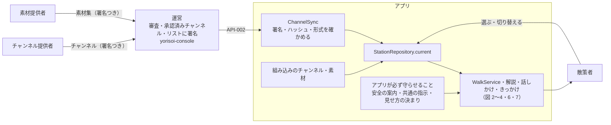
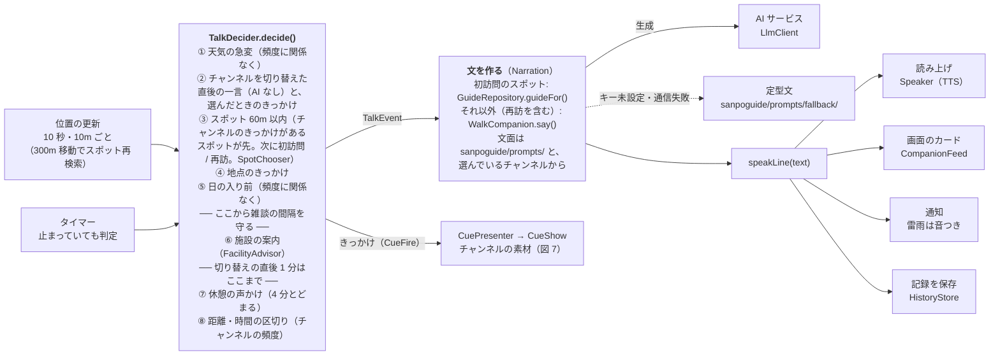
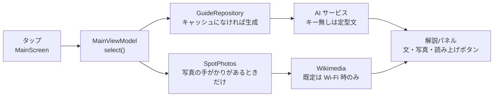
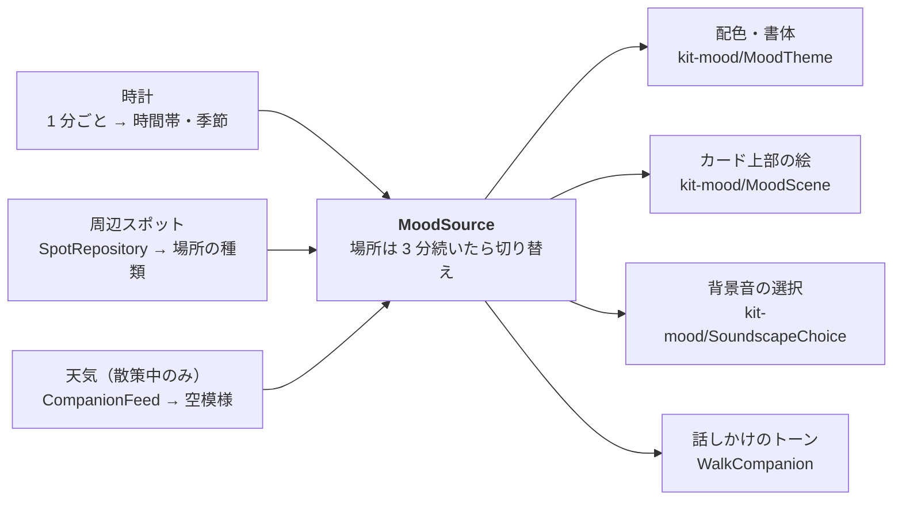
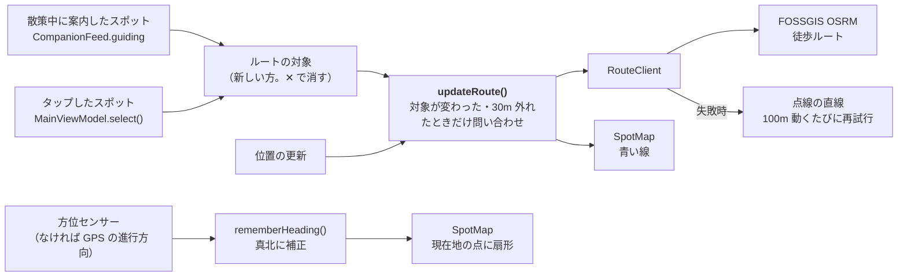
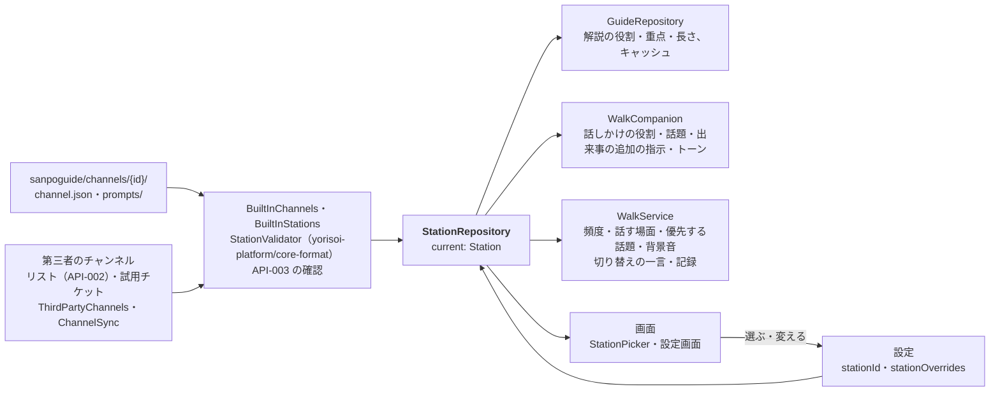
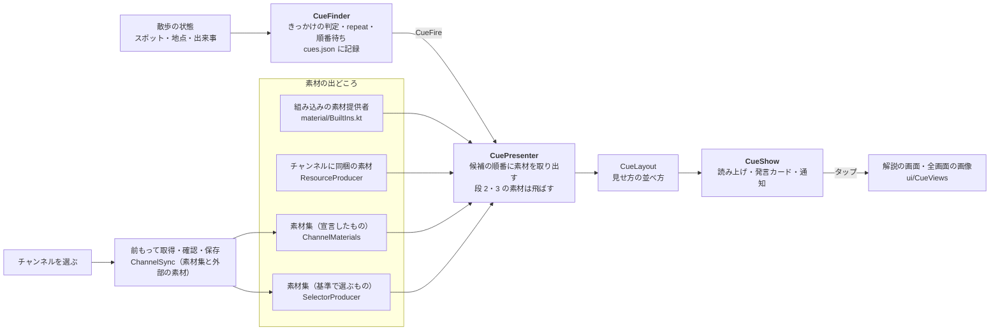

# 散策ガイドの構造図

アプリ全体を 7 枚の図で説明する。最初に、アプリの中心にある「チャンネル」の考え方と関係者を示す。図 1 で「どこに何があるか」をつかみ、図 2〜7 で散策モードの話しかけ・スポット解説・雰囲気・地図のルートと向き・チャンネル・素材ときっかけという 6 つの流れを追う。

- ソース 51 ファイル / 約 7,300 行（アプリ 47 ファイル・7,046 行、プロンプト・パック `:prompts` 4 ファイル・277 行。共通の部品は yorisoi-platform）、アプリのパッケージ 11
- 画面 4（メイン・設定・記録・配信されているチャンネル）、常駐サービス 1（`WalkService`）、外部サービス 8（Google マップとチャンネル・リストは設定で選んだときだけ）

図はコードから手で書き起こしたもの。`WalkService` の判定順を変えたり、パッケージを追加したりしたときは、この文書も更新する。

## チャンネルという考え方

チャンネルは、語り手・話題・話す場面・話す量・トーン・背景音をまとめて切り替え、**同じ散歩を違う体験にする**もの。ラジオの局のように散歩の途中でも切り替えられる（コード上の名前 `Station` はこのたとえから）。図 2〜4・7 の流れは、どれも選んでいるチャンネルを見て動く。

関係者は、チャンネルを選んで歩く**散策者**、チャンネルを作る**チャンネル提供者**、チャンネルが使う素材を作る**素材提供者**、そのあいだで審査と署名をする**運営**（[stakeholders.md](https://github.com/duwenji/yorisoi-platform/blob/main/docs/stakeholders.md)）。

| | 組み込みのチャンネル | 第三者のチャンネル |
|---|---|---|
| 作る人・届き方 | アプリの開発者・アプリの版 | チャンネル提供者（素材は素材提供者も）・運営が出すリスト |
| 散策者が変えられるか | 頻度・場面・解説の長さなど（設定画面） | 変えられない（使う・使わないだけ） |
| チャンネルで止められないもの | 天気の急変・日の入り・施設の案内、AI への共通の指示（`shared/guard`）、見せ方の安全の決まり | 同じ |

## 図 1 · 全体: 画面とサービスは、SanpoApp が持つ共有部品を使う

DI ライブラリは使っていない。`SanpoApp.onCreate()` が部品を 1 つずつ作り、画面の ViewModel と `WalkService` は `(application as SanpoApp).spots` のように直接取り出す。

```mermaid
flowchart TB
  subgraph UI["画面（ui）"]
    MainActivity
    MainScreen["MainScreen<br/>SpotMap・CompanionCard・StationPicker<br/>CueViews（解説の画面・全画面の画像）"] --> MainViewModel
    SettingsScreen --> SettingsViewModel
    HistoryScreen --> HistoryViewModel
    ChannelsScreen["ChannelsScreen<br/>リスト・配信されているチャンネル・試用チケット"] --> ChannelsViewModel
  end

  subgraph WALK["常駐処理（walk）"]
    WalkService["WalkService<br/>位置の追跡・話す判断・通知・背景音"]
    CueShow["CueShow<br/>きっかけの読み上げ・カード・通知"]
  end

  subgraph APP["共有部品（SanpoApp.onCreate() で生成）"]
    prompt["プロンプト（:prompts・yorisoi-platform/core-prompt）<br/>PromptTemplates・StationPrompts<br/>← sanpoguide/prompts/*.md"]
    history["history<br/>HistoryStore<br/>walk_history.json（端末内）"]
    settings["settings<br/>SettingsRepository・Threshold<br/>（API キーの暗号化は kit-llm の KeyCipher）"]
    mood["kit-mood<br/>MoodSource・Mood・PlaceGuess"]
    station["station<br/>StationRepository・Station<br/>← sanpoguide/channels/（yorisoi-platform/core-format で確認）<br/>station/remote: ThirdPartyChannels・ChannelSync"]
    material["material<br/>Producers・Narration<br/>CueFinder・CuePresenter・ChannelMaterials"]
    data["kit-geo<br/>SpotRepository<br/>OverpassClient・SpotPhotos<br/>RouteClient・WeatherClient・GoogleMapTiles"]
    guide["guide・kit-llm・kit-voice<br/>GuideRepository・Speaker<br/>LlmClient・Provider"]
    companion["companion<br/>WalkCompanion・CompanionFeed<br/>WeatherChange ほか"]
    sound["kit-voice<br/>AmbientPlayer・Voices<br/>※ WalkService が生成"]
  end

  subgraph EXT["外部・端末"]
    Overpass["Overpass API<br/>スポット・施設"]
    OSRM["FOSSGIS OSRM<br/>徒歩ルート"]
    Wikimedia["Wikimedia<br/>写真"]
    AI["AI サービス<br/>Claude / OpenAI 互換 API"]
    OpenMeteo["Open-Meteo<br/>天気・予報・日の入り"]
    Device["端末<br/>TTS・音声出力・GPS・方位センサー"]
    GSI["地図画像<br/>地理院タイル / Google Map Tiles API"]
    Provider["チャンネル・リスト（任意）<br/>リスト・パッケージ・素材集<br/>例: yorisoi-console"]
  end

  MainActivity -- "開始・終了" --> WalkService
  MainViewModel & SettingsViewModel & HistoryViewModel & ChannelsViewModel -- "app.◯◯ で参照" --> APP
  WalkService -- "app.◯◯ で参照" --> APP
  data --> Overpass & Wikimedia & OSRM & OpenMeteo
  data -. "セッション・出典" .-> GSI
  guide --> AI
  station --> Provider
  material --> guide & companion & data
  sound --> Device
  MainScreen -. "SpotMap が直接取得" .-> GSI
  MainScreen -. "rememberHeading が読む" .-> Device
```

`WalkService` がアプリの中心。散策モード中は画面を閉じても動き続け、位置・天気・周辺スポットと、選んでいるチャンネル（`station`）を見て「いま何を話すか」を決める。`sound` だけは SanpoApp ではなく、WalkService が必要になったときに作る。話す文・写真・背景音は、`material` の素材提供者（`Producers`）を通して取り出す（図 7）。

## 図 2 · 散策モード: 話しかけるまでの流れ

位置が更新されるたびと、一定間隔のタイマーで `WalkService.maybeTalk()` が呼ばれる。`maybeTalk()` はその時の状況（`TalkSituation`。距離・経過時間・セッションの値などを計算済みの値で）を集め、`TalkDecider.decide()` が上から順に判定して、最初に当たった 1 件を決定（`TalkDecision`）として返す。判定は 8 つのルール（`TalkDecider.rules`）の並びで、それぞれ 4 つのゲート（`WalkGate`: スポットの間隔・雑談の間隔・とどまっていない・切り替えの直後でない）のうち要るものが開いているときだけ評価される。並びを評価するエンジンは `yorisoi-platform/kit-companion` の `TalkEngine`。`maybeTalk()` はその決定を実行する（読み上げ・通知・記録・セッションの更新）。判定は Android に依存しない純粋な関数で、場面ごとのテスト（`TalkDeciderTest`）がある。

- 順番はコードの判定順（`companion/TalkDecider.kt`）そのまま。README の表とは並びが違い、実際には「スポット」が「日の入り」より先に判定される。
- 天気と日の入りは安全に関わるため、話しかけの頻度設定を無視する。施設の案内も含め、この 3 つはチャンネルの設定で止まらない。
- スポット（初訪問・再訪）・休憩・区切り・開始・終了は、チャンネルの「話す場面」でオフにできる。頻度（`TalkLevel`）もチャンネルごと。
- チャンネルを切り替えると、次に話すのは新しいチャンネルの一言（`WalkSession.pendingGreeting`）。その後 1 分はスポット案内と休憩・区切りを控える（`WalkSession.justSwitched()`）。
- チャンネルのきっかけ（スポット・地点）は、チャンネルが「話題」や「話す場面」で除いているスポットでも出す（チャンネルが意図して置いたため）。どちらも、とどまっている間と切り替えの直後は出さない。スポットのきっかけは、スポット案内の間隔（`TalkLevel.spotGapMs`）も守る。散歩の開始・終了のきっかけは開始・終了の一言のあとに出す。
- 読み上げ中は判定しない（`Speaker.isSpeaking` と `Mutex` で 1 件ずつ）。
- 記録の保存は、スポット案内・距離の区切り・散歩の終了のときに行う。区切りで話さないチャンネルでも、区切りの時点で保存だけはする。

### スポットが近くに複数あるとき

案内範囲（`ANNOUNCE_RADIUS_M` = 60m）は**ユーザーの現在地を中心にした円**で、スポットごとの範囲ではない。スポット同士の距離は判定に使わないので、「A が B の近くにある」こと自体は A の案内に影響しない。

- 1 回の判定で案内するのは 1 件だけ。`notability`（Wikipedia/Wikidata タグで +2、主要カテゴリで +1）に、チャンネルの「優先する話題」に入っている種類なら +2 を足し、高い方、同点なら近い方を選ぶ（`companion/SpotChooser.kt`）。チャンネルが除く種類は候補にしない。
- 選ばれなかったスポットは候補に残る。次の判定（30 秒ごと）で次の条件をすべて満たせば案内される。
  - 前回のスポット案内から `TalkLevel.spotGapMs` 以上経った
  - まだ 60m 以内にいる
  - 2 分以上とどまっていない（とどまっている間は周りを順に紹介しない）
  - 読み上げ中でない
- 間隔が空く前に 60m の外へ出たら、そのときは案内されない。案内済み（`talkedAbout`）にはならないので、また近づけば案内される。
- 今回の散歩で案内したスポット（同じ ID、または同じ名前で近い位置）は候補から外れる。過去の散歩で訪れたスポットは、再訪の一言の候補になる。
- スポットの通知は 1 枠（`SPOT_NOTIFICATION_ID`）を使い回すため、新しい案内が前の通知を置き換える。

## 図 3 · スポット解説: 地図でスポットをタップしたとき

解説と写真は別々に取りに行く。解説は「AI サービス・モデル・チャンネル（版を含む）・解説の長さ・スポット・位置情報を送る設定」の組み合わせでキャッシュするため、同じ条件で料金がかかるのは 1 回だけ。解説の役割・重点・長さは、選んでいるチャンネルから入る。

読み上げは自動では始まらず、パネルのボタンで `Speaker` に渡す。散策モードで初訪問のスポットに近づいたときも同じ `GuideRepository.guideFor()` を使うので、キャッシュは両方で共有される。

## 図 4 · 雰囲気: 1 つの「雰囲気」を画面・音・話し方で共有する

`MoodSource` が 3 つの入力をまとめて現在の `Mood`（時間帯 × 季節 × 空模様 × 場所）を作り、4 か所がそれを読む。

設定の「画面を雰囲気に合わせる」をオフにすると、配色・絵は雰囲気を使わなくなる。話しかけのトーンに使うかはチャンネルの設定（`mood.tone`）で決まる。背景音は、チャンネルの背景音が「自動」のときに雰囲気から選ぶ。

## 図 5 · 地図: ルートと向き

地図には、案内中のスポットまでの道と、今回の散策で歩いた道と、ユーザーの向いている方向を描く。どれも画面（`MainViewModel` と `SpotMap`）だけの処理で、`WalkService` は案内したスポットを `CompanionFeed.guiding` に、歩いた道を `CompanionFeed.walked` に出すだけ。

- ルートを取得するあいだは直線を仮に描き、地図左上のラベルに「ルートを検索中…」と出す。
- 経路サービスには現在地とスポットの緯度経度を送る。AI に位置を送るかどうかの設定（`shareLocationWithAi`）とは別で、ルート表示には常に送る。
- 歩いた道は `WalkSession` が記録している経路（8m 以上動くごとに 1 点、最大 3,000 点）をそのまま、案内の青い線の下にピンクの線で描く。散策を終えると消える。
- 方位センサーは画面が表示されている間だけ動かす。向きが 3° 以上変わったときだけ描き直す。
- 扇形の画像は 5° ごとに 1 枚作り、使い回す。

### 地図の種類

設定の「地図」（`GuideSettings.mapStyle`）で、国土地理院の 4 種類（標準・淡色・写真・標高）と Google マップの 2 種類（地図・航空写真）を選ぶ。

- 設定値は `MainViewModel.map` が `MapTiles` に変換し、`SpotMap` が osmdroid の地図画像（`kit-geo` の `map/MapTiles.kt`）を差し替える。
- Google は散策者自身の API キーで Map Tiles API のセッションを作り（`GoogleMapTiles.session()`、2 週間有効）、地図画像の URL に付ける。
- Google の地図を表示している間は、規約に従い左下にロゴ、右下に表示範囲の出典を出す。出典は地図の移動が止まってから viewport API で取得する（`onMapViewport()`）。
- キーが未設定・無効・接続できないときは地理院の標準地図にし、理由を地図の上に出す。

### AI に送る位置情報

設定「AI に緯度経度と歩いた経路を送る」（`GuideSettings.shareLocationWithAi`、既定はオフ）をオンにしたときだけ、次を AI に送る。

| 送り先のプロンプト | 追加する値 | 作るところ |
|---|---|---|
| スポット解説（`guide/user`） | スポットの緯度経度（`coords`） | `GuidePrompt.spotVars()` |
| 話しかけ（`companion/situation`） | 現在地の緯度経度と、今回歩いた経路を最大 20 点に間引いたもの（`location`） | `WalkCompanion.situationVars()` |

解説のキャッシュは設定のオン・オフで分けている（同じスポットでも、緯度経度ありとなしで別の解説になるため）。

## 図 6 · チャンネル: 選んだチャンネルが、解説・話しかけ・話す判断を変える

考え方は[チャンネルという考え方](#チャンネルという考え方)、設計は [channels.md](channels.md)、形式は [channel-package-format.md](https://github.com/duwenji/yorisoi-platform/blob/main/docs/channel-package-format.md)。ここでは、選んだチャンネルがアプリの中でどこに効くかを追う。チャンネルの中身は、語り手・話題・話す場面・頻度・解説の長さ・優先する話題・トーン・背景音のひとまとまり。

- 組み込みのチャンネル（標準・歴史探訪・自然観察・グルメの旅・ショッピング・しずかに）は起動時に読み込み、第三者のパッケージと同じ確認（`StationValidator`）を通す。確認に通らなければ起動時に止まる（アプリ自身のファイルの誤りのため）。
- `StationRepository.current` は、選んでいるチャンネルに散策者の変更（`StationOverrides`。初期値から変えた項目だけ）を重ねたもの。変えられるのは組み込みのチャンネルだけ。
- プロンプトの `guide/system`・`companion/system` は枠で、チャンネルの文章は変数として入る（テンプレートとしては解釈されない）。最後に共通の指示 `shared/guard` が必ず付く。
- 散歩中に切り替えると、`WalkService` が `current` の変化を見て、記録に区間を足し（`WalkSession.stations`）、一言を予約する。同じチャンネルの設定を変えただけでは切り替えとみなさない。
- 第三者のチャンネルは、散策者が足したリスト（API-002）から取り込む。`ChannelSync` がリストの署名（要約、P-8）・パッケージの SHA-256・チャンネル提供者の署名を確かめ、`StationValidator` を通したものだけを端末に保存する（`ChannelStore`）。リストは 24 時間ごと（起動時・散歩の開始時に期限を見る）に取り直し、取り下げられたチャンネルは消して標準に戻す。署名の確認は Tink の Ed25519（`TinkEd25519`）
- 第三者のチャンネルは散策者が変えられない（使う・使わないだけ）。開発者モードでは、試用チケットで審査前のチャンネルを 7 日まで試せる
- 天気の急変・日の入り・施設の案内は、チャンネルに項目がない（止められない）。

## 図 7 · 素材ときっかけ: チャンネルが決めた場面で、決めた素材を出す

チャンネルは、きっかけ（スポット・地点・出来事）と見せ方を決め、素材（文字・画像）を出せる（[ADR-002](https://github.com/duwenji/yorisoi-platform/blob/main/docs/adr/ADR-002-material-producers.md)、[API-003](https://github.com/duwenji/yorisoi-platform/blob/main/docs/channel-package-format.md)・[API-004](https://github.com/duwenji/yorisoi-platform/blob/main/docs/material-producer-api.md)）。素材は、組み込みの素材提供者（AI の解説・話しかけ、定型文、Wikimedia の写真、背景音、雰囲気の絵）・チャンネルに同梱の素材・リストに載った素材集から、共通の IF（`Producer`）で取り出す。

- 素材は、チャンネルを選んだときにまとめて取得し、端末で確かめてから使う（その後の更新は従量制でない回線のときだけ）。スポットに近づいてから取得することはない
- 基準（種類・タグ）で素材集を選ぶチャンネルは、今いる地域と隣の地域（geohash 3 文字）と地域を持たない素材集を、従量制でない回線のときだけ、順番の上位から 50MB まで取得する。運営に渡るのは大まかな地域だけ（`Regions.around()`）
- アプリが出せるのは第 1 段（文字と画像）まで（`ChannelSync.MEDIA_STAGE`）。音声・映像を指す候補は飛ばして次の候補へ進む
- 見せ方の安全の決まりはアプリが強制する。全画面の画像はタップしたときだけ開き、歩いている間（0.5m/s 以上）は開けない。画像には作者・ライセンス・素材提供者を添える（`MaterialCredit`）
- 散歩の外でチャンネルを選んだときの `select` のきっかけは `SanpoApp.showEventCues()` が出す。散歩の終了のきっかけも同じ

## パッケージ一覧

アプリのパスは `app/src/main/java/io/github/duwenji/yorisoi/sanpoguide/` からの相対。行数は空行・コメントを含む。

アプリ（`:app`）のパッケージ:

| パッケージ | 役割 | 主なファイル | 行数 |
|---|---|---|---:|
| `ui` | Compose の 4 画面、発言カード、チャンネルの選択、配信されているチャンネルとリスト・試用チケット、きっかけの解説の画面と全画面の画像、ViewModel | MainScreen, SettingsScreen, ChannelsScreen, StationPicker, CueViews, CompanionCard, MainViewModel | 2,500 |
| `companion` | 散歩の友の発話、散歩中の状態（チャンネルの切り替えを含む）、画面向けの発言、天気の急変判定、施設案内の判定、話題にするスポットの選択 | WalkCompanion, WalkSession, SpotChooser, FacilityAdvisor, WeatherChange | 650 |
| `walk` | 散策モードのフォアグラウンドサービス。いつ何を話すかを決める。きっかけの読み上げ・カード・通知 | WalkService, CueShow | 624 |
| `guide` | スポット解説とキャッシュ、AI サービスへの接続の生成 | GuideRepository, GuidePrompt | 96 |
| `settings` | 設定の保存（選んでいるチャンネルと、その変更を含む）、話しかけの頻度の段階、しきい値 | SettingsRepository, OverrideCodec, TalkLevel, Threshold | 339 |
| `history` | 散歩の記録（端末内 JSON、最新 500 件。チャンネルの区間を含む）と再訪の判定 | HistoryStore（WalkJson） | 192 |
| `station` | チャンネル（[channels.md](channels.md)）。組み込みのチャンネルの読み込み、散策者の変更の反映、プロンプトのスロットの値、画面の表示名。`station/remote` は第三者のチャンネル: リストの設定、リスト・パッケージ・素材集の取得と確認と保存、取り下げ・期限・鍵の移し替え、試用チケット | Station, BuiltInStations, StationRepository, StationLabels, remote/ThirdPartyChannels, remote/ChannelSync, remote/ChannelStore, remote/TinkEd25519 | 1,193 |
| `material` | 素材の素材提供者の共通の IF と組み込みの素材提供者、チャンネルの素材、きっかけの判定と素材への変換、基準で選ぶ素材提供者、見せ方の並べ方（[ADR-002](https://github.com/duwenji/yorisoi-platform/blob/main/docs/adr/ADR-002-material-producers.md)） | Producer, BuiltIns, Narration, ChannelMaterials, Cues（CueFinder・CuePresenter）, ResourceProducer, Selectors, CueLayout | 1,014 |
| (root) | 共有部品の生成、通知チャンネルの登録、散歩の外でのきっかけ | SanpoApp | 204 |

共通の部品（別のリポジトリ [yorisoi-platform](https://github.com/duwenji/yorisoi-platform)。公開した版を `gradle/libs.versions.toml` の `yorisoi` で固定して使う。[ADR-003](https://github.com/duwenji/yorisoi-platform/blob/main/docs/adr/ADR-003-companion-app-platform.md)）と SanpoGuide のプロンプト・パック:

| モジュール | パッケージ | 役割 | 主なファイル | 行数 |
|---|---|---|---|---:|
| `yorisoi-platform/core-format`（JVM） | `io.github.duwenji.yorisoi.core.format`・`.material` | チャンネル・素材集の形式と確認、署名、リストの文書、語彙（スポットの種類・出来事など） | StationValidator, StationManifest, Cues, ProviderDocuments, CollectionReferences, Collections, Resources, Regions | 2,078 |
| `yorisoi-platform/core-prompt`（JVM） | `…core.prompt` | プロンプトのテンプレート | PromptTemplates | 90 |
| `yorisoi-platform/kit-voice` | `io.github.duwenji.yorisoi.kit.voice` | 読み上げ（TTS・オーディオフォーカス）、背景音の合成と再生 | Speaker, AmbientPlayer, Voices, Soundscape | 500 |
| `yorisoi-platform/kit-llm` | `…kit.llm` | AI サービスの抽象と実装、API キーの暗号化 | Provider（LlmClient）, ClaudeClient, OpenAiCompatibleClient, KeyCipher | 221 |
| `yorisoi-platform/kit-geo` | `…kit.geo`・`.weather`・`.map` | Overpass でのスポット・施設検索、現在地とスポットの共有状態、Wikimedia の写真、徒歩ルート、天気と日の入り、地図（種類の切り替え・ルート・向き・Google の地図タイル） | OverpassClient, SpotRepository, SpotPhotos, RouteClient, WeatherClient, SpotMap, MapTiles, MapStyle, Heading, GoogleMapTiles | 1,366 |
| `yorisoi-platform/kit-companion`（JVM） | `…kit.companion` | 「いま何を話すか」のエンジン: ルールの並びを、アプリのゲート（間隔・とどまっているか など）に従って上から評価する | TalkEngine, TalkRule, TalkGates | 45 |
| `yorisoi-platform/kit-mood` | `…kit.mood` | 雰囲気のモデル、場所の種類の推定、現在の雰囲気、配色と絵、背景音の選び方 | Mood, MoodSource, PlaceGuess, MoodTheme, MoodScene, SoundscapeChoice | 622 |
| `:prompts`（JVM） | `io.github.duwenji.yorisoi.sanpoguide.prompt` | SanpoGuide のプロンプトのファイルと組み込みのチャンネル、スロットの差し込み、審査の見本 | Prompts, StationPrompts, BuiltInChannels, ReviewSamples | 277 |

チャンネルの形式（[API-003](https://github.com/duwenji/yorisoi-platform/blob/main/docs/channel-package-format.md)）の読み込みと確認（第三者のパッケージの ZIP の展開とチャンネル提供者の署名の確認を含む）、リストの文書（発見の文書・鍵セット・リスト・試用チケット。[API-002](https://github.com/duwenji/yorisoi-platform/blob/main/docs/channel-list-api.md)）の確認、素材集の形式と参照の解決・地域の計算（[API-004](https://github.com/duwenji/yorisoi-platform/blob/main/docs/material-producer-api.md)）、プロンプトのファイルと `PromptTemplates`、チャンネルのスロットからプロンプトを組み立てる `StationPrompts`、組み込みのチャンネルは、Android に依存しない JVM のモジュールにある。形式・リスト・素材集の確認は `yorisoi-platform/core-format`、`PromptTemplates` は `yorisoi-platform/core-prompt`、プロンプトのファイル・`StationPrompts`・組み込みのチャンネル・審査の見本は SanpoGuide のプロンプト・パック `:prompts`。チャンネル管理システムの審査用の道具でも、同じ確認と同じプロンプトを使うため（GitHub Packages に `io.github.duwenji.yorisoi:core-format`・`core-prompt` と `io.github.duwenji.yorisoi.sanpoguide:prompts` として公開する）。ファイルは `prompts/src/main/resources/sanpoguide/` にあり、アプリはクラスパスから読む。

## 変更の入口: こうしたいときはここを開く

| やりたいこと | 最初に開くファイル |
|---|---|
| 話しかけ・解説の文面を変える | 枠は `prompts/src/main/resources/sanpoguide/prompts/`（一覧は [prompts.md](prompts.md)）、役割や話題はチャンネルの `sanpoguide/channels/{id}/prompts/` |
| 話す条件や優先順位を変える | `companion/TalkDecider.kt` の `rules`（ルールの並びとゲート。場面のテストは `TalkDeciderTest`）。決まったことの実行は `walk/WalkService.kt` の `maybeTalk()`。スポットの選び方は `companion/SpotChooser.kt` |
| 組み込みのチャンネルを追加・変更する | `prompts/src/main/resources/sanpoguide/channels/{id}/`（形式は [API-003](https://github.com/duwenji/yorisoi-platform/blob/main/docs/channel-package-format.md)）と、`BuiltInChannels.kt` の `IDS` |
| チャンネルの形式の確認を変える | `yorisoi-platform/core-format/`（`StationValidator`）。形式そのものを変えるときは API-003 も |
| チャンネルの設定画面の項目を変える | `ui/SettingsScreen.kt` の `StationSettings`・`ui/SettingsViewModel.kt`、保存は `settings/SettingsRepository.kt` |
| 距離・時間・気温などの既定値を変える | `settings/Threshold.kt` |
| 話しかけの頻度の段階を変える | `settings/TalkLevel.kt` |
| 施設案内の条件を変える | `companion/FacilityAdvisor.kt` |
| AI サービスを追加する | OpenAI 互換なら `yorisoi-platform/kit-llm` の `Provider.kt` に 1 行。独自 API なら `LlmClient` を実装して `GuideRepository.createClient` に分岐を足す |
| 検索するスポットの種類を変える | `yorisoi-platform/kit-geo` の `OverpassClient.kt`（種類の語彙は `yorisoi-platform/core-format` の `SpotKind`） |
| 地図の歩いた道の表示を変える | `companion/CompanionFeed.kt` の `walked`（いつ更新するか）・`yorisoi-platform/kit-geo` の `map/SpotMap.kt`（描画） |
| 地図のルート表示（対象・再検索の条件）を変える | `ui/MainViewModel.kt` の `updateRoute()`。経路サービスは `yorisoi-platform/kit-geo` の `RouteClient.kt` |
| 地図の種類を追加・変更する | `yorisoi-platform/kit-geo` の `map/MapStyle.kt`（設定の選択肢）・`map/MapTiles.kt`（地図画像の URL と出典）。Google は `map/GoogleMapTiles.kt` |
| 地図の向きの表示を変える | `yorisoi-platform/kit-geo` の `map/Heading.kt`（向きの取得）・`map/SpotMap.kt`（描画） |
| AI に送る位置情報を変える | `guide/GuidePrompt.kt`・`companion/WalkCompanion.kt`（設定 `shareLocationWithAi` で切り替え） |
| 配色・絵・背景音の選び方を変える | `yorisoi-platform/kit-mood` の `MoodTheme.kt`・`MoodScene.kt`・`SoundscapeChoice.kt`（音の合成は `yorisoi-platform/kit-voice` の `Voices.kt`） |
| 記録の保存形式や再訪の判定を変える | `history/HistoryStore.kt`（読み書きは `WalkJson`） |
| リストの取得や取り下げの扱いを変える | `station/remote/ChannelSync.kt`（端末での保存は `ChannelStore.kt`）。文書の確認は `yorisoi-platform/core-format` の `ProviderDocuments` |
| きっかけの判定（いつ出すか）を変える | `material/Cues.kt` の `CueFinder`。散歩の中での順番は `companion/TalkDecider.kt` |
| きっかけの見せ方（カード・通知・解説の画面）を変える | `material/CueLayout.kt`・`walk/CueShow.kt`・`ui/CueViews.kt` |
| 組み込みの素材提供者（AI・写真・背景音など）を足す・変える | `material/BuiltIns.kt` と、`SanpoApp.onCreate()` の `Producers` |
| 素材集の取得（前もっての取得・基準で選ぶ取得）を変える | `material/ChannelMaterials.kt`・`material/Selectors.kt`、取得の実行は `ChannelSync` |

## 計画中: 素材の第 2 段以降

第三者のチャンネルの取り込み（図 6）、素材の第 1 段（文字・画像。図 7）、宣伝を含むチャンネル・素材集の表示は実装済み。素材の第 2 段（音声）・第 3 段（映像）はまだ実装していない（[channels.md](channels.md)「素材・きっかけ・見せ方」）。審査は [channel-review-policy.md](https://github.com/duwenji/yorisoi-platform/blob/main/docs/channel-review-policy.md) に従い、アプリとは別のチャンネル管理システムで行う。

## 計画中: 位置に紐づく秘密メッセージ

アプリの外にメッセージサーバーを置く予定。API の契約（yorisoi-platform の [API-001](https://github.com/duwenji/yorisoi-platform/blob/main/docs/secret-messages-api.md)）と OpenAPI（[sanpo-messages.openapi.yaml](https://github.com/duwenji/yorisoi-platform/blob/main/docs/api/sanpo-messages.openapi.yaml)）はできているが、アプリ側・サーバー側ともまだ実装されていないため、上の図には入れていない。進み具合は [TODO.md](TODO.md) にある。
