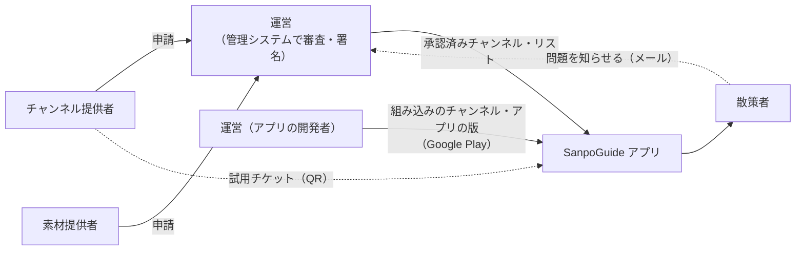

# 散策ガイド 運用操作説明書

| 項目 | 内容 |
|---|---|
| 対象 | SanpoGuide（散策ガイド）の Android アプリ。版 1.0.0 |
| 読む人 | 散策者・チャンネル提供者・素材提供者・運営 |
| 関連 | 管理システムの[利用ガイド](https://github.com/duwenji/yorisoi-console/blob/main/docs/guide/README.md)、platform の[関係者と呼び方](https://github.com/duwenji/yorisoi-platform/blob/main/docs/stakeholders.md) |

本書は、アプリを**使う・確かめる・運用する**ための手順を、関係者ごとに分けてまとめたもの。チャンネルや素材集を作って申請する手順は管理システム（yorisoi-console）の利用ガイドにあり、本書ではアプリの側から見た操作だけを書く。

## 読む人ごとの入口

| あなたは | 読むもの | 主にすること |
|---|---|---|
| **散策者**（アプリで散歩する人） | [散策者の手引き](walker.md) | はじめの設定、散策、チャンネルの選び方と変え方、記録、問題を知らせる |
| **チャンネル提供者**（チャンネルを作る人） | [チャンネル提供者の手引き](publisher.md) | 試用チケットで自分のチャンネルを試す、アプリでの見え方、公開後の確かめ方 |
| **素材提供者**（素材集を作る人） | [素材提供者の手引き](producer.md) | 素材がアプリで出る条件と見え方、試し方 |
| **運営**（審査・配信・アプリの公開をする人） | [運営の手引き](operator.md) | 問い合わせ・通報の受け方、組み込みのチャンネルの確認、アプリの公開と更新、障害のときの判断 |

## 関係者とアプリの関係

- アプリは、組み込みのチャンネル 6 本（標準・歴史探訪・自然観察・グルメの旅・ショッピング・しずかに）を持つ。これらはアプリの版として届く
- 第三者のチャンネル・素材集は、運営が審査して署名した**リスト**からだけ取り込む。アプリは管理システムではなく署名を信用する
- 生成 AI は関係者ではなく、その場で話す「実演」の層。AI を呼ぶ費用は散策者自身の API キーにかかる

## 今の公開の状態

| 項目 | 状態 |
|---|---|
| Google Play | 公開の準備中（[TODO](../TODO.md#google-play-での公開)） |
| 組み込みのチャンネル | 6 本。だれでも使える |
| 第三者のチャンネル | 本番のリストはまだない。設定の「配信されているチャンネル・リスト」は**開発者モードのときだけ**出る |
| 素材 | 文字と画像（第 1 段）まで。音声・映像は未対応 |
| 管理システム | 開発用だけ稼働（運営の画面 https://d32w19p7au8cu2.cloudfront.net、公開 URL https://d32t2reyxml47d.cloudfront.net、リストID `sc1363urrzsrhjuxasgz5pnxkcf5mcieqhv`） |

## 用語

| 用語 | 意味 |
|---|---|
| 散策モード | 「散策をはじめる」から「散策を終える」まで。画面を閉じても位置を追い、話しかける |
| チャンネル | 語り手・話題・話しかける場面と頻度・解説の長さ・雰囲気をまとめたもの。散歩の途中でも切り替えられる |
| 組み込みのチャンネル | アプリが持つチャンネル。散策者が頻度などを変えられる |
| 第三者のチャンネル | チャンネル提供者が作り、運営が審査したチャンネル。散策者は使う・使わないだけを決める |
| リスト・リストID | 運営が出す承認済みチャンネル・リスト。URL とリストID（`sc1…`）で足す |
| 試用チケット | 審査前のチャンネルを、チャンネル提供者が自分の端末で 7 日まで試すための QR コード |
| 開発者モード | 設定画面の一番下の「バージョン」を 7 回タップすると入る。試用チケットとリストの操作が出る |
| 安全の案内 | 天気の急変・日の入り・施設（トイレ・水飲み場・休憩所など）の案内。どのチャンネルでも止められない |
| 定型文 | AI を使わずに話す決まった文。API キーがない・AI の呼び出しに失敗した・1 日の上限に達したときに使う |

## 問い合わせ先

| 何について | 宛先 |
|---|---|
| アプリ・組み込みのチャンネル・プライバシー | duwenji@gmail.com（[プライバシーポリシー](../privacy-policy.md#8-問い合わせ)と同じ） |
| 第三者のチャンネル・AI の発言 | そのチャンネルを載せたリストの運営（リストの案内文書の `contact`。なければ上と同じ） |
