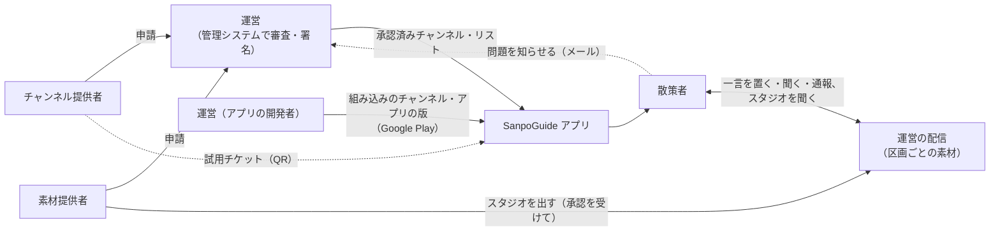

# SanpoGuide の操作・試用・運用手引き

| 項目     | 内容                                                                                                                                                                          |
| -------- | ----------------------------------------------------------------------------------------------------------------------------------------------------------------------------- |
| 対象     | SanpoGuide（散策ガイド）の Android アプリ                                                                                                                                     |
| 読む人   | 散策者・チャンネル提供者・素材提供者・運営                                                                                                                                    |
| 置き場所 | 4 者にまたがる手順なので yorisoi-platform に置く。アプリの設計は [yorisoi-sanpoguide の docs](https://github.com/duwenji/yorisoi-sanpoguide/tree/main/docs)                    |
| 関連     | 管理システムの[利用ガイド](https://github.com/duwenji/yorisoi-console/blob/main/docs/manual/README.md)、platform の[関係者と共通用語](https://github.com/duwenji/yorisoi-platform/blob/main/docs/overview/roles-and-vocabulary.md) |

**SanpoGuide 固有の手引きです。** yorisoi エコシステム共通の方針・契約は [docs の入口](https://github.com/duwenji/yorisoi-platform/blob/main/docs/README.md) を参照してください。

本書は、アプリを**使う・確かめる・運用する**ための手順を、関係者ごとに分けてまとめたもの。チャンネルや素材集を作って申請する手順は管理システム（yorisoi-console）の利用ガイドにあり、本書ではアプリの側から見た操作だけを書く。

## 読む人ごとの入口

| あなたは                                           | 読むもの                                | 主にすること                                                             |
| -------------------------------------------------- | --------------------------------------- | ------------------------------------------------------------------------ |
| **散策者**（アプリで散歩する人）             | [散策者の手引き](walker.md)              | はじめの設定、散策、チャンネルの選び方と変え方、記録、スタジオの一言とお知らせ、問題を知らせる |
| **チャンネル提供者**（チャンネルを作る人）   | [チャンネル提供者の手引き](publisher.md) | 試用チケットで自分のチャンネルを試す、アプリでの見え方、公開後の確かめ方 |
| **素材提供者**（素材集を作る人）             | [素材提供者の手引き](producer.md)        | 素材がアプリで出る条件と見え方、試し方                                   |
| **運営**（審査・配信・アプリの公開をする人） | [運営の手引き](operator.md)              | 問い合わせ・通報の受け方、組み込みのチャンネルの確認、障害のときの判断   |

## 関係者とアプリの関係

- 組み込みチャンネルの数と名前など、現在の状態は下表を参照してください。チャンネルはアプリの版として届きます
- 第三者のチャンネル・素材集は、運営が審査して署名した**リスト**からだけ取り込む。アプリは管理システムではなく署名を信用する
- 生成 AI は関係者ではなく、その場で話す「実演」の層。AI は既定で運営の AI（費用は運営が持ち、1 日の回数に上限がある）を使い、散策者が自分の API キーに切り替えることもできる

## 現在の公開状態

| 項目               | 状態                                                                                                                                                                  |
| ------------------ | --------------------------------------------------------------------------------------------------------------------------------------------------------------------- |
| 組み込みチャンネル | 6 本（標準・歴史探訪・自然観察・グルメの旅・ショッピング・しずかに）                                                                                                  |
| Google Play        | 内部テストに公開。本番の準備中（[TODO](https://github.com/duwenji/yorisoi-sanpoguide/blob/main/docs/TODO.md#google-play-での公開)）                                      |
| 第三者チャンネル   | 本番のリストはまだない。設定の「チャンネル・リストと試用チケット」は**開発者モードのときだけ**出る                                                              |
| 素材               | 文字と画像（第 1 段）まで。音声・映像は未対応                                                                                                                         |
| スタジオ           | 一言とお知らせを聞く・一言を置く。開発用のスタジオにつながる                                                                                              |
| 管理システム       | 開発用だけ稼働。運営の AI の中継とスポットのタイルの配信も開発用（運営の画面 https://d32w19p7au8cu2.cloudfront.net、公開 URL https://d32t2reyxml47d.cloudfront.net、リスト ID `sc1363urrzsrhjuxasgz5pnxkcf5mcieqhv`） |

## 用語

| 用語                 | 意味                                                                                               |
| -------------------- | -------------------------------------------------------------------------------------------------- |
| 散策モード           | 「散策をはじめる」から「散策を終える」まで。画面を閉じても位置を追い、話しかける                   |
| チャンネル           | 語り手・話題・話しかける場面と頻度・解説の長さ・雰囲気をまとめたもの。散歩の途中でも切り替えられる |
| 組み込みのチャンネル | アプリが持つチャンネル。散策者が頻度などを変えられる                                               |
| 第三者のチャンネル   | チャンネル提供者が作り、運営が審査したチャンネル。散策者は使う・使わないだけを決める               |
| リスト・リストID     | 運営が出す承認済みチャンネル・リスト。URL とリストID（`sc1…`）で足す                            |
| 試用チケット         | 審査前のチャンネルを、チャンネル提供者が自分の端末で 7 日まで試すための QR コード                  |
| 開発者モード         | 設定画面の一番下の「バージョン」を 7 回タップすると入る。試用チケットとリストの操作が出る          |
| 安全の案内           | 天気の急変・日の入り・施設（トイレ・水飲み場・休憩所など）の案内。どのチャンネルでも止められない   |
| 定型文               | AI を使わずに話す決まった文。API キーがない・AI の呼び出しに失敗した・1 日の上限に達したときに使う |
| スタジオ             | 運営が認めた店・地域の素材提供者が出す「お知らせ」。近くを歩く人に、チャンネルの語りの合間などに読み上げる |
| 一言                 | 散策者がその場所に置く短い投稿。後からその場所を歩く人に読み上げる。スタジオとは別のもの |

## 問い合わせ先

| 何について                                 | 宛先                                                                                                                                          |
| ------------------------------------------ | --------------------------------------------------------------------------------------------------------------------------------------------- |
| アプリ・組み込みのチャンネル・プライバシー | duwenji@gmail.com（[プライバシーポリシー](https://github.com/duwenji/yorisoi-sanpoguide/blob/main/docs/policies/privacy-policy.md#8-問い合わせ)と同じ） |
| 第三者のチャンネル・AI の発言              | そのチャンネルを載せたリストの運営（リストの案内文書の `contact`。なければ上と同じ）                                                        |
