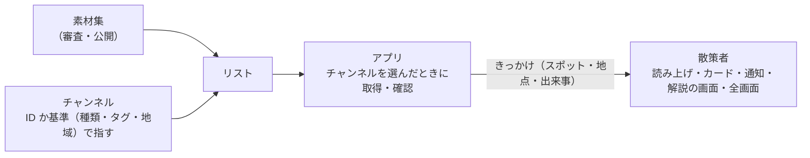

# 素材提供者の手引き

[運用操作説明書](README.md) ＞ 素材提供者の手引き

あなたの素材集の素材が、散策者のアプリでいつ・どう出るかを確かめるための手引きです。素材集の作り方・申請・身元の確認は、管理システムの[素材提供者ガイド](https://github.com/duwenji/yorisoi-console/blob/main/docs/guide/producer.md)と platform の [API-004](https://github.com/duwenji/yorisoi-platform/blob/main/docs/material-producer-api.md) を先に読んでください。

## 目次

1. [素材が散策者に届くまで](#1-素材が散策者に届くまで)
2. [アプリが今出せる素材](#2-アプリが今出せる素材)
3. [アプリでの見え方](#3-アプリでの見え方)
4. [AI の根拠として使われるとき](#4-ai-の根拠として使われるとき)
5. [取得の時期と量](#5-取得の時期と量)
6. [アプリで試す](#6-アプリで試す)
7. [公開のあと](#7-公開のあと)

## 1. 素材が散策者に届くまで

素材集は、それだけでは散策者に出ません。**チャンネルが使ったときに**、そのチャンネルが決めたきっかけと見せ方で出ます。

| チャンネルの使い方 | 説明 |
|---|---|
| ID で指す | チャンネルが、あなたの素材集の ID と素材の ID を名指しする。利用許諾（`grants`）で、使ってよいチャンネル提供者を決められる |
| 基準で選ぶ | チャンネルが、種類・タグで素材を選ぶ。今いる地域とその隣の地域（geohash 3 文字、約 150km 四方）の素材集と、地域を持たない素材集から選ぶ |

## 2. アプリが今出せる素材

| 素材の種類 | アプリ | 説明 |
|---|---|---|
| 文字（`text`） | 出せる | 読み上げ・カード・通知・解説の画面 |
| 画像（`image`） | 出せる | カード・解説の画面・全画面 |
| 音声（`audio`） | まだ出せない | 対応していない素材を使うチャンネルは、アプリが取り込まない |
| 映像（`video`） | まだ出せない | 同上 |

音声・映像だけの素材集は、今のアプリでは散策者に届きません。文字起こし（`transcript`）や画像の代替テキスト（`alt`）は、AI の根拠には使われます（[4 章](#4-ai-の根拠として使われるとき)）。

## 3. アプリでの見え方

| 見せ方 | 散策者から見たもの | 決まり |
|---|---|---|
| 読み上げ（`speak`） | 文字をそのまま読み上げる | 出典は読み上げない |
| カード（`card`） | メイン画面の発言のカードに文字・画像（高さは小さめ） | 画像の下に出典の行 |
| 通知（`notify`） | 通知（チャンネル「チャンネルの案内」） | タップで解説の画面を開く |
| 解説の画面（`sheet`） | 下から出る画面 | カードの「詳しく見る」か通知をタップしたときだけ開く |
| 全画面（`fullscreen`） | 画像を全画面で | 歩いている間（0.5m/s 以上）は開けず「立ち止まって見てください」と出る |

### 出典の行

素材には、出典の行が添えられます。画像の出典はタップで `credit.source` を開きます。

| 素材 | 出典の行の例 |
|---|---|
| 画像 | `画像: 山田太郎 / CC-BY-4.0 / 提供: 鎌倉観光協会` |
| 文字 | `文: 山田太郎 / 許諾を得て掲載 / 提供: 鎌倉観光協会` |
| AI の文章（あなたの素材を根拠にしたとき） | `鎌倉観光協会の資料をもとに作成` |

- ライセンスは SPDX の ID をそのまま出します。`PD` は「パブリックドメイン」、`permission` は「許諾を得て掲載」と出ます
- 作者がない画像は「作者不明」と出ます。権利のある方の名前を `credit.author` に入れてください

## 4. AI の根拠として使われるとき

利用許諾で AI の根拠に使うことを許した（`grants.grounding`）素材集は、AI がスポットや地点の話をするときに、事実の根拠として渡されます。

- 渡すのは、素材の題材（`about`）が今話すスポット・地点と一致するものだけ
- 文字はその本文、画像は代替テキスト、音声・映像は文字起こし
- 1 回に 3 件・1,500 字まで。チャンネルが名指しした素材集が先、基準で選んだものが後
- アプリが先に取得した素材集だけを読む（根拠のために新しく取得はしない）
- 根拠にした文章には「◯◯の資料をもとに作成」と添える

AI は根拠を言い換えて話します。言い換えの誤りは、審査では事前に防げません。気づいたら運営に知らせてください（[7 章](#7-公開のあと)）。

## 5. 取得の時期と量

| いつ | 何を |
|---|---|
| 散策者がチャンネルを選んだとき | そのチャンネルが ID で指す素材集・素材をまとめて取得する（回線の種類を問わない） |
| その後の更新 | 新しい版の素材集、取り損ねた素材。従量制でない回線（Wi-Fi など）のときだけ |
| 基準で選ぶ素材集 | チャンネルを選んだとき・起動時・散歩の開始時に、従量制でない回線のときだけ |

- スポットに近づいてから取得することはありません。散歩の途中に、まだ取得していない素材は出ません（次の候補を使います）
- 1 つのチャンネルの素材は、映像を除いて 50MB まで
- どのチャンネルも使わなくなった素材は、すぐに端末から消えます。基準で選んだ素材集は、散策者が離れた地域に移ると消えます
- 素材の取得の要求には、位置も散策者の情報も入りません。ただし基準で選ぶとき、どの地域の素材集を取得したかから、大まかな地域（約 150km 四方）が運営に分かりえます

## 6. アプリで試す

素材集だけでは試せません。あなたの素材を使うチャンネルを、チャンネル提供者に試用チケットで試してもらうか、自分でチャンネル提供者として試験用のチャンネルを作って試します（[チャンネル提供者の手引き 3 章](publisher.md#3-試用チケットで試す)）。

見るところ:

| 見るところ | 確かめ方 |
|---|---|
| 画像の写り | カードの小さい表示と、全画面（立ち止まって）の両方 |
| 出典の行 | 作者・ライセンス・提供者名が正しいか。タップで出典のページが開くか |
| 読み上げ | 文字の読み上げで、読みの誤り（地名・人名）がないか。誤るなら表記を変える |
| 根拠 | 根拠を許したとき、AI の解説に「◯◯の資料をもとに作成」と添えられ、内容がずれていないか |
| 大きさ | モバイル回線でも取得に時間がかかりすぎないか |

## 7. 公開のあと

| 起きること | アプリでの動き |
|---|---|
| 素材集の新しい版が承認された | 散策者の端末は、従量制でない回線のときに取り替える |
| 素材集が取り下げられた | その素材は出なくなる。使っていたチャンネルにも影響する |
| 散策者が問題を知らせた | メールはリストの運営に届く。素材の中身が原因なら、運営からあなたに修正を求める |

権利の申し立て（自分の写真が無断で使われている など）も、リストの運営の窓口で受けます。流れは platform の[審査基準「権利の申し立て」](https://github.com/duwenji/yorisoi-platform/blob/main/docs/channel-review-policy.md#権利の申し立て)にあります。
