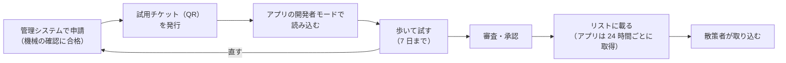

# チャンネル提供者の手引き

[運用操作説明書](README.md) ＞ チャンネル提供者の手引き

あなたのチャンネルが、散策者のアプリでどう動き、どう見えるかを確かめるための手引きです。登録・鍵・パッケージの作り方・申請は、管理システムの[チャンネル提供者ガイド](https://github.com/duwenji/yorisoi-console/blob/main/docs/guide/publisher.md)を先に読んでください。

## 目次

1. [アプリから見た全体の流れ](#1-アプリから見た全体の流れ)
2. [アプリを用意する](#2-アプリを用意する)
3. [試用チケットで試す](#3-試用チケットで試す)
4. [試すときに見るところ](#4-試すときに見るところ)
5. [チャンネルが決められること・決められないこと](#5-チャンネルが決められること決められないこと)
6. [公開のあと](#6-公開のあと)
7. [試用で困ったとき](#7-試用で困ったとき)

## 1. アプリから見た全体の流れ

- 審査前に試せるのは、機械の確認に合格した申請だけです
- 承認されると、散策者のアプリには最長 24 時間で届きます。散策者が「取り込んで使う」を押すまで、パッケージは取得されません

## 2. アプリを用意する

1. Android 8.0 以上の端末に散策ガイドを入れる
2. 自分の AI の API キーを設定する（[散策者の手引き 2 章](walker.md#2-はじめての設定)）。試用中の AI の費用は、あなたのキーにかかります
3. 設定画面の一番下の「バージョン」を 7 回タップする。「（開発者モード）」と出て、「開発者向け」の欄が開く
4. 「配信されているチャンネル・リスト」で、試用チケットを出した管理システムのリストを足す

開発用の管理システムで試すときのリスト:

| 項目 | 値 |
|---|---|
| URL | https://d32t2reyxml47d.cloudfront.net |
| リストID | `sc1363urrzsrhjuxasgz5pnxkcf5mcieqhv` |

足したら一度「今すぐ確かめる」を押して、リストの情報を取得しておきます。

## 3. 試用チケットで試す

1. 管理システムのチャンネル提供者の画面で、機械の確認に合格した申請の「試用チケット」を押し、QR コードを出す（7 日で切れる。1 日 10 枚まで）
2. アプリの「配信されているチャンネル・リスト」で「QR コードを読み込む」（または設定の「試用チケットを読み込む」）を押し、QR コードを写す
   - Google のコードスキャナを使うので、アプリにカメラの権限は要りません
3. 「試用チケット（開発者向け）」の欄に「チャンネル名（版 ◯、期限 まで）」が出て、そのチャンネルに切り替わる
4. 「散策をはじめる」で歩く。散策の最初に「審査前の試用のチャンネルです」と言う

- 試用中のチャンネルは「審査前の試用」と表示され、あなたの端末だけで使えます。ほかの人とは共有できません
- 期限が切れる、開発者モードをオフにする、チケットを「削除」すると使えなくなります
- 同じチャンネルの新しいチケットを読み込むと、前の試用と入れ替わります
- 審査前でも、安全の案内・AI への共通の指示・上限・出力の確認は、公開後と同じように働きます

## 4. 試すときに見るところ

| 見るところ | 確かめ方 |
|---|---|
| 語り口・話題 | スポットをタップして解説を読む。散策中の話しかけを聞く |
| 話す量 | 1 時間ほど歩き、設定の「今日は◯回使いました」で AI を呼んだ回数を見る。取り込むときに散策者に出る目安（1 時間で多くて約◯回）と大きくずれないか |
| 話す場面 | `talk.events` で止めた場面で話さないか。安全の案内は止められない（[5 章](#5-チャンネルが決められること決められないこと)） |
| 切り替えの一言 | 散歩の途中でチャンネルを切り替え、`greeting` が自然か |
| 優先する話題 | スポットが密集した場所で、意図した種類から話すか |
| 素材ときっかけ | 指定したスポット・地点・出来事で、素材が意図した見せ方で出るか（[素材提供者の手引き 3 章](producer.md#3-アプリでの見え方)） |
| 見せ方の安全 | 歩いている間（0.5m/s 以上）は全画面が開けず「立ち止まって見てください」と出るか |
| AI の出力 | URL・メールアドレス・電話番号を言わせる指示になっていないか（含まれると定型文に代わる） |
| 散歩の記録 | 記録画面でチャンネル名が正しく出るか |

エミュレータで試すときは、Extended controls → Location で位置を指定します。地点やルートの再生で、きっかけの地点に近づけます。

## 5. チャンネルが決められること・決められないこと

| 決められる（`channel.json`・プロンプト） | 決められない（アプリが必ず守らせる） |
|---|---|
| 語り手（人格・口調）、話題 | 天気の急変・日の入り・施設の案内（止められない。ほかより先に話す） |
| 話しかけの頻度、話す場面、解説の長さ | AI への共通の指示（個人情報を尋ねない、勧誘しない、危険な場所や私有地に誘わない など） |
| 優先する・除くスポットの種類 | 散策者が決めた AI の利用の上限（話す量はこの中で動く） |
| 話し方を雰囲気に合わせるか、背景音の種類 | 見せ方の安全（歩いている間は全画面を開かない、解説の画面はタップしたときだけ） |
| きっかけ・素材・見せ方 | 素材の取得の時期と量（チャンネルを選んだときにまとめて。映像を除き 50MB まで） |

散策者は、第三者のチャンネルの頻度や場面を変えられません。使う・使わないだけを選びます。

## 6. 公開のあと

| 起きること | アプリでの動き | あなたがすること |
|---|---|---|
| 承認された | リストに載り、散策者が「取り込んで使う」で取り込める。取り込む前に AI の費用の目安が出る | 自分の端末でもリストから取り込み、試用と同じに動くか確かめる |
| 新しい版を承認された | 散策者の端末は、従量制でない回線のとき自動で、または「新しい版を取り込む」で更新する。届くまでは前の版が動く | 版の番号を上げて申請する |
| 取り下げられた | 散策者の端末からパッケージが消え、理由が知らされ、標準のチャンネルに戻る | 理由に沿って直し、新しい版を申請する（前の版には戻らない） |
| 鍵を移し替えた | 運営の裏付け（`publisherChange`）があれば新しい版を受け入れ、散策者に一度知らせる。裏付けがなければ新しい版を拒む | 管理システムの手順で移し替える |
| 散策者が問題を知らせた | メールはリストの運営に届く（あなたには直接届かない） | 運営から修正を求められたら、期限（軽いもので 14 日）までに直す |

問題が起きたときに直す人は原因で決まります。語り口・話題・きっかけ（演出）が原因ならあなた、素材の中身なら素材提供者、共通の決まりをすり抜けた AI の発言ならアプリの開発者です。

## 7. 試用で困ったとき

| アプリの表示 | 意味と対処 |
|---|---|
| 試用チケットは開発者モードのときだけ読み込めます | 「バージョン」を 7 回タップして開発者モードにする |
| この試用チケットのリスト（…）を先に足してください | チケットを出した管理システムのリストを足す（[2 章](#2-アプリを用意する)） |
| リストの情報がまだありません | 「今すぐ確かめる」を押してから読み込む |
| 試用チケットを確かめられませんでした | 期限切れ、または別のリストのチケット。管理システムで新しく発行する |
| パッケージがチケットと一致しません | 申請を出し直した後に古いチケットを使った。新しいチケットを発行する |
| パッケージの確認に失敗しました（package_rejected: …） | 括弧内のエラーコードを API-003 で確かめて直す |
| このアプリでは使えないチャンネルです／形式です | アプリが対応していない素材や項目を使っている（今は文字と画像まで）。アプリを最新にするか、内容を変える |
| QR コードを読み取れませんでした | 画面の明るさ・距離を変えて写し直す |
