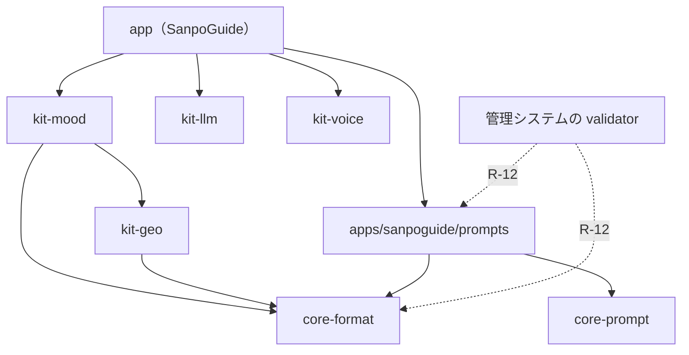

# RFC-002 段階 1: 共通部分をコアと Android キットに切り出す（動きを変えない）

## 文書情報

| 項目 | 内容 |
|---|---|
| 文書ID | RFC-002 |
| ドキュメント種別 | リファクタリング計画書 |
| 対象システム/機能 | SanpoGuide の `:station-format` と、アプリの `guide`・`sound`・`data`・`mood` ほか。ADR-003 の段階 1（T-1） |
| 関連Skill | refactoring-safety |
| 作成日 | 2026-10-12 |
| 作成者 | Claude（開発者との検討） |
| 承認者 | 開発者（1.0: 2026-10-12。実施結果は PR でレビュー） |
| ステータス | 実施済（2026-10-12） |
| 版 | 1.1 |

## 目的・背景

[ADR-003](../adr/ADR-003-companion-app-platform.md) で、SanpoGuide の共通部分をコア（JVM）と Android キットに切り出し、付き添いアプリのプラットフォーム（yorisoi）にすることを決めた。本書はその段階 1（T-1）の計画で、**依存を付け替えずに移せる部分だけを、動きを変えずに移す**。

移す前にコードの依存を調べた（2026-10-12）。分かったことは次の 3 つで、計画の範囲と順番はこれで決めている。

1. **station-format の中は、素材とチャンネルが互いに使い合っている**: `material/format`（素材集・素材）は `station/format` の `PackageArchive`・`StationFiles`・`RejectCode`・`internal` の補助関数（`Checks.kt`・`PublisherSignature.kt`）を使い、`station/format` の `Cues`・`CollectionReferences`・`ProviderDocuments`・`StationValidator` は `material/format` を使う。Gradle のモジュールに分けると `internal` が使えなくなり、補助関数を公開の API にしなければならない
2. **アプリの `material`・`station`・`companion`・`history` は散歩と強く結びついている**: `MaterialContext` が `Station`・`WalkSession`・`Weather` を持ち、`Station` が `TalkLevel`（設定）・`ChannelMaterials` を持ち、`ChannelSync` が `Station` を作る。ここを切り出すには型を汎用にする必要がある（ADR-003 E-16）ので、段階 1 の「動きを変えない移動」に入らない
3. **地図・天気の部品は、置き場所の違う型 3 つを移せば切り出せる**: `LatLon`（今は `history`）、`Weather`・`WeatherCodes`（今は `companion/WeatherClient.kt`）、`GoogleMapType`・`MapStyle`（今は `settings`）。どれも中身は変えずに移せる

**アプリの動き・保存しているデータ・チャンネルの形式は変えない。**

## 対応元ID（トレーサビリティ）

| 対応元ID | 内容 | 対応状況 |
|---|---|---|
| ADR-003 T-1 | 段階 1 の計画書 | 本書 |
| ADR-003 T-2 | 判定順の場面テスト | 手順 0 に含める（段階 2 の前提だが、段階 1 の保証にも使う） |
| ADR-003 E-3・E-4 | コアとキットのモジュール | 本書で範囲を絞る（R-2・R-5） |
| ADR-003 E-19 | モノレポの構成 | 手順 5 |
| ADR-003 E-22 | パッケージ名 `io.github.duwenji.yorisoi` | 本書で実施（R-3） |
| RFC-001 | 動きを変えずに切り出す進め方、プロンプトの比較 | 同じ保証を使う |

## 方針・決定事項

| No. | 論点 | 決定 |
|---|---|---|
| R-1 | 範囲 | 段階 1 で移すのは、依存を付け替えずに移せるものだけ。コア: `core-format`・`core-prompt`。キット: `kit-voice`・`kit-llm`・`kit-geo`・`kit-mood`。アプリのプロンプトと組み込みのチャンネルは、アプリ側の JVM モジュール（プロンプト・パック）にする |
| R-2 | `core-format` の分け方 | ADR-003 E-3 の `core-format`・`core-material`・`core-trust` は、段階 1 では **1 つのモジュール `core-format` の中のパッケージ**として分ける（`…core.format.archive`・`…core.format.material`・`…core.format.channel`・`…core.format.list`）。理由: 上の 1 のとおり互いに `internal` を使い合っていて、モジュールに分けると補助関数を公開の API にしなければならない。また、使う側（アプリと管理システムの validator）は常に全部を使うので、分けても得がない。分ける必要が出たら（素材集だけを扱う道具ができたときなど）、そのときに公開してよい API を決めて分ける。**実施（手順 1）では、パッケージも `…core.format`（チャンネル・パッケージの土台・リスト）と `…core.format.material`（素材集・素材）の 2 つにとどめた**。土台・チャンネル・リストの間でも互いに参照している（`Checks.kt` の `Reject` が `StationValidator.kt` の `RejectCode` を、`PackageArchive` が `StationFiles` を使う、など）ため、4 つに分けるのは移動ではなく設計の変更になる |
| R-3 | パッケージ名と座標 | コアとキットは `io.github.duwenji.yorisoi.core.*`・`io.github.duwenji.yorisoi.kit.*`（ADR-003 E-22）。移すのと同じコミットで改める（機械的な置き換えで、コンパイルとテストで確かめられるため）。プロンプト・パックとアプリは `io.github.duwenji.sanpoguide.*` のまま |
| R-4 | プロンプト・パック | 新しい JVM モジュール `apps/sanpoguide/prompts`（公開の座標は `io.github.duwenji.sanpoguide:prompts`）。中身: `sanpoguide/prompts/`・`sanpoguide/channels/` のリソースと `channelIndex` タスク、`BuiltInChannels`、`Prompts`（SanpoGuide のプロンプトのファイルの一覧）、`StationPrompts`（SanpoGuide のテンプレートへのスロットの差し込み方）、`ReviewSamples`（散歩の場面の見本）。`core-prompt` に置くのはテンプレートの仕組み（`PromptTemplates`）だけ。リソースのパス（`sanpoguide/…`）は変えない |
| R-5 | 段階 1 に入れないもの | `kit-material`・`kit-channels`・`kit-companion`、`core-trust` の独立、`history`、`WeatherChangeDetector`・`FacilityAdvisor`・`SpotChooser`（散歩の判定のルール）、`GuideRepository`。理由は上の 2 のとおりで、型を汎用にする設計（ADR-003 E-7・E-16）が要る。段階 2・3 の RFC で扱う |
| R-6 | 語彙 | `SpotKind`・`TalkEventKind`・`TalkLevel`・`GuideLength`・`SoundChoice`・`Slot` は、エコシステム共通の語彙として `core-format` に置く（ADR-003 E-9）。値・JSON の表記は変えない |
| R-7 | 段階 1 で移す型 | 中身を変えずに置き場所だけ変える: `LatLon`（`history` → `kit-geo`）、`Weather`・`WeatherCodes`・`WeatherClient`（`companion` → `kit-geo` の `weather`）、`GoogleMapType`・`MapStyle`（`settings` → `kit-geo`）。保存している JSON・設定の値は enum の名前と項目名で、Kotlin のパッケージ名は入らないので、データには影響しない（手順 0 のテストで確かめる） |
| R-8 | 端末に保存したものの名前 | `SharedPreferences` のファイル名とキー、Android Keystore の別名（`KeyCipher`）、記録のファイル名、通知のチャンネル ID、`WalkService` などマニフェストに書くクラス名は変えない。`KeyCipher` はキットに移しても別名の文字列をそのまま使う |
| R-9 | Android のリソース | `SpotMap` が使う drawable（`spot_dot`・`me_dot`・`facility_*_dot`）は `kit-geo` に移す。`app_name` などアプリの文字列はアプリに残す。`android.nonTransitiveRClass=true` なので、キットのリソースはキットの `R` で参照する |
| R-10 | ビルドの設定 | 依存の版をそろえるため、Gradle のバージョンカタログ（`gradle/libs.versions.toml`）を作り、アプリ・キット・コアで使う。版の数字は今と同じにする |
| R-11 | 公開 | コアとプロンプト・パックを GitHub Packages に公開する（コアは `yorisoiCoreVersion`、タグ `yorisoi-core-v<版>`。プロンプト・パックは `sanpoguidePromptsVersion`、タグ `sanpoguide-prompts-v<版>`）。キットは公開しない（同じリポジトリのアプリだけが使う。ADR-003 E-19）。`station-format` は 2.1.0 を最後に公開をやめる |
| R-12 | 管理システム | validator は station-format 2.1.0 を固定して使っているので、段階 1 の間も動き続ける。手順 1 の公開の後、validator の依存を `core-format`・`sanpoguide:prompts` に切り替える PR を yorisoi-console に出す（ADR-003 T-7 から先に切り出す。import と依存の座標を変えるだけ）。以後、形式の修正は新しいコアだけで行う |
| R-13 | CI | 今は公開のワークフローしかないので、プルリクエストごとに全モジュールの単体テスト・lint・デバッグ版のビルドを走らせるワークフローを足す（ADR-003 のリスク「モノレポで 1 つの変更がほかを壊す」への備え） |

### モジュールと移すもの

| モジュール | 種類 | パッケージ | 移すもの（今の場所） |
|---|---|---|---|
| `platform/core-format` | JVM | `io.github.duwenji.yorisoi.core.format.*` | `station-format` の `station/format/*`（`BuiltInChannels` を除く）と `material/format/*` |
| `platform/core-prompt` | JVM | `io.github.duwenji.yorisoi.core.prompt` | `prompt/PromptTemplates.kt` |
| `apps/sanpoguide/prompts` | JVM | `io.github.duwenji.sanpoguide.prompt`（今のまま） | `prompt/Prompts.kt`・`StationPrompts.kt`・`ReviewSamples.kt`、`station/format/BuiltInChannels.kt`、リソース `sanpoguide/prompts/`・`sanpoguide/channels/`、`channelIndex` タスク |
| `platform/kit-voice` | Android | `io.github.duwenji.yorisoi.kit.voice` | `guide/Speaker.kt`、`sound/AmbientPlayer.kt`・`Voices.kt`、`sound/Soundscape.kt` の enum（音の種類。手順 2 で分けた。下の注記） |
| `platform/kit-llm` | Android | `io.github.duwenji.yorisoi.kit.llm` | `guide/Provider.kt`（`LlmClient`・`Provider`）・`ClaudeClient.kt`・`OpenAiCompatibleClient.kt`、`settings/KeyCipher.kt` |
| `platform/kit-geo` | Android | `io.github.duwenji.yorisoi.kit.geo`（`.weather`・`.map` を含む） | `data/*`（`Poi`・`Shape`・`Facility`・`OverpassClient`・`SpotRepository`・`RouteClient`・`SpotPhotos`・`GoogleMapTiles`）、`companion/WeatherClient.kt`、`history` の `LatLon`、`settings/MapStyle.kt` と `GoogleMapType`、`ui/SpotMap.kt`・`MapTiles.kt`・`Heading.kt`、`ui/MainViewModel.kt` の `SpotItem`・`FacilityItem`・`RouteToSpot`（`SpotMap` が描くもの。手順 3 で加えた）、drawable 7 つ（`spot_dot`・`me_dot`・`facility_*_dot`。通知のアイコン `ic_walk` と Google マップのロゴはアプリに残す） |
| `platform/kit-mood` | Android | `io.github.duwenji.yorisoi.kit.mood` | `mood/*`、`sound/SoundscapeChoice.kt`（雰囲気・チャンネルから音を選ぶ。手順 2 で `Soundscape` から分けた）、`ui/MoodTheme.kt`・`MoodScene.kt` |
| `app`（手順 5 で `apps/sanpoguide/app`） | Android | `io.github.duwenji.sanpoguide.*`（今のまま） | 残り: `companion`（`WeatherClient` を除く）・`guide/GuideRepository`・`GuidePrompt`・`history`・`material`・`settings`・`station`・`ui`・`walk`・`SanpoApp` |

依存の向き（上が下を使う。逆向きはない）:

`kit-geo` が `core-format` を使うのは、スポットの種類（`SpotKind`）で検索する種類を決めているため（`OverpassClient.categoryOf`）。`kit-mood` が `core-format` を使うのは、背景音の選び方（`SoundChoice`）のため。

**手順 2 での変更**: 計画では `Soundscape` を `kit-mood` に置く予定だったが、`Voices`・`AmbientPlayer`（`kit-voice`）が音の種類（`Soundscape` の enum）を使っていて、そのままでは `kit-voice` が `kit-mood` に依存してしまう。そこで `Soundscape` を、音の種類の enum（`kit-voice`）と、雰囲気・チャンネルの指定から選ぶ処理 `SoundscapeChoice`（今はアプリ、手順 4 で `kit-mood`）に分けた。呼び出しは `Soundscape.of`・`forMood` から `SoundscapeChoice.of`・`forMood` に変わるだけで、選び方は変えていない。依存の向きは `kit-mood` → `kit-voice` になる。

### 手順と保証

PR は手順ごとに分ける。どの PR も、その時点で下の「毎回の保証」を満たす。

**毎回の保証**

| ID | 保証 | 確かめ方 |
|---|---|---|
| G-1 | 単体テストがすべて通り、数が減らない（移したテストも数える） | `./gradlew test`。手順 0 で数を記録し、PR ごとに比べる |
| G-2 | プロンプトの組み立て結果が 1 文字も変わらない | 手順 0 で作る基準のファイルとの比較テスト |
| G-3 | コアは Android に依存しない | `core-*` の依存に Android がないこと（Gradle の JVM モジュールなのでビルドで確かめられる） |
| G-4 | lint とリリース版のビルドが通る | `./gradlew lint assembleRelease`（署名なしでよい） |
| G-5 | 端末に保存したものが読める | 手順 0 で作るテスト（R-8 の名前の固定）と、エミュレータで既存のデータを残したまま上書きインストールして確かめる |

**手順**

| 手順 | 内容 | この手順で足す保証 |
|---|---|---|
| 0 | 準備（PR-0）。① CI（R-13）。② プロンプトの基準のファイル: 組み込みのチャンネル 6 本 × スポット解説・散歩の友のシステムプロンプト、出来事ごとの追加の指示、定型文、`ReviewSamples` の見本を、今のコードで書き出してテストのリソースにし、比べるテストを足す（RFC-001 の 36 件・48 件の比較を、残るテストにしたもの）。③ R-8 の名前（設定のファイル名とキー、Keystore の別名、通知のチャンネル ID）を固定するテスト。④ 判定順の場面テスト（ADR-003 T-2）: `maybeTalk()` の判定を、場面ごとの期待する発言の表にする。`WalkService` から判定を取り出さないと書けない場合は、取り出す部分を最小にし、別の PR にする。⑤ バージョンカタログ（R-10） | 足したテストが今のコードで通る。リリース版の APK の中身（クラス以外のファイルの一覧）を記録する |
| 1 | コア（PR-1）。`station-format` を `core-format`・`core-prompt`・`apps/sanpoguide/prompts` に分け、パッケージを改める（R-2〜R-4・R-6）。`station-format` のテストを、それぞれのモジュールに移す。公開のワークフローを改める（R-11） | `publishToMavenLocal` で公開した jar と org.json だけで、見本を組み立てられる（RFC-001 の手順 5 と同じ確かめ方）。APK の中のリソースの一覧（`sanpoguide/channels/index.txt` を含む）が手順 0 と同じ |
| 1a | 管理システム（yorisoi-console の PR）。validator を新しいコアとプロンプト・パックに切り替える（R-12） | validator のテストと、開発用の環境での機械審査（組み込みのチャンネル 1 本と、試用のパッケージ 1 つ） |
| 2 | `kit-voice`・`kit-llm`（PR-2）。どちらもアプリのほかのパッケージを使っていないので、そのまま移す | エミュレータ: 設定画面の接続テスト（AI）、解説の読み上げ、背景音（イヤホンなしでスピーカーを選んだとき）。API キーが上書きインストールの後も読める（G-5） |
| 3 | `kit-geo`（PR-3）。先に R-7 の型を移し、次に `data`・地図の画面を移す。テスト（`data/*Test`）も移す | エミュレータ（鎌倉で位置を指定）: 地図とスポット・施設のマーカーとチップ（施設のチップは 2026-09-29 に落ちる不具合があった箇所）、地図の種類の切り替え、ルートと向き、スポットの写真。散歩の記録の経路が読める |
| 4 | `kit-mood`（PR-4）。テスト（`MoodTest`・`SoundscapeTest`）も移す | エミュレータ: 配色の切り替え、散策中のカードの絵、明朝体、背景音の選択 |
| 5 | モノレポの構成（PR-5）。`app` を `apps/sanpoguide/app` に移す（Gradle のパスは `:apps:sanpoguide:app`）。CI・公開のワークフロー、README のビルドの手順、architecture.md・yorisoi-tutorial の参照を直す。`station-format` のフォルダを消す | ファイルの移動だけで、手順 4 までと同じ保証。`git log --follow` で履歴をたどれる |

各手順の後、エミュレータで散策モードを通しで確かめる（開始・スポットの話しかけ・チャンネルの切り替え・終了・記録）。第三者のチャンネルの取り込みは、手順 1 の後に管理システムの `publish:local` で作ったリストを使って確かめる。

### 実施の記録

| 手順 | 日付 | 結果 |
|---|---|---|
| 0 | 2026-10-12 | テストの数の基準: station-format 69 件、app 128 件（debug・release とも）。足したもの: CI（`.github/workflows/ci.yml`）、`PromptGoldenTest`（基準は `station-format/src/test/resources/prompt-golden.txt`。組み込みのチャンネル 6 本 × 解説のシステムプロンプト（長さ 3 通り）・散歩の友のシステムプロンプト・出来事ごとの追加の指示・審査の見本、プロンプトとチャンネルの全ファイルの SHA-256。プロンプトを 1 文字変えると落ちることを確かめた）、`StoredNamesTest`（R-8。そのため `KeyCipher.ALIAS` を `private` から `internal` にした）、バージョンカタログ（依存の解決結果が、アプリの実行時・アプリのテスト・station-format のコンパイルとテストで、書き換え前と同じことを確かめた）。判定順の場面テストは段階 2 に回した（未決事項 No.1）。CI と同じコマンド（`./gradlew test lint assembleRelease`）が手元で通り、テストは station-format 70 件・app 132 件。リリース版 APK の中身の一覧（.dex を除く）を [RFC-002-apk-files.txt](RFC-002-apk-files.txt) に記録した |
| 1 | 2026-10-12 | station-format を `:platform:core-format`（`io.github.duwenji.yorisoi.core.format`・`.material`）・`:platform:core-prompt`（`…core.prompt`）・`:apps:sanpoguide:prompts`（`io.github.duwenji.sanpoguide.prompt`、`BuiltInChannels` を含む）に `git mv` で分けた（31 ファイル）。パッケージは 2 つにとどめた（R-2 の注記）。公開は `.github/workflows/publish.yml`（タグ `yorisoi-core-v*`・`sanpoguide-prompts-v*`）、版は `yorisoiCoreVersion=1.0.0`・`sanpoguidePromptsVersion=1.0.0`。結果: テストは core-format 54・core-prompt 9・prompts 7（計 70 で手順 0 と同じ。`PromptGoldenTest` を含む）・app 132。`./gradlew test lint assembleRelease` が通る。リリース版 APK の中身（339 ファイル、`sanpoguide/` の CRC を含む）が手順 0 の基準と同じ。`publishToMavenLocal` の jar と org.json・kotlin-stdlib だけで、JShell から標準チャンネルの審査の見本 9 件を組み立てられた。エミュレータでの確認は未実施（この PC に AVD がない。APK の中身が同じことで代えた） |
| 2 | 2026-10-12 | `kit-voice`（`Speaker`・`AmbientPlayer`・`Voices`・`Soundscape` の enum）と `kit-llm`（`Provider`・`LlmClient`・`GuideException`・`ClaudeClient`・`OpenAiCompatibleClient`・`KeyCipher`）を作った。`Soundscape` を enum と `SoundscapeChoice` に分けた（上の注記）。`KeyCipher` はアプリから使うため `internal` から公開にし、Keystore の別名のテストを `kit-llm` の `KeyCipherTest` に、音の合成のテスト `VoicesTest` を `kit-voice` に移した。結果: テストは app 129・kit-llm 1・kit-voice 2（計 132 で手順 0 と同じ）、形式とプロンプトは変更なし。`./gradlew test lint assembleRelease` が通る。リリース版 APK の中身が手順 0 の基準と同じ。エミュレータでの確認は未実施（AVD がない） |
| 3 | 2026-10-12 | `kit-geo` を作った。パッケージは `…kit.geo`（場所・ルート・写真・`LatLon`）・`…kit.geo.weather`（`WeatherClient`）・`…kit.geo.map`（`GoogleMapTiles`・`MapStyle`・`SpotMap`・`MapTiles`・`Heading`・`MapItems`）。`SpotMap` が描く `SpotItem`・`FacilityItem`・`RouteToSpot` を `MainViewModel.kt` から `MapItems.kt` に移した。ライブラリ単体の lint が `SpotPhotos` の回線の判定に `ACCESS_NETWORK_STATE` を求めたので、`kit-geo` のマニフェストに `INTERNET`・`ACCESS_NETWORK_STATE` を宣言した（アプリにもともとあり、APK の権限は変わらない）。結果: テストは app 108・kit-geo 21（計 129。kit-llm・kit-voice と合わせ 132 で手順 0 と同じ）。`./gradlew test lint assembleRelease` が通る。リリース版 APK の中身と権限が手順 0 と同じ。エミュレータ（Android 11、AVD `sanpo30`、手順 2 のデータを残した上書きインストール）: 地図・スポットと施設のマーカー・現在地・施設のチップ（押すと地図が動く）、前回の散歩の訪問回数と記録の画面、地図の種類の切り替え（地理院 写真。保存した値がアプリを開き直しても残る）、散策の開始（天気を取得して雰囲気が「晴れ」）。落ちない。気づいたこと: Overpass の予備のサーバー（`overpass.private.coffee`・`maps.mail.ru`）の証明書は、Android 11 にないルート（Let's Encrypt の新しい階層・HARICA）につながっていて、主のサーバーが失敗したときの検索が証明書のエラーになる。移動とは関係しない（別に調べる） |
| 4 | 2026-10-12 | `kit-mood`（`io.github.duwenji.yorisoi.kit.mood`）を作り、`Mood`・`MoodSource`・`PlaceGuess`・`SoundscapeChoice`・`MoodTheme`・`MoodScene` とテスト（`MoodTest`・`SoundscapeTest`）を移した。アプリの `mood`・`sound` パッケージはなくなった。`kit-mood` は `kit-geo`（天気・周辺のスポット）・`kit-voice`（`Soundscape`）・`core-format`（`SoundChoice`）を使う。結果: テストは app 93・kit-mood 15（計 108 で手順 3 の app と同じ。全体で 132）。`./gradlew test lint assembleRelease` が通る。リリース版 APK の中身が手順 0 と同じ。エミュレータ（上書きインストール）: 散策中の絵（秋の朝・晴れ・寺社の近く: 鳥居・朝日・紅葉）と明朝体、端末の時刻を 19:30 に進めると 1 分ほどで夜の配色と夜空の絵（星・月）に変わる。前回までの散歩の訪問回数が読める。落ちない |
| 5 | 2026-10-12 | `app` を `apps/sanpoguide/app`（`:apps:sanpoguide:app`）に `git mv` で移した。テストが読むプロンプト・パックの相対パス、`.gitattributes`、`settings.gradle.kts`（コアとキット、SanpoGuide の順に並べた）、README のビルドの手順、architecture.md（図 1・パッケージ一覧・変更の入口。手順 2〜4 で移した部品の置き場所もここでまとめて直した）、prompts.md・channels.md の出力先を直した。結果: テストは app 93（ほかは変更なし。全体で 132）。`./gradlew test lint assembleRelease` が通る。リリース版 APK の中身が手順 0 と同じ。エミュレータ: `:apps:sanpoguide:app:installDebug` で入れて起動し、保存した地図の種類が残っている。スポットの検索は Overpass の 3 つのサーバーがすべて失敗（504・500・証明書）していて確かめられなかった（コードは変えていない）。**段階 1 はこれで終わり** |

### 戻し方

手順ごとに PR を分けるので、PR ごとに戻せる。戻すときに注意が要るのは次の 2 つ。

- 手順 1 の後に新しいコアを公開していた場合: 公開した版は消さず、管理システムは手順 1a を戻せば station-format 2.1.0 で動く
- 手順 5: フォルダの移動だけなので、戻すときは PR を戻すだけでよい

## 影響範囲

| 観点 | 影響 |
|---|---|
| 散策者 | なし（動き・データ・権限を変えない） |
| チャンネル提供者・素材提供者 | なし（形式を変えない） |
| 管理システム | validator の依存の座標と import（手順 1a） |
| 開発 | import とモジュールのパスが変わる。ビルドのコマンドが手順 5 で変わる（`:app:` → `:apps:sanpoguide:app:`） |
| 文書 | architecture.md（図 1 とモジュールの一覧）、README（ビルドの手順）、RFC-001 への注記、yorisoi-tutorial 第 1 部 1-2（モジュール）・第 5 部（station-format） |

## 未決事項・リスク

| No. | 内容 | 対応 |
|---|---|---|
| 1 | ~~判定順の場面テスト（手順 0 ④）を、`WalkService` を動かさずに書けるか~~ → 段階 2 の最初に回した（2026-10-12）。`maybeTalk()` は判定の途中で読み上げ・通知・きっかけの記録・記録の保存を行い、`app` の部品（`speaker`・`stations`・`settings`・`spots`・`cueFinder`・`history`）を直接読むため、判定だけを取り出すのは段階 2 の設計（ADR-003 E-7）そのものになる。段階 1 では `WalkService` を移さないので、保証は G-1〜G-5 とエミュレータでの確認で足りる | — |
| 2 | `kit-geo` の Overpass の検索の範囲（半径・種類）は散歩に合わせた値で、サイクリングでは変えたい | 段階 1 では今の値のまま移す。設定できるようにするのは、サイクリングのアプリ（ADR-003 T-9）のとき |
| 3 | 計装テストがないため、端末での確認は手作業のまま（RFC-001 の未決事項 No.4 と同じ） | 手順ごとにエミュレータで確かめ、確かめたことを PR に書く |
| 4 | GitHub Packages の座標が変わるので、管理システムの CI の読み取りの設定（`read:packages`）を確かめる | 手順 1a |

リスク:
- パッケージ名の置き換えで、文字列の中のパッケージ名（ログのタグ、リフレクション）を取りこぼす。手順 0 の調べ（2026-10-12）では、クラス名を保存に使っている箇所は見つかっていない
- キットに移した Compose の画面（`SpotMap`・`MoodScene`）が、アプリのテーマやリソースに暗に頼っていて、見た目が変わる。エミュレータで並べて比べる

## 関連ドキュメント・参照リンク

- [ADR-003](../adr/ADR-003-companion-app-platform.md): 付き添いアプリのエコシステム
- [RFC-001](RFC-001-prompts-to-station-format.md): プロンプトと組み込みのチャンネルを `:station-format` に移す
- [architecture.md](../architecture.md): 今のアプリの構造

## 変更履歴

| 日付 | 版 | 変更内容 | 変更者 |
|---|---|---|---|
| 2026-10-12 | 0.1 | 草案 | Claude |
| 2026-10-12 | 1.0 | 承認（R-2・R-5・R-12 を含む） | Claude（承認: 開発者） |
| 2026-10-12 | 1.1 | 手順 0〜5 を実施（#37〜#39・#41〜#43）。実施の記録と、実施で変えたこと（R-2 のパッケージ、`Soundscape` の分け方、地図用のデータクラス）を記録 | Claude |
