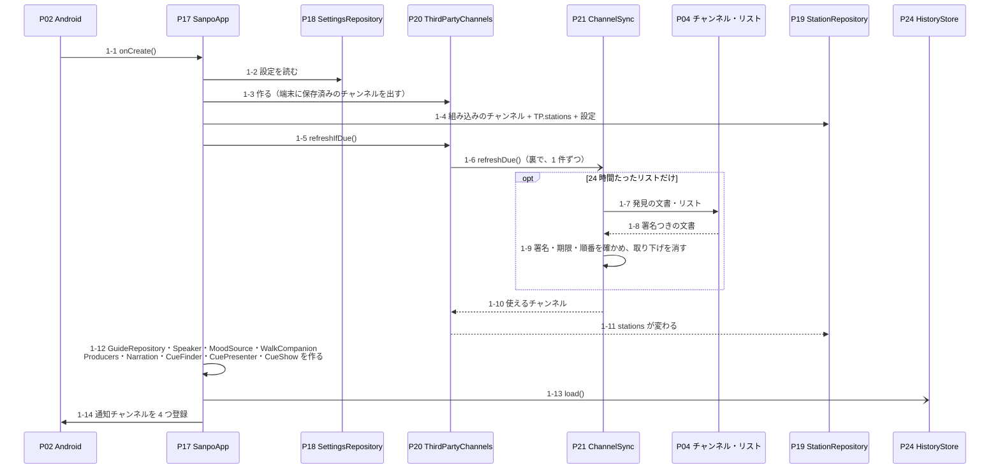
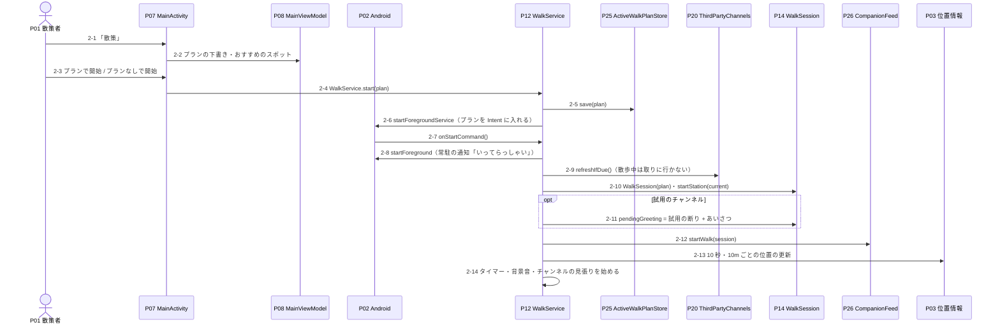
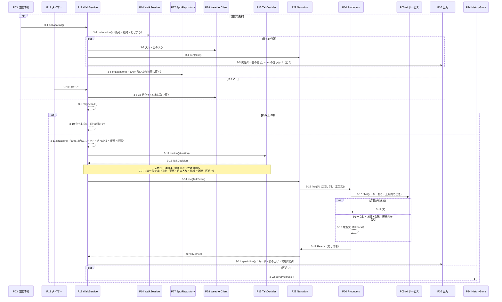
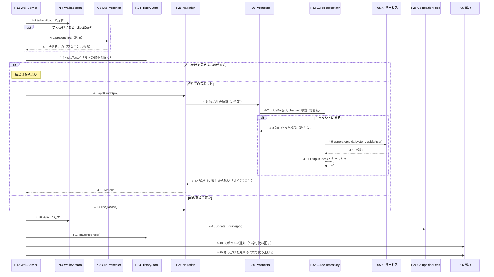
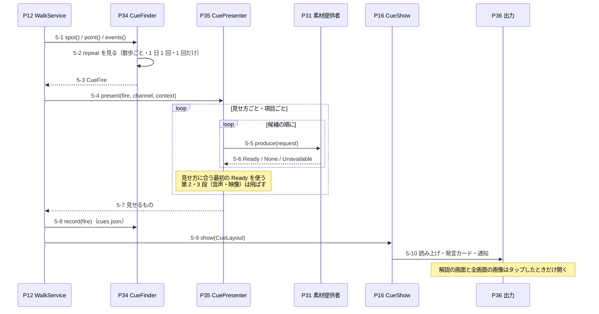
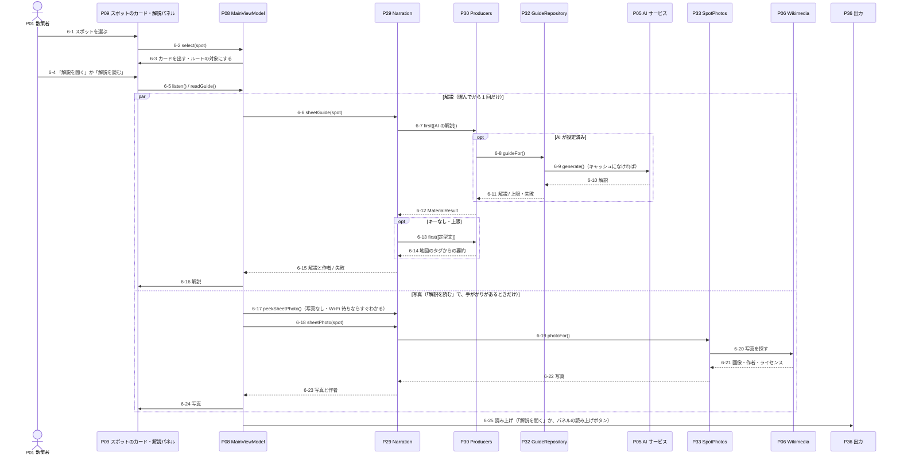
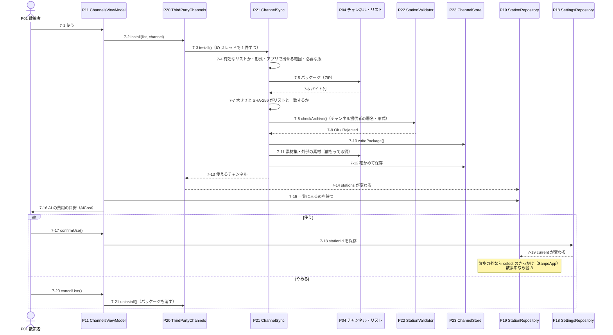
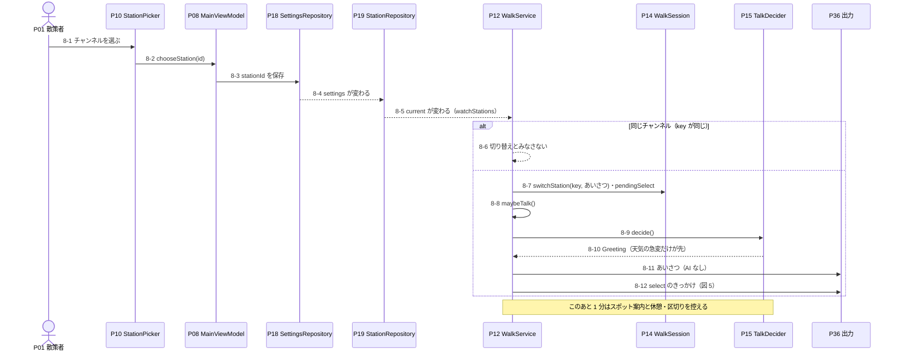
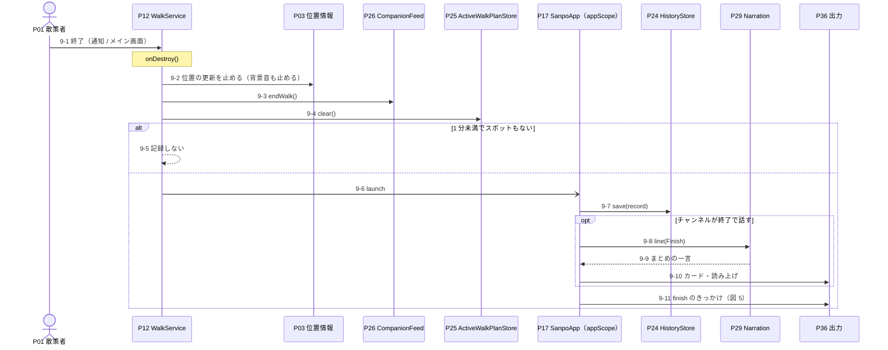

# 散策ガイドのシーケンス図

主な処理を、呼び出しの順に追う。部品の置き場所とつながりは[構造図](architecture.md)、ここでは「いつ・だれが・だれを呼ぶか」と、各ステップで何をするかを示す。

| 場面 | 図 |
|---|---|
| アプリを開いたとき | [図 1 · 起動](#図-1--起動-sanpoapp-が共有部品を作る) |
| 散策を始めたとき | [図 2 · 散策の開始](#図-2--散策の開始-プランを保存してから-walkservice-を起こす) |
| 散策中、位置が変わるたび・30 秒ごと | [図 3 · 話しかけ](#図-3--話しかけ-位置の更新とタイマーから話すまで) |
| 散策中、スポットに近づいたとき | [図 4 · スポットの案内](#図-4--スポットの案内-きっかけか解説か再訪の一言) |
| チャンネルのきっかけが当たったとき | [図 5 · きっかけ](#図-5--きっかけ-チャンネルの素材を取り出して見せる) |
| 地図か一覧でスポットを選んだとき | [図 6 · スポット解説](#図-6--スポット解説-解説と写真を別々に取る) |
| 第三者のチャンネルを使うとき | [図 7 · チャンネルの取り込み](#図-7--チャンネルの取り込み-確かめてから使う) |
| 散策中にチャンネルを切り替えたとき | [図 8 · 散策中の切り替え](#図-8--散策中の切り替え-一言を予約する) |
| 散策を終えたとき | [図 9 · 散策の終了](#図-9--散策の終了-記録してからまとめの一言) |

図はコードから手で書き起こしたもの。`WalkService`・`SanpoApp`・`ChannelSync` の呼び出し順を変えたときは、この文書も更新する。

## 図と表の読み方

- **参加者の番号（P01〜P36）**: 図の上に並ぶ参加者（Node）には、下の[参加者一覧](#参加者一覧)の番号を付けている。同じ部品は、どの図でも同じ番号になる。
- **ステップの番号（例: 3-12）**: 図の矢印の文の先頭に「図の番号-ステップ番号」で書いている。表の番号と同じで、3-12 は図 3 の 12 番目の矢印。
- **送り手 → 受け手**: 矢印の根元と先の参加者の番号。P12 → P12 のように同じ番号なら、自分の中の処理。
- **コード**: パスは `app/src/main/java/io/github/duwenji/yorisoi/sanpoguide/` からの相対。`yorisoi-platform/…` は共通の部品（別のリポジトリ）。

## 参加者一覧

| 番号 | 参加者 | 実体 | 出てくる図 |
|---|---|---|---|
| P01 | 散策者 | アプリを使う人 | 2, 6, 7, 8, 9 |
| P02 | Android | OS（`Application` の起動・フォアグラウンドサービス・通知） | 1, 2 |
| P03 | 位置情報 | Google Play 開発者サービスの `FusedLocationProviderClient` | 2, 3, 9 |
| P04 | チャンネル・リスト | 散策者が足したリストのサーバー（例: yorisoi-console） | 1, 7 |
| P05 | AI サービス | Claude / OpenAI 互換 API（`yorisoi-platform/kit-llm` の `LlmClient`） | 3, 4, 6 |
| P06 | Wikimedia | Wikimedia Commons・Wikidata | 6 |
| P07 | MainActivity | `ui/MainActivity.kt`（画面の切り替え・散策の開始と終了） | 2 |
| P08 | MainViewModel | `ui/MainViewModel.kt` | 2, 6, 8 |
| P09 | スポットのカード・解説パネル | `ui/MainScreen.kt` の `SpotCard`・`GuideSheet` | 6 |
| P10 | StationPicker | `ui/StationPicker.kt`（メイン画面のチャンネルの選択） | 8 |
| P11 | ChannelsViewModel | `ui/ChannelsViewModel.kt`（配信されているチャンネルの画面） | 7 |
| P12 | WalkService | `walk/WalkService.kt`（散策モードのフォアグラウンドサービス） | 2, 3, 4, 5, 8, 9 |
| P13 | タイマー | `WalkService.startTicker()`（30 秒ごと） | 3 |
| P14 | WalkSession | `companion/WalkSession.kt`（散歩中の状態） | 2, 3, 4, 8 |
| P15 | TalkDecider | `companion/TalkDecider.kt`（いま何を話すか） | 3, 8 |
| P16 | CueShow | `walk/CueShow.kt`（きっかけを見せる） | 5 |
| P17 | SanpoApp | `SanpoApp.kt`（共有部品と `appScope`） | 1, 9 |
| P18 | SettingsRepository | `settings/SettingsRepository.kt` | 1, 7, 8 |
| P19 | StationRepository | `yorisoi-platform/kit-channel` の `StationRepository.kt`（チャンネルの一覧と使っているチャンネル） | 1, 7, 8 |
| P20 | ThirdPartyChannels | `station/remote/ThirdPartyChannels.kt`（`ChannelSync` を 1 件ずつ IO スレッドで動かす） | 1, 2, 7 |
| P21 | ChannelSync | `station/remote/ChannelSync.kt`（リスト・パッケージ・素材集の取得と確認） | 1, 7 |
| P22 | StationValidator | `yorisoi-platform/core-format` の `StationValidator` | 7 |
| P23 | ChannelStore | `station/remote/ChannelStore.kt`（`files/channels/`） | 7 |
| P24 | HistoryStore | `history/HistoryStore.kt`（`walk_history.json`） | 1, 3, 4, 9 |
| P25 | ActiveWalkPlanStore | `walk/ActiveWalkPlanStore.kt`（`active_walk_plan.json`） | 2, 9 |
| P26 | CompanionFeed | `companion/CompanionFeed.kt` の状態（散歩の数字・歩いた道・案内中のスポット） | 2, 4, 9 |
| P27 | SpotRepository | `yorisoi-platform/kit-geo` の `SpotRepository`（運営のタイル、なければ Overpass でスポット・施設を検索） | 3 |
| P28 | WeatherClient | `yorisoi-platform/kit-geo` の `WeatherClient`（Open-Meteo） | 3 |
| P29 | Narration | `material/Narration.kt`（散歩と画面が使う素材の窓口） | 3, 4, 6, 9 |
| P30 | Producers | `yorisoi-platform/kit-channel` の `material/Producer.kt` の `Producers`（候補を順に試す） | 3, 4, 6 |
| P31 | 素材提供者 | 組み込み（`material/BuiltIns.kt`）・チャンネルに同梱（kit-channel の `ResourceProducer`）・素材集（kit-channel の `ChannelMaterials`・`SelectorProducer`） | 5 |
| P32 | GuideRepository | `guide/GuideRepository.kt`（AI の解説とキャッシュ・自由な生成） | 4, 6 |
| P33 | SpotPhotos | `yorisoi-platform/kit-geo` の `SpotPhotos` | 6 |
| P34 | CueFinder | `yorisoi-platform/kit-channel` の `material/Cues.kt` の `CueFinder`（きっかけの当たり判定と回数） | 5 |
| P35 | CuePresenter | `yorisoi-platform/kit-channel` の `material/Cues.kt` の `CuePresenter`（きっかけを素材にする） | 4, 5 |
| P36 | 出力 | 読み上げ（`kit-voice` の `Speaker`）・発言カード（`CompanionFeed.add`）・通知 | 3, 4, 5, 6, 8, 9 |

P26 と P36 はどちらも `CompanionFeed` を使うが、P26 は地図とカードの上の数字に出す状態、P36 は発言（カード 1 枚ずつ）として分けている。

## 図 1 · 起動: SanpoApp が共有部品を作る

DI ライブラリは使わず、`SanpoApp.onCreate()` が部品を順に作る（構造図の図 1）。チャンネルのリストの取得は待たずに裏で進め、取れたものから `StationRepository` に入る。

| 番号 | 送り手 → 受け手 | 処理 | コード |
|---|---|---|---|
| 1-1 | P02 → P17 | アプリのプロセスが起動すると 1 回だけ呼ばれる。osmdroid の User-Agent に版を入れる。 | `SanpoApp.onCreate()` |
| 1-2 | P17 → P18 | 端末に保存した設定（選んでいるチャンネル `stationId`、散策者の変更 `stationOverrides`、AI のサービス・キー・1 日の上限など）を読み、`settings` として流す。続けて `SpotRepository`（検索するお店の種類は、そのとき使っているチャンネルから読む）とプロンプト（`Prompts.fromResources()`。`:prompts` のファイル）を作る。 | `SettingsRepository`・`SanpoApp.onCreate()` |
| 1-3 | P17 → P20 | `ChannelSync`・`ChannelStore`（`files/channels/`）・HTTP（OkHttp）・署名の確認（Tink の Ed25519）をまとめて作る。作った直後に、端末に保存済みのチャンネルを確かめて `stations` に出す（ここでは取りに行かない）。開発者モードが変わったときも出し直す。素材集を選ぶ地域は、現在地から計算した geohash 3 文字だけを渡す（`Regions.around()`）。 | `ThirdPartyChannels` の `init`・`exec()` |
| 1-4 | P17 → P19 | 組み込みのチャンネル（`BuiltInStations.load()`。`StationValidator` を通し、通らなければ起動時に止まる）と P20 の `stations` を並べて `list` にし、設定の `stationId` で `current` を決める。見つからなければ標準。組み込みのチャンネルには散策者の変更を重ねる。あわせて、発言カードに「どのチャンネルで言ったか」を残すため `feed.channel` を設定する。 | `StationRepository.list`・`current`・`select()` |
| 1-5 | P17 → P20 | リストを取り直す時期かを見るよう頼む。待たずに次へ進む。 | `ThirdPartyChannels.refreshIfDue()` |
| 1-6 | P20 → P21 | `appScope` で起動し、`Mutex` で 1 件ずつ、IO スレッドで動かす。今の回線が従量制でないかを渡す。有効なリストのうち、前に試してから 24 時間たったものだけを取り直す。 | `ChannelSync.refreshDue()` |
| 1-7 | P21 → P04 | 発見の文書（`/.well-known/sanpo-channels`、64KB まで）と、そこに書かれたリストを取る。位置や利用者の情報は送らない。URL は https だけ（デバッグ版はローカルの http も可）。 | `ChannelSync.refresh()`・`OkHttpProviderHttp` |
| 1-8 | P04 → P21 | 発見の文書（ルート鍵・署名鍵のセット）と、署名つきの要約を持つリスト。 | — |
| 1-9 | P21 → P21 | 発見の文書: ルート鍵から計算したリスト ID が、散策者が登録した ID と一致するか、鍵のセットの署名、`seq` が戻っていないか。リスト: 要約の署名が有効な署名鍵か、本文の大きさと SHA-256 が要約と一致するか、期限（発行から 14 日以内・期限前）、`seq` が戻っていないか。通ったら `apply()` で、取り下げられたチャンネルを消してお知らせを出し、新しい版は従量制でない回線のときだけ取る。失敗したら理由をリストの `error` に残し、前のリストを期限まで使う。最後に、近くの素材集の取得（従量制でない回線のとき）・期限切れのお知らせ・試用の期限切れの削除をする。 | `ProviderDocuments.discovery()`・`channelList()`（core-format）・`ChannelSync.apply()`・`fetchNearby()` |
| 1-10 | P21 → P20 | 成功しても失敗しても、使えるチャンネル・リストの表示・お知らせ・試用のチャンネルを流し直す。 | `ThirdPartyChannels.exec()` の `finally` |
| 1-11 | P20 → P19 | `stations` が変わると `list` と `current` が計算し直される。端末に保存した第三者のチャンネルを選んでいた場合は、ここで標準から替わる。 | `StationRepository.list`・`current` |
| 1-12 | P17 → P17 | 残りの共有部品を作る: チャンネルを替えてお店の種類が変わったらスポットを検索し直す見張り、`AiUsage`、`GuideRepository`、`Speaker`、`SpotPhotos`、`HistoryStore`、`ActiveWalkPlanStore`、`MoodSource`、`WalkCompanion`、組み込みの素材提供者 6 つを持つ `Producers`、`Narration`、`CueFinder`（`cues.json`）、`CuePresenter`（素材の第 1 段まで）、`CueShow`。散歩の外でチャンネルを選んだときに `select` のきっかけを出す見張り（図 5）も始める。 | `SanpoApp.onCreate()` |
| 1-13 | P17 → P24 | 散歩の記録を `appScope` で読み込む。待たない。 | `HistoryStore.load()` |
| 1-14 | P17 → P02 | 通知チャンネルを登録する: `cue`（チャンネルの案内・高）、`walk`（散策モード・低）、`spot`（スポット案内・高）、`weather_alert`（雷雨の予報・高、音とバイブあり）。 | `NotificationManager.createNotificationChannel()` |

- `StationRepository.current` は、設定の `stationId` を一覧から探したもの。見つからなければ標準になる。端末に保存済みの第三者のチャンネルも裏で読むため、読み終わるまでは標準で、読み終わると選んでいたチャンネルに替わる（1-3・1-11）。
- 散歩の外でチャンネルを選び直したときの `select` のきっかけは、`SanpoApp` が設定の `stationId` を見張って出す（図 5 の形）。散歩中は図 8 の流れになる。

## 図 2 · 散策の開始: プランを保存してから WalkService を起こす

メイン画面の「散策」ボタンは、まず散策プランの画面（`ui/WalkPlanScreen`）を開く。プランは任意で、テーマ・時間・距離・立ち寄るスポットを決められる。

| 番号 | 送り手 → 受け手 | 処理 | コード |
|---|---|---|---|
| 2-1 | P01 → P07 | メイン画面の「散策」ボタン。散策中でなければプランの画面に移る（散策中なら終了。図 9）。 | `MainActivity` の `onToggleWalk` |
| 2-2 | P07 → P08 | プランの画面が下書き（`planDraft`）を表示・変更する。立ち寄り先のおすすめは、近くのスポットから 3 件。テーマなしなら近い順、テーマありならそのテーマを優先する並べ方（`SpotChooser.rank`）。 | `WalkPlanScreen`・`MainViewModel.updatePlan()`・`suggestions`・`PlanSuggestions.recommend()` |
| 2-3 | P01 → P07 | 「プランで開始」なら下書き、「プランなしで開始」なら空のプランで始める。 | `MainActivity.startWalk()` |
| 2-4 | P07 → P12 | サービスを起こす静的な関数を呼ぶ。成功したら下書きを消してメイン画面に戻る。失敗の種類（保存できない・起動できない・権限がない）ごとに、プランの画面にエラーを出す。 | `WalkService.start(context, plan)` |
| 2-5 | P12 → P25 | プランを `active_walk_plan.json` に保存する。OS がサービスを作り直したときに読み直すため。 | `ActiveWalkPlanStore.save()` |
| 2-6 | P12 → P02 | プランを JSON にして `Intent` に入れ、フォアグラウンドサービスとして起動を頼む。失敗したら保存したプランを消して例外を投げ直す。 | `Context.startForegroundService()` |
| 2-7 | P02 → P12 | 終了の操作（`ACTION_STOP`）なら止まる。散歩がまだなければプランを復元する: `Intent` が null（OS による作り直し）なら保存したプラン、そうでなければ `Intent` の JSON。読めなければ「散策を再開できませんでした」と通知して止まる。 | `WalkService.onStartCommand()`・`failToResume()` |
| 2-8 | P12 → P02 | 位置情報の種類のフォアグラウンドサービスにして、常駐の通知を出す（「終了」ボタンつき）。 | `ServiceCompat.startForeground()`・`walkingNotification()` |
| 2-9 | P12 → P20 | 24 時間たったリストがあれば、ここで取り直す（図 1 の 1-6〜1-11）。散歩中は取りに行かない。 | `ThirdPartyChannels.refreshIfDue()` |
| 2-10 | P12 → P14 | プランを持つ散歩の状態を作り、最初のチャンネルを区間として記録する。 | `WalkSession(plan)`・`startStation()` |
| 2-11 | P12 → P14 | 試用のチャンネルなら「審査前の試用のチャンネルです。」とあいさつを、最初に話す一言として予約する。 | `WalkSession.pendingGreeting`・`trialNotice()` |
| 2-12 | P12 → P26 | 発言・歩いた道・案内済み・案内中のスポットを空にし、散歩の数字を出し始める。 | `CompanionFeed.startWalk()` |
| 2-13 | P12 → P03 | 高精度で、10 秒・10m ごとの位置の更新を頼む。届いた位置は図 3 の 3-1 へ。 | `startLocationUpdates()` |
| 2-14 | P12 → P12 | タイマー（30 秒ごと。図 3 の 3-7）、背景音（設定・雰囲気・チャンネルの組み合わせが変わるたびに選び直す）、チャンネルの見張り（図 8）を始め、`walking` を true にする。 | `startTicker()`・`startAmbient()`・`watchStations()` |

- プランは話す判断と文に効く。立ち寄るスポットは候補の中で先に選ばれ（`SpotChooser`。ただし地点のきっかけは追い越さない）、プランの要約は話しかけのプロンプトに入る（`WalkCompanion` の `plan`）。
- 散歩の記録にもプランを残す（`WalkSession.toRecord()`）。

## 図 3 · 話しかけ: 位置の更新とタイマーから話すまで

位置の更新とタイマーの両方が `maybeTalk()` を呼ぶ。`TalkDecider.decide()` は Android に依存しない純粋な関数で、ルールを上から評価して最初に当たった 1 件を返す（判定順は構造図の図 2）。`WalkService` はその決定を実行する。

| 番号 | 送り手 → 受け手 | 処理 | コード |
|---|---|---|---|
| 3-1 | P03 → P12 | 新しい位置が届く。散歩がなければ何もしない。 | `LocationCallback.onLocationResult()`・`WalkService.onLocation()` |
| 3-2 | P12 → P14 | 精度が 50m より悪い位置は捨てる。前に数えた点から 8m 以上動いたら距離に足し、経路に 1 点足す（最大 3,000 点）。30m 以内にいるあいだを「とどまり」として数える。続けて画面の数字と歩いた道を更新する（`CompanionFeed.update()`）。 | `WalkSession.onLocation()`・`trackRest()` |
| 3-3 | P12 → P28 | 散歩で最初の位置のときだけ、すぐに天気（現在・予報・日の入り）を取る。以後は 15 分ごと（3-8）。失敗したら前の天気のまま。 | `refreshWeather()`・`WeatherClient.current()` |
| 3-4 | P12 → P29 | チャンネルが「開始」で話すなら、開始の一言を作る（3-15〜3-20 と同じ流れ）。 | `Narration.line(TalkEvent.Start)` |
| 3-5 | P12 → P36 | 開始の一言を話し、続けてチャンネルの `start` のきっかけを出す（図 5）。 | `speakLine()`・`eventCues(CueEvent.START)` |
| 3-6 | P12 → P27 | 現在地を渡す。前の検索から 300m より動いた・チャンネルが求めるお店の種類が変わったときだけ、スポットと施設を検索し直す（運営のタイルを先に使い、取れないときは Overpass）。失敗はログだけ。 | `SpotRepository.onLocation()`（kit-geo） |
| 3-7 | P13 → P12 | 止まっていて位置の更新が来なくても判定するため、30 秒ごとに起きる。 | `startTicker()` |
| 3-8 | P12 → P28 | 前に取ってから 15 分たっていれば天気を取り直す。 | `refreshWeather()` |
| 3-9 | P12 → P12 | 話すかどうかの判定を始める。散歩か位置がなければ戻る。 | `maybeTalk()` |
| 3-10 | P12 → P12 | 読み上げ中（読み上げの順番待ちを含む）なら、何もしないで戻る。次の判定でもう一度決める。 | `Speaker.isSpeaking` |
| 3-11 | P12 → P12 | 判定に使う値を集める: 60m 以内のスポット（今回の散歩で案内済みか、前の散歩で来たか、チャンネルのきっかけがあるか、プランの立ち寄り先か）、近くの施設、地点のきっかけ、天気、しきい値、チャンネルの頻度・話す場面・話題、経過時間・距離・とどまり、前に話した時刻、予約中のあいさつ、切り替えの直後か。値を集めるだけで、判断はしない。 | `situation()`・`CueFinder.spot()`・`point()`・`HistoryStore.visitsTo()` |
| 3-12 | P12 → P15 | ルールを上から評価する: 天気の急変 → チャンネルのあいさつ → スポット → 地点のきっかけ → 日の入り → 施設 → 休憩 → 区切り。各ルールは必要なゲート（スポットの間隔・雑談の間隔・とどまっていない・切り替えの直後でない）が開いているときだけ評価する。 | `TalkDecider.decide()`・`rules`（評価は `kit-companion` の `TalkEngine`） |
| 3-13 | P15 → P12 | 最初に当たった決定を 1 件返す。何もなければ `Nothing`。 | `TalkDecision` |
| 3-14 | P12 → P29 | 決定ごとに、セッションの値（警告した時刻・施設・区切りの距離など）を更新してから、その出来事の一言を頼む。施設は歩いている向きから「前方」などの方向を添える。`talk { }` は `Mutex` を `tryLock` するだけで、ほかの一言を作っている最中なら何もしない。 | `talk { }`・`Narration.line(TalkEvent)`・`directionTo()` |
| 3-15 | P29 → P30 | 使っているチャンネルを入れた素材の要求を作り、候補「AI の話しかけ → 定型文」の順に頼む。 | `Producers.first(Shorthand.COMPANION)` |
| 3-16 | P30 → P05 | AI の話しかけの素材提供者が、チャンネルのスロットで system プロンプトを、状況・出来事・チャンネルの追加の指示で user プロンプトを組み立てて生成する。AI が未設定、または今日の上限に達していれば呼ばない（`AiUsage.tryUse()` で 1 回数える）。 | `AiCompanionProducer`・`WalkCompanion.aiLine()`・`GuideRepository.chat()`・`LlmClient.generate()` |
| 3-17 | P05 → P30 | 返事に URL・メールアドレス・電話番号がなければ、作者「AI（モデル名）」を付けて採用する。 | `OutputCheck.violation()`・`aiCredit()` |
| 3-18 | P30 → P30 | AI が使えなかったとき（キーなし・上限・通信の失敗・連絡先を含む返事）は、次の候補の定型文（`fallback/` のプロンプト）を使う。前の候補が使えなかった理由（`after`）を渡す。 | `FallbackTextProducer`・`WalkCompanion.fallbackLine()` |
| 3-19 | P30 → P29 | 最初に用意できた素材を返す。定型文は必ず用意できるので、話しかけは必ず 1 文になる。 | `MaterialResult.Ready` |
| 3-20 | P29 → P12 | 文と作者を持つ素材を返す。 | `Material` |
| 3-21 | P12 → P36 | 最近の 4 行と話した時刻を覚え（AI が同じことを繰り返さないため）、発言カードに足し、読み上げの順番に入れ、常駐の通知の文を替える。雷雨の急変は、その前に音つきの通知（`weather_alert`）も出す。散歩が終わったあとに届いた文は捨てる。 | `speakLine()`・`WalkSession.remember()`・`CompanionFeed.add()`・`Speaker.speak()` |
| 3-22 | P12 → P24 | 距離・時間の区切りでは、話すかどうかにかかわらず、ここまでの散歩を記録する。`appScope` で書くので、サービスが止まっても書き切る。 | `saveProgress()`・`HistoryStore.save()` |

- 雷雨の急変は、読み上げに加えて音つきの通知も出す。イヤホンなしでも気づけるように。
- 区切りで話さないチャンネルでも、区切りの時点で記録は保存する（`TalkDecision.Checkpoint`）。
- AI の文には作者「文: AI（モデル名）」が付く（`material/creditLine`）。定型文には付かない。

## 図 4 · スポットの案内: きっかけか、解説か、再訪の一言

`TalkDecider` が `SpotCue`（チャンネルがきっかけを置いたスポット）か `Spot` を返したときの `talkAboutSpot()`。図 3 の 3-13 の続き。

| 番号 | 送り手 → 受け手 | 処理 | コード |
|---|---|---|---|
| 4-1 | P12 → P14 | スポット案内の時刻（`lastSpotTalkAt`）を更新し、このスポットを今回の散歩で案内済みにする。以後この散歩では候補から外れる。 | `maybeTalk()`・`talkAboutSpot()` |
| 4-2 | P12 → P35 | チャンネルがこのスポットにきっかけを置いていれば、その素材を取り出す（図 5 の 5-4〜5-7）。 | `present()`・`CuePresenter.present()` |
| 4-3 | P35 → P12 | 見せるものの一覧を返す。素材がどれも出せなければ空。 | `List<Shown>` |
| 4-4 | P12 → P24 | 前の散歩でこのスポットに来た記録を探す（同じ ID、または同じ名前で近い位置）。今回の散歩は除く。 | `HistoryStore.visitsTo()` |
| 4-5 | P12 → P29 | きっかけで見せるものがなく、前の散歩でも来ていなければ、スポットの解説を頼む。 | `Narration.spotGuide()` |
| 4-6 | P29 → P30 | 候補「AI の解説 → 定型文」の順に頼む。AI の解説（作る素材提供者）への要求にだけ、素材集の資料を根拠として添える（同じスポットについての資料、3 件・1,500 字まで。前もって取得したものだけ）。 | `Producers.first(Shorthand.SPOT_GUIDE)`・`groundedFor()`・`Grounding.collect()` |
| 4-7 | P30 → P32 | AI が未設定なら呼ばずに「キーなし」で次の候補へ。設定済みなら解説を頼む。 | `AiGuideProducer`・`GuideRepository.guideFor()` |
| 4-8 | P32 → P30 | キャッシュの鍵（AI サービス・モデル・チャンネルの key・解説の長さ・スポット・位置情報を送る設定・根拠）が一致すれば、前に作った解説を返す。上限に達していても返せ、回数にも数えない。 | `GuideRepository.cache` |
| 4-9 | P32 → P05 | 上限内なら 1 回数えてから生成する。system はチャンネルの解説の役割・重点・長さ、user はスポットの名前・種類・距離・タグ、チャンネルが `mood.tone` なら雰囲気、設定がオンなら緯度経度、根拠。 | `AiUsage.tryUse()`・`GuidePrompt.spotVars()`・`LlmClient.generate()` |
| 4-10 | P05 → P32 | 解説の文。 | — |
| 4-11 | P32 → P32 | 連絡先を含む返事は例外にして使わない。使える解説はキャッシュに入れる。 | `OutputCheck.violation()` |
| 4-12 | P30 → P29 | AI の解説なら作者「AI（モデル名）」と、根拠にした素材提供者を付けて返す。AI が失敗したら、定型文の短い「近くに◯◯があります」（`fallback/nearby`）。AI が未設定なら地図のタグからの要約（`fallback/guide`）。 | `AiGuideProducer`・`FallbackTextProducer` |
| 4-13 | P29 → P12 | 解説の素材を返す。 | `Material` |
| 4-14 | P12 → P29 | 前の散歩で来ていれば、再訪の一言を頼む（図 3 の 3-15〜3-20 と同じ流れ。前の訪問の日時が入る）。 | `Narration.line(TalkEvent.Revisit)` |
| 4-15 | P12 → P14 | 訪問を記録する（スポット・時刻・言った文・位置・チャンネル）。文はきっかけの最初の文字、解説、なければスポットの名前。 | `WalkSession.visits`・`SpotVisit` |
| 4-16 | P12 → P26 | 散歩の数字を更新し、このスポットを案内中にする。地図はここまでの道を描く（`MainViewModel.updateRoute()`）。 | `CompanionFeed.update()`・`guide()` |
| 4-17 | P12 → P24 | ここまでの散歩を記録する。 | `saveProgress()` |
| 4-18 | P12 → P36 | スポットの通知を出す。通知の枠は 1 つ（`SPOT_NOTIFICATION_ID`）で、新しい案内が前の通知を置き換える。 | `spotNotification()` |
| 4-19 | P12 → P36 | きっかけがあれば図 5 の 5-8〜5-10 で見せる。解説・再訪の一言なら作者を添えて読み上げる（読み上げはスポットの名前から始める）。 | `show()`・`speakLine()` |

- 解説のキャッシュは図 6 のタップと共有する。
- きっかけの素材がどれも出せなかったときは、ふつうの解説に戻る（4-3 が空なら 4-5 へ）。

## 図 5 · きっかけ: チャンネルの素材を取り出して見せる

きっかけは、スポット・地点・出来事（開始・終了・選んだとき）の 3 種類。どれも `CueFinder` が当たりを決め、`CuePresenter` が素材を取り出し、`CueShow` が見せる。散歩の外（散歩の終了後・散歩の外でチャンネルを選んだとき）は、P12 の代わりに P17 の `SanpoApp.showEventCues()` が 5-1・5-3〜5-10 を同じ順に行う。

| 番号 | 送り手 → 受け手 | 処理 | コード |
|---|---|---|---|
| 5-1 | P12 → P34 | きっかけを探す。スポット: OSM の ID か名前でそのスポットを名指しするきっかけ、なければ種類で当てるきっかけ（スポットごとに数える）。地点: 半径の中にいる最初のきっかけ。出来事: その出来事（`start`・`finish`・`select`）のきっかけすべて。スポットと地点は 3-11 の判定材料として、出来事は 3-5・8-12・9-11 から呼ばれる。 | `CueFinder.spot()`・`point()`・`events()` |
| 5-2 | P34 → P34 | きっかけの鍵（`チャンネル#きっかけ`、種類で当てるものは `@スポット` 付き）で、出してよいかを見る。散歩ごとに 1 回は今回の散歩の記録、1 日 1 回は今回の散歩の記録と `cues.json` の日付、1 回だけは `cues.json`。 | `CueFinder.fire()` |
| 5-3 | P34 → P12 | 出してよいきっかけを返す。 | `CueFire` |
| 5-4 | P12 → P35 | きっかけを素材にするよう頼む。チャンネル・散歩・天気・雰囲気を一緒に渡す。`narration: add` のきっかけは、AI の解説を先頭に足す。 | `CuePresenter.present()`・`expand()` |
| 5-5 | P35 → P31 | 見せ方ごとに、アプリが出せる型（第 1 段の文字・画像）だけを受け付けるとして、項目の候補を順に頼む。候補は、チャンネルに同梱の素材（`Self`）、組み込みの素材提供者（`BuiltIn`）、素材集か選ぶ基準の別名（`Alias`）。AI が作る素材提供者にだけ根拠を添える。 | `CuePresenter.first()`・`Producer.produce()`・`groundedFor()` |
| 5-6 | P31 → P35 | 用意できた（`Ready`）・ない（`None`）・今は出せない（`Unavailable`）。`Ready` でも見せ方に合わなければ（カード・通知の文字数を超えるなど）次の候補へ。`Unavailable` の理由は次の候補に渡す。例外は `Unavailable` として扱う。 | `fits()`・`MaterialResult` |
| 5-7 | P35 → P12 | 見せ方ごとの素材の一覧を返す。何も出せない見せ方は外す。 | `List<Shown>` |
| 5-8 | P12 → P34 | 見せたことを記録する。何も出せなかったきっかけも記録する（判定のたびに試し直さないため）。散歩ごとに 1 回のもの以外は `cues.json` にも書く。 | `CueFinder.record()`・`FileCueMemory` |
| 5-9 | P12 → P16 | 素材を並べ方にして渡す。読み上げ・カード・通知は順に 1 つずつ、解説の画面に入れるものと全画面の画像はまとめて「解説」（`CueDetail`）にする。 | `CueLayout.of()`・`CueShow.show()` |
| 5-10 | P16 → P36 | 読み上げは散歩中なら `WalkService.speakLine()`（散歩の外ならカードと読み上げ）、カードは発言カード、通知は `cue` の通知チャンネル（タップすると解説の画面が開く）。最後の発言に解説を付ける。発言がなく解説だけなら「解説があります」のカードを出す。素材には作者・ライセンス・素材提供者を添える。 | `CueShow.show()`・`notify()`・`MainActivity.EXTRA_CUE` |

- 素材集の資料を根拠として渡すのは、AI が作る素材提供者への依頼だけ（`groundedFor()`）。
- 素材は前もって取得したものだけを使う（図 7 の 7-11・7-12）。きっかけが当たってから取りには行かない。
- 全画面の画像は、歩いている間（0.5m/s 以上）は開けない（`ui/CueViews`）。

## 図 6 · スポット解説: 解説と写真を別々に取る

地図か一覧でスポットを選んだとき。散策中でなくても動く。選んだだけでは解説を作らず、カードの「解説を聞く」か「解説を読む」を押したときに作る（AI の料金がかかりうるため）。

| 番号 | 送り手 → 受け手 | 処理 | コード |
|---|---|---|---|
| 6-1 | P01 → P09 | 地図の点か一覧の行でスポットを選ぶ。 | `MainScreen` |
| 6-2 | P09 → P08 | 選んだスポットを渡す。同じスポットをもう一度選んだときは、作った解説をそのまま使う。 | `MainViewModel.select()` |
| 6-3 | P08 → P09 | このスポットを地図のルートの対象にし、一覧のシートをスポットのカード（名前・種類・距離・立ち寄った回数）に替える。地図はこのスポットへ動いて大きく描き、ほかのスポットを薄くする。 | `routeTarget`・`_selected`・`SpotMap` の `selected` |
| 6-4 | P01 → P09 | カードの「解説を聞く」か「解説を読む」を押す。 | `MainScreen` の `SpotCard` |
| 6-5 | P09 → P08 | 「解説を聞く」は解説ができたら読み上げ、「解説を読む」は解説パネルを開く。どちらも、まだなら解説を頼む（6-6）。 | `listen()`・`readGuide()`・`guideFor()` |
| 6-6 | P08 → P29 | 解説を頼む（`viewModelScope`）。選んでいる間は 1 回だけで、失敗したときだけ頼み直す。 | `Narration.sheetGuide()` |
| 6-7 | P29 → P30 | まず AI の解説だけを候補にして頼む。根拠の添え方は 4-6 と同じ。 | `Producers.first([AI_GUIDE])` |
| 6-8 | P30 → P32 | AI が設定済みなら解説を頼む。未設定なら呼ばずに「キーなし」。 | `AiGuideProducer`・`GuideRepository.guideFor()` |
| 6-9 | P32 → P05 | キャッシュになく上限内なら生成する（4-8〜4-11 と同じ。キャッシュは散策中の案内と共有）。 | `LlmClient.generate()` |
| 6-10 | P05 → P32 | 解説の文。 | — |
| 6-11 | P32 → P30 | 使える解説、または上限・失敗（連絡先を含む返事を含む）。 | `MaterialResult` |
| 6-12 | P30 → P29 | AI の結果を返す。 | `MaterialResult` |
| 6-13 | P29 → P30 | 理由が「キーなし」か「上限」のときだけ、定型文を頼む。それ以外の失敗は 6-15 でそのまま失敗として出す（散策者は画面を見ていて、やり直せるため）。 | `Narration.sheetGuide()` の `FIXED_LINE_INSTEAD` |
| 6-14 | P30 → P29 | 地図のタグからの要約（`fallback/guide`）。 | `FallbackTextProducer` |
| 6-15 | P29 → P08 | 解説（作者つき）か、失敗の理由。 | `MaterialResult` |
| 6-16 | P08 → P09 | 解説の文・作者・AI が書いたか（AI なら誤りがありうる旨も出す）、または「解説の生成に失敗しました」。作っている間、カードの「解説を聞く」は「準備しています」になる。結果が届いたときに別のスポットを選んでいたら捨てる。 | `GuideState`・`updateSelected()` |
| 6-17 | P08 → P29 | 「解説を読む」で初めて、取りに行かずにわかる写真の状態を見る: 写真の設定がオフ・手がかり（OSM の `wikimedia_commons`・`wikidata` タグ）がない → 写真なし、従量制の回線でモバイルデータの写真がオフ → Wi-Fi 待ち。どちらでもなければ「読み込み中」にして 6-18 へ。カードに写真を出さないのは、ライセンスが写真の横に作者を出すことを求めるため。 | `Narration.peekSheetPhoto()`・`CommonsPhotoProducer.peek()` |
| 6-18 | P08 → P29 | 6-17 で「読み込み中」になったときだけ写真を頼む。 | `Narration.sheetPhoto()` |
| 6-19 | P29 → P33 | Wikimedia の写真の素材提供者を通して、スポットの写真を頼む。 | `CommonsPhotoProducer`・`SpotPhotos.photoFor()` |
| 6-20 | P33 → P06 | タグの Commons のファイル、なければ Wikidata の項目の画像（P18）を探して取る。 | `SpotPhotos.find()`（kit-geo） |
| 6-21 | P06 → P33 | 画像・作者・ライセンス・ページの URL。 | — |
| 6-22 | P33 → P29 | 写真。見つからなければ「なし」。 | `MaterialResult.Ready`・`None` |
| 6-23 | P29 → P08 | 写真と作者（「Wikimedia Commons 経由」）。 | `Credit` |
| 6-24 | P08 → P09 | 写真を出す。解説と同じく、別のスポットに移っていたら捨てる。 | `PhotoState`・`updateSelected()` |
| 6-25 | P08 → P36 | 「解説を聞く」なら解説ができたとき、パネルなら読み上げボタンで、いまの読み上げを止めてから「スポットの名前。解説」を読み上げる。読み上げている間、カードのボタンは「止める」になる。 | `MainViewModel.speak()`・`Speaker.stop()`・`speak()` |

## 図 7 · チャンネルの取り込み: 確かめてから使う

配信されているチャンネルの画面（`ui/ChannelsScreen`）で「使う」を押したとき。リストは前もって足してある（`addProvider`。リスト ID は散策者が別の経路で受け取ったもので、サーバーからは受け取らない）。

| 番号 | 送り手 → 受け手 | 処理 | コード |
|---|---|---|---|
| 7-1 | P01 → P11 | チャンネルの「使う」を押す。 | `ChannelsScreen`・`ChannelsViewModel.use()` |
| 7-2 | P11 → P20 | 取り込みを頼む。失敗の理由（`ChannelSyncException`）は画面のメッセージに出す。 | `act { }`・`ThirdPartyChannels.install()` |
| 7-3 | P20 → P21 | `Mutex` で 1 件ずつ、IO スレッドで動かす。今の回線が従量制でないかを渡す。 | `exec { install(…, unmetered()) }` |
| 7-4 | P21 → P21 | 取る前に確かめる: リストが有効か（確認済みの結果を使う）、リストにあるチャンネルか、パッケージの形式がアプリの読める版か、アプリで出せる範囲か（`SanpoProfile`）、アプリの更新が要らないか（`minAppVersions`）。前の版がありチャンネル提供者が変わっていれば、リストに移し替えの裏付け（`publisherChange`）があるかも見る。 | `ChannelSync.install()`・`validList()`・`Compatibility.reasons()`・`download()` |
| 7-5 | P21 → P04 | パッケージ（ZIP）を取る。URL は https だけ。大きさはリストに書かれた大きさと上限の小さい方まで。 | `download()`・`checkedUrl()`・`OkHttpProviderHttp.get()` |
| 7-6 | P04 → P21 | パッケージのバイト列。 | — |
| 7-7 | P21 → P21 | 大きさと SHA-256 がリストと一致しなければ使わない（`hash_mismatch`）。 | `download()`・`sha256()` |
| 7-8 | P21 → P22 | ZIP を開き、ファイルの数と合計の大きさ、`channel.json` の形式、許されたファイルだけか、リストに書かれた ID・版・チャンネル提供者と一致するか、チャンネル提供者の署名（Ed25519）を確かめる。アプリ向けの確かめ方（知らない値は使わないだけで拒まない）。 | `StationValidator.checkArchive()`（core-format） |
| 7-9 | P22 → P21 | 通ればチャンネル、通らなければ理由のコード（`package_rejected`）。通ったら、パッケージの中身でもアプリで出せる範囲かをもう一度見る。 | `StationCheck.Ok`・`Rejected` |
| 7-10 | P21 → P23 | パッケージを SHA-256 の名前で保存し、取り込み済みの一覧を更新する。新しい版が通ってから、前の版を消す。 | `ChannelStore.writePackage()`・`deletePackage()` |
| 7-11 | P21 → P04 | チャンネルが使う素材を前もって取る: 名指しした素材集、選ぶ基準があれば従量制でない回線のときだけ今いる地域とその隣の素材集（50MB まで）、外部の素材。 | `fetchMaterials()`・`SelectorPlan.toFetch()`・`MaterialPlan.prefetch()` |
| 7-12 | P21 → P23 | 素材集は大きさ・SHA-256・素材提供者の署名を、外部の素材は大きさ・SHA-256 を確かめてから保存する。失敗したものだけ外し、次の取得で試し直す。使われなくなった素材集と素材は消す。 | `fetchCollection()`・`CollectionValidator.checkArchive()`・`fetchResource()`・`collectGarbage()` |
| 7-13 | P21 → P20 | 使えるチャンネルの一覧を流し直す（図 1 の 1-10 と同じ）。 | `exec()` の `finally` |
| 7-14 | P20 → P19 | `list` に新しいチャンネルが入る。 | `StationRepository.list` |
| 7-15 | P11 → P19 | 一覧に入るのを 5 秒まで待つ。入らなければ、確かめずにそのまま `stationId` を保存する。 | `withTimeoutOrNull`・`StationRepository.list` |
| 7-16 | P11 → P01 | AI の費用の目安を出す: 話しかけの頻度・解説の長さ・1 時間の散歩で AI を呼ぶ最大の回数・標準より多いか・1 日の上限。ここまで、このチャンネルで AI は呼ばない。 | `AiCost.of()`・`pendingUse`・`ChannelsScreen` の `CostDialog` |
| 7-17 | P01 → P11 | 「使う」を選ぶ。 | `ChannelsViewModel.confirmUse()` |
| 7-18 | P11 → P18 | `stationId` を `リストID/チャンネルID` にして保存する。 | `SettingsRepository.save()` |
| 7-19 | P18 → P19 | `current` が新しいチャンネルになる。散歩の外なら `SanpoApp` が `select` のきっかけを出し（図 5）、散歩中なら図 8 の 8-5 へ。 | `StationRepository.current` |
| 7-20 | P01 → P11 | 「やめる」を選ぶ。 | `ChannelsViewModel.cancelUse()` |
| 7-21 | P11 → P20 | 取り込んだパッケージを消し、使われなくなった素材も消す。 | `ThirdPartyChannels.uninstall()`・`ChannelSync.uninstall()` |

- 確かめに通らなければ保存せず、理由を画面に出す。前の版があれば、新しい版が通るまで前の版を使う。
- 試用チケット（開発者モード）も同じ確かめ方で、選ぶとすぐ使うチャンネルになる（`loadTicket()`）。

## 図 8 · 散策中の切り替え: 一言を予約する

`WalkService` は `StationRepository.current` を見張る。チャンネルが変わったら記録に区間を足し、新しいチャンネルの一言を予約して、すぐ `maybeTalk()` を呼ぶ。

| 番号 | 送り手 → 受け手 | 処理 | コード |
|---|---|---|---|
| 8-1 | P01 → P10 | メイン画面でチャンネルを選ぶ。使っているチャンネルを選んだときは何もしない。 | `StationPicker` |
| 8-2 | P10 → P08 | 選んだチャンネルの ID を渡す。 | `MainViewModel.chooseStation()` |
| 8-3 | P08 → P18 | 設定の `stationId` を替えて保存する。 | `SettingsRepository.save()` |
| 8-4 | P18 → P19 | 設定の変化から `current` を計算し直す。 | `StationRepository.current`・`select()` |
| 8-5 | P19 → P12 | 散歩中だけ、`current` の変化を受け取る。 | `watchStations()` |
| 8-6 | P12 → P12 | 直前の区間と key が同じなら切り替えとみなさない。key は `組み込み:ID@版` や `リストID/チャンネルID@版` なので、同じチャンネルの設定（話しかけの頻度など）を変えただけでは同じ、新しい版に替わったときは切り替えになる。 | `watchStations()` |
| 8-7 | P12 → P14 | 区間を足し、切り替えた時刻を記録し、新しいチャンネルのあいさつ（試用なら断りつき）を予約する。`select` のきっかけを出す印も立てる。 | `WalkSession.switchStation()`・`pendingSelect` |
| 8-8 | P12 → P12 | すぐに判定する（図 3 の 3-9〜）。読み上げ中なら次の判定まで予約のまま待つ。 | `maybeTalk()` |
| 8-9 | P12 → P15 | 予約中のあいさつがある状況で判定する。 | `TalkDecider.decide()` |
| 8-10 | P15 → P12 | 天気の急変がなければ、あいさつのルールが当たる。 | `TalkDecision.Greeting` |
| 8-11 | P12 → P36 | 予約を消して、あいさつを話す。チャンネルに書かれた文なので AI は呼ばず、すぐ話せる。 | `speakLine()` |
| 8-12 | P12 → P36 | 印を消して、新しいチャンネルの `select` のきっかけを出す（図 5）。 | `eventCues(CueEvent.SELECT)` |

- 切り替えから 1 分は、スポット案内と休憩・区切りを控える（`WalkSession.justSwitched()`）。施設の案内と天気・日の入りは控えない。
- 切り替えでスポットの検索の種類（`searchedKinds`）が変わるときは、`SanpoApp` がスポットを検索し直す。
- 背景音は `current` と雰囲気を見て、選び直す（`startAmbient()`）。

## 図 9 · 散策の終了: 記録してから、まとめの一言

通知の「終了」かメイン画面のボタンで `WalkService` が止まる。まとめの一言とその後の処理は、サービスが止まっても続くように `SanpoApp.appScope` で動かす。

| 番号 | 送り手 → 受け手 | 処理 | コード |
|---|---|---|---|
| 9-1 | P01 → P12 | 常駐の通知の「終了」（`ACTION_STOP` → `stopSelf()`）か、メイン画面のボタン（`WalkService.stop()` → `stopService()`）。どちらも `onDestroy()` に来る。 | `onStartCommand()`・`WalkService.stop()`・`onDestroy()` |
| 9-2 | P12 → P03 | 位置の更新を止め、背景音のプレーヤーを放す。 | `removeLocationUpdates()`・`AmbientPlayer.release()` |
| 9-3 | P12 → P26 | 散歩の記録（`toRecord()`）と最後の天気をとっておいてから、散歩の数字・天気・案内中のスポット・歩いた道を消す。 | `finishWalk()`・`CompanionFeed.endWalk()` |
| 9-4 | P12 → P25 | 保存していたプランを消す。消せなくてもログだけ。 | `ActiveWalkPlanStore.clear()` |
| 9-5 | P12 → P12 | 1 分未満でスポットにも寄っていなければ、記録しないで終わる。 | `MIN_SAVED_WALK_MS` |
| 9-6 | P12 → P17 | 残りを `appScope` で動かす。サービスはこのあと散歩を null にし、`walking` を false にする。 | `appScope.launch` |
| 9-7 | P17 → P24 | 散歩を記録する（最新 500 件まで）。 | `HistoryStore.save()` |
| 9-8 | P17 → P29 | チャンネルが「終了」で話すなら、まとめの一言を頼む（3-15〜3-20 と同じ流れ。距離・時間・寄ったスポットが入る）。 | `Narration.line(TalkEvent.Finish)` |
| 9-9 | P29 → P17 | まとめの一言と作者。 | `Material` |
| 9-10 | P17 → P36 | 発言カードに足して読み上げる。散歩はもう終わっているので、`speakLine()` ではなく直接出す。 | `CompanionFeed.add()`・`Speaker.speak()` |
| 9-11 | P17 → P36 | チャンネルの `finish` のきっかけを出す（図 5。散歩の外の出し方）。 | `SanpoApp.showEventCues(CueEvent.FINISH)` |

- 終わったあとに生成が終わった文は、`speakLine()` が捨てる（常駐の通知を出し直さないため）。まとめの一言だけは、この図のとおり `appScope` から出す。
