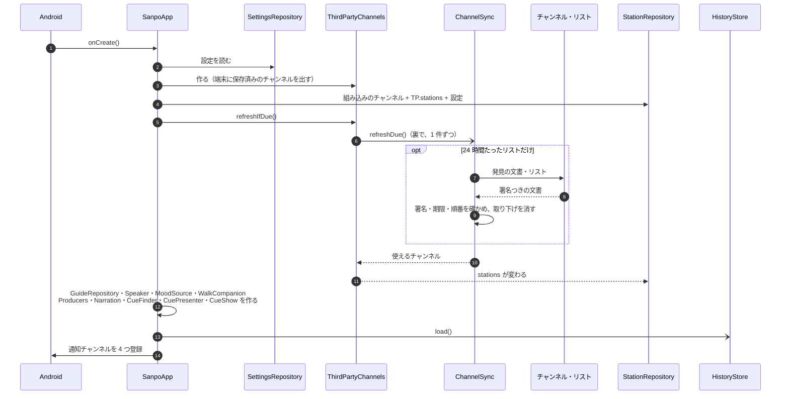
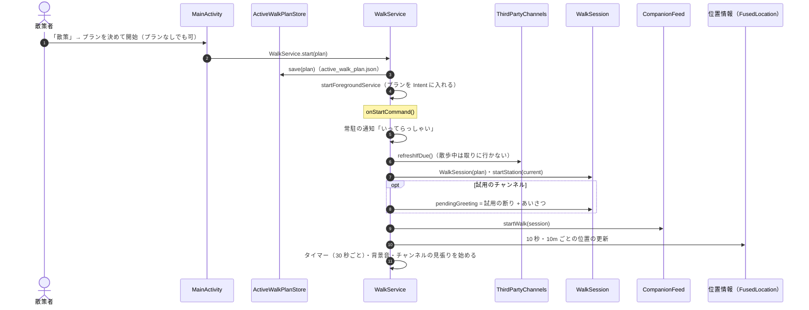
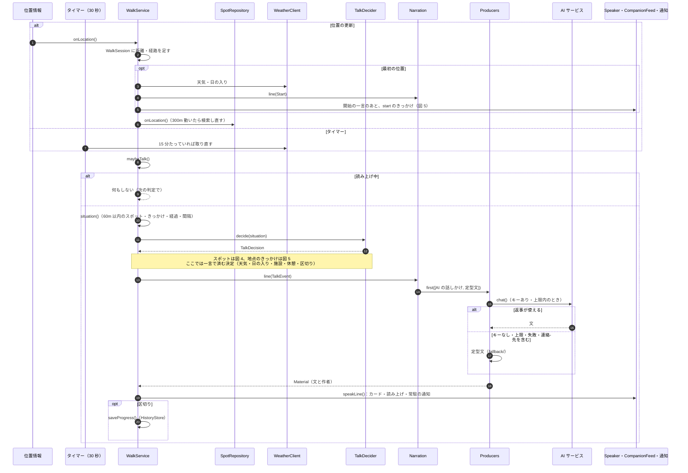
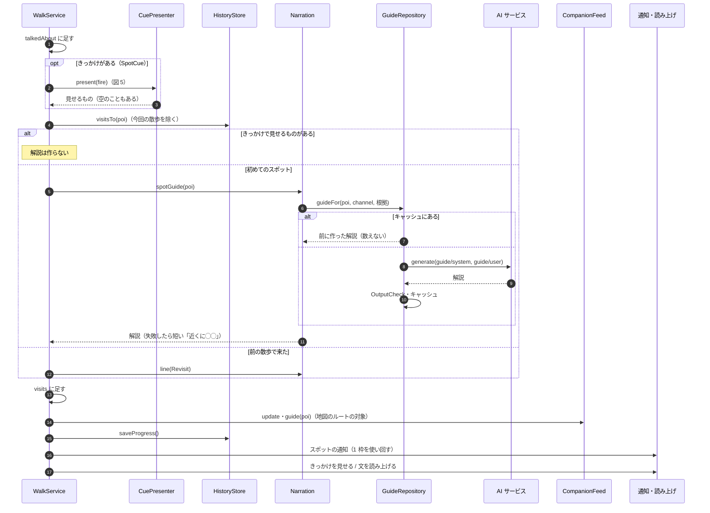
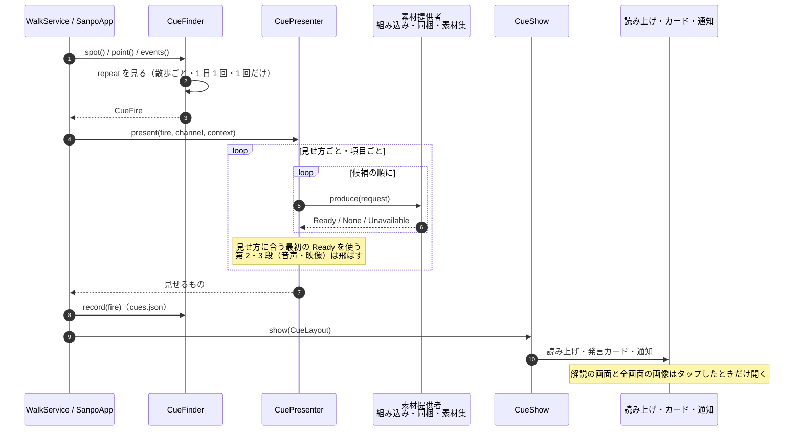
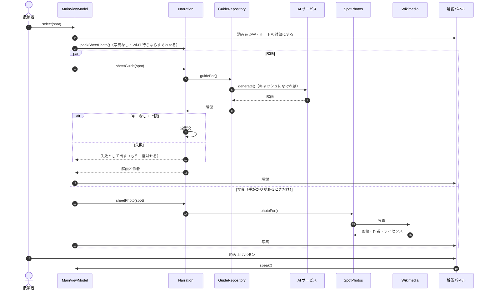
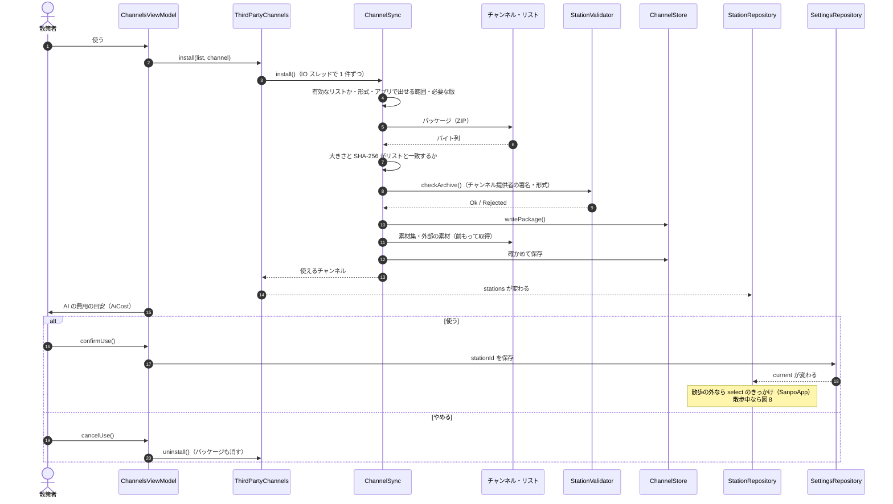
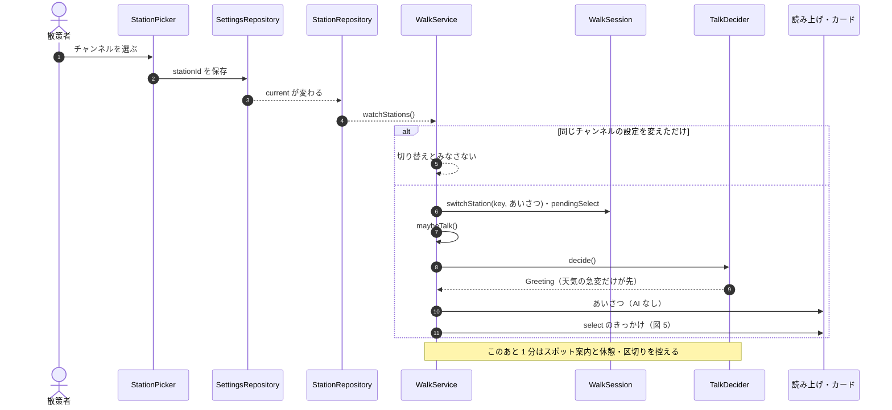
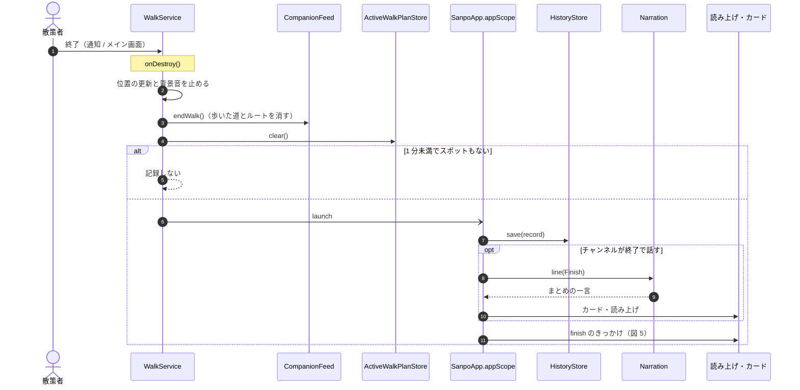

# 散策ガイドのシーケンス図

主な処理を、呼び出しの順に追う。部品の置き場所とつながりは[構造図](architecture.md)、ここでは「いつ・だれが・だれを呼ぶか」を示す。

| 場面 | 図 |
|---|---|
| アプリを開いたとき | [図 1 · 起動](#図-1--起動-sanpoapp-が共有部品を作る) |
| 散策を始めたとき | [図 2 · 散策の開始](#図-2--散策の開始-プランを保存してから-walkservice-を起こす) |
| 散策中、位置が変わるたび・30 秒ごと | [図 3 · 話しかけ](#図-3--話しかけ-位置の更新とタイマーから話すまで) |
| 散策中、スポットに近づいたとき | [図 4 · スポットの案内](#図-4--スポットの案内-きっかけか解説か再訪の一言) |
| チャンネルのきっかけが当たったとき | [図 5 · きっかけ](#図-5--きっかけ-チャンネルの素材を取り出して見せる) |
| 地図でスポットをタップしたとき | [図 6 · スポット解説](#図-6--スポット解説-解説と写真を別々に取る) |
| 第三者のチャンネルを使うとき | [図 7 · チャンネルの取り込み](#図-7--チャンネルの取り込み-確かめてから使う) |
| 散策中にチャンネルを切り替えたとき | [図 8 · 散策中の切り替え](#図-8--散策中の切り替え-一言を予約する) |
| 散策を終えたとき | [図 9 · 散策の終了](#図-9--散策の終了-記録してからまとめの一言) |

図はコードから手で書き起こしたもの。`WalkService`・`SanpoApp`・`ChannelSync` の呼び出し順を変えたときは、この文書も更新する。パスは `app/src/main/java/io/github/duwenji/yorisoi/sanpoguide/` からの相対。

## 図 1 · 起動: SanpoApp が共有部品を作る

DI ライブラリは使わず、`SanpoApp.onCreate()` が部品を順に作る（構造図の図 1）。チャンネルのリストの取得は待たずに裏で進め、取れたものから `StationRepository` に入る。

- `StationRepository.current` は、設定の `stationId` を一覧から探したもの。見つからなければ標準になる。端末に保存済みの第三者のチャンネルも裏で読むため、読み終わるまでは標準で、読み終わると選んでいたチャンネルに替わる。
- 散歩の外でチャンネルを選び直したときの `select` のきっかけは、`SanpoApp` が設定の `stationId` を見張って出す（図 5 の形）。散歩中は図 8 の流れになる。

## 図 2 · 散策の開始: プランを保存してから WalkService を起こす

メイン画面の「散策」ボタンは、まず散策プランの画面（`ui/WalkPlanScreen`）を開く。プランは任意で、テーマ・時間・距離・立ち寄るスポットを決められる。立ち寄り先の候補は、テーマに合う近くのスポット 3 件（`companion/PlanSuggestions`）。

- 保存に失敗すると、散策は始めずにプランの画面にエラーを出す。
- OS がサービスを再起動したとき（`Intent` が null）は、保存したプランを読み直して続ける。読めなければ「散策を再開できませんでした」と通知して止まる。
- プランは話す判断と文に効く。立ち寄るスポットは候補の中で先に選ばれ（`SpotChooser`。ただし地点のきっかけは追い越さない）、プランの要約は話しかけのプロンプトに入る（`WalkCompanion` の `plan`）。

## 図 3 · 話しかけ: 位置の更新とタイマーから話すまで

位置の更新とタイマーの両方が `maybeTalk()` を呼ぶ。`TalkDecider.decide()` は Android に依存しない純粋な関数で、ルールを上から評価して最初に当たった 1 件を返す（判定順は構造図の図 2）。`WalkService` はその決定を実行する。

- `talk { }` は `Mutex` を `tryLock` するだけで、待たない。話している間に当たった決定は捨て、次の判定でもう一度決める。
- 雷雨の急変は、読み上げに加えて音つきの通知（`CHANNEL_ALERT`）も出す。イヤホンなしでも気づけるように。
- 区切りで話さないチャンネルでも、区切りの時点で記録は保存する（`TalkDecision.Checkpoint`）。
- AI の文には作者「文: AI（モデル名）」が付く（`material/creditLine`）。定型文には付かない。

## 図 4 · スポットの案内: きっかけか、解説か、再訪の一言

`TalkDecider` が `SpotCue`（チャンネルがきっかけを置いたスポット）か `Spot` を返したときの `talkAboutSpot()`。

- 解説のキャッシュの鍵は、AI サービス・モデル・チャンネル（版を含む）・解説の長さ・スポット・位置情報を送る設定・根拠の組み合わせ。図 6 のタップと共有する。
- きっかけの素材がどれも出せなかったときは、ふつうの解説に戻る。

## 図 5 · きっかけ: チャンネルの素材を取り出して見せる

きっかけは、スポット・地点・出来事（開始・終了・選んだとき）の 3 種類。どれも `CueFinder` が当たりを決め、`CuePresenter` が素材を取り出し、`CueShow` が見せる。

- 何も出せなかったきっかけも見せたことにする。判定のたびに試し直さないため。
- 素材集の資料を根拠として渡すのは、AI が作る素材提供者への依頼だけ（`groundedFor()`）。
- 素材は前もって取得したものだけを使う（図 7）。きっかけが当たってから取りには行かない。

## 図 6 · スポット解説: 解説と写真を別々に取る

地図でスポットをタップしたとき。散策中でなくても動く。

- 散策中と違い、AI の失敗はそのまま失敗として出す。散策者が画面を見ていて、やり直せるため。
- 結果が届いたときに別のスポットを選んでいたら、その結果は捨てる（`updateSelected`）。

## 図 7 · チャンネルの取り込み: 確かめてから使う

配信されているチャンネルの画面（`ui/ChannelsScreen`）で「使う」を押したとき。リストは前もって足してある（`addProvider`。リスト ID は散策者が別の経路で受け取ったもので、サーバーからは受け取らない）。

- 確かめに通らなければ保存せず、理由を画面に出す（`ChannelSyncException`）。前の版があれば、新しい版が通るまで前の版を使う。
- チャンネル提供者が変わった新しい版は、リストに移し替えの裏付け（`publisherChange`）があるときだけ受け入れる。
- 散策者が「使う」を選ぶまで、そのチャンネルで AI は呼ばない。
- 試用チケット（開発者モード）も同じ確かめ方で、選ぶとすぐ使うチャンネルになる。

## 図 8 · 散策中の切り替え: 一言を予約する

`WalkService` は `StationRepository.current` を見張る。チャンネルが変わったら記録に区間を足し、新しいチャンネルの一言を予約して、すぐ `maybeTalk()` を呼ぶ。

- 切り替えでスポットの検索の種類（`searchedKinds`）が変わるときは、`SanpoApp` がスポットを検索し直す。
- 背景音は `current` と雰囲気を見て、選び直す（`startAmbient()`）。

## 図 9 · 散策の終了: 記録してから、まとめの一言

通知の「終了」かメイン画面のボタンで `WalkService` が止まる。まとめの一言とその後の処理は、サービスが止まっても続くように `SanpoApp.appScope` で動かす。

- 終わったあとに生成が終わった文は、`speakLine()` が捨てる（常駐の通知を出し直さないため）。まとめの一言だけは、この図のとおり `appScope` から出す。
