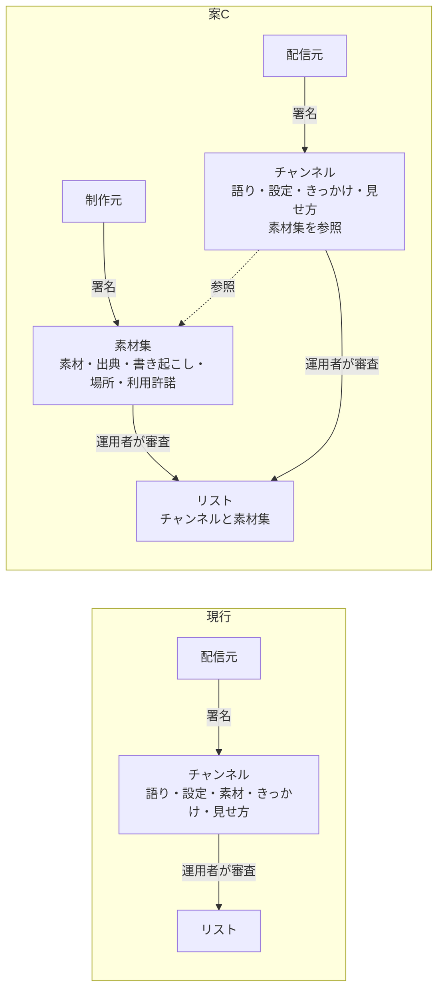

# architecture-decision-record ログ

## 基本情報

| 項目 | 内容 |
|------|------|
| テーマ | 素材（テキスト・画像・音声・映像）の制作元の役割を、チャンネルの配信元から切り出す（ADR-002 予定） |
| 記録日 | 2026-10-11 |
| 承認者 | 開発者（未承認） |
| モード | balance |

## 段階記録

### Phase 1（段階1〜6）

- 実施内容: API-003 の「素材・きっかけ・見せ方」（M-1〜M-4、F-8〜F-13）、ADR-001（C-3・C-4・C-7・C-8）、API-002、channels.md、TODO.md「チャンネル」、sanpo-channel-console の仕組み（concepts.md）・DM-001 を確認した
- 開発者のテーマ（段階3）: 素材の制作元（Producer）の役割を切り出す。チャンネルは素材を利用し、利用者に見せる（プレゼンテーション）
- 現行構成（段階4）: 素材はチャンネルのパッケージの一部（`channel.json` の `resources`）。小さいものは ZIP の中、大きいものは配信元が置いた URL と SHA-256。出典は `credit`（文字列）だけで、制作元の身元・署名・利用許諾の仕組みはない。審査はチャンネルの版ごとで、素材の中身（出典・ライセンス・写っているもの・宣伝）もチャンネルの審査で確かめる
- 現行の問題: (1) 同じ素材（観光協会の音声ガイドなど）を複数のチャンネルで使うと、同じ素材をチャンネルごとに審査する (2) 素材だけ作りたい人（観光協会・写真家・語り手）も、語り手・話題まで含むチャンネルを作らないと届けられない (3) 素材を直すと、使っているすべてのチャンネルが申請し直しになる (4) 誰がその素材を使ってよいかを、配信元の自己申告（`license: permission`）でしか示せない

#### 構成差分（段階5）

#### 候補案（段階6）

| 案 | 内容 | 利点 | 欠点 |
|----|------|------|------|
| A. 現状維持 | 制作元は配信元に素材を渡すだけ。関係はシステムの外の取り決め | 変更なし | 上の問題 (1)〜(4) が残る |
| B. 出典の項目だけ足す | `credit` に制作元のアカウントID を書けるようにする。署名・審査・配信はチャンネル単位のまま | 変更が小さい | 身元を名乗れるだけで確かめられない。(1)〜(3) は残る |
| C. 素材集を独立した単位にする（推奨） | 制作元が「素材集」を作って署名し、運用者が素材集として審査・承認してリストに載せる。チャンネルは素材集を参照し、きっかけと見せ方だけを決める | (1)〜(4) を解く。チャンネルと素材の審査を分けられる。素材だけの参加者を受け入れられる | API-002・API-003・管理システムの変更が大きい。素材集の更新・取り下げがチャンネルに波及する |
| D. 素材集を作るが審査はチャンネルと一緒 | 素材集は制作元が署名して自分で置く。チャンネルは素材集の SHA-256 を固定して参照し、審査はチャンネルの申請のときに一緒に行う | リスト（API-002）は変えずに済む | 素材集を直すと、使うチャンネルすべてが申請し直し。同じ素材の審査の重複は残る |

- 判断根拠（推奨を C とした理由）: 開発者の意図は役割の分離で、審査と更新の単位まで分けないと分離の効果（再利用・素材だけの参加）が出ない。第三者のチャンネルはまだ公開前（ADR-001 T-5 の実装直後）なので、形式を変える費用が今がいちばん小さい
- 承認ステータス: 段階7（候補案の決定）待ち。案 C を採る場合の細かな論点（参照の固定、利用許諾、場所の情報、取り下げの波及、組み込みのチャンネルの扱い、アカウントの役割）は開発者に提示した

### Phase 1 追記（段階6、2026-10-11）

- 開発者の問い: 案 C で、今使っている素材（API で取得する素材など）も扱えるか
- 確認した今の素材の出どころ: スポットの写真（Wikimedia Commons・Wikidata の API、スポットごとにその場で取得）、AI の解説・話しかけ（利用者のキーでその場で生成）、雰囲気の絵（アプリが描画）、背景音（アプリが合成、6 種類）、定型文（アプリに内蔵）。地図タイル・スポットの情報（Overpass）・天気は見せる素材ではなく、判断に使うデータとして対象外にする
- 分析: 案 C の素材集は「前もって作り、署名し、審査し、まとめて取得する」静的な素材。今の素材は「その場で取得・生成する」動的な素材で、前もって審査できない。素材集の形には入らない
- 提案: 制作元を 2 種類にする。(1) 組み込みの制作元: アプリのコードで動く（Commons の写真・AI の語り・合成の背景音・雰囲気の絵・定型文）。安全はアプリのコードと固定の指示で守り、増やすのはアプリの更新だけ (2) 第三者の制作元: 静的な素材集だけ。第三者の動的な制作元（第三者の API をその場で呼ぶ）は認めない（F-10 の位置の漏れと、審査できないため）。チャンネルは両方を同じ参照の書き方で使い、今の `mood.sound`・プロンプトのスロットは「組み込みの制作元への指示」と位置づける（形式は変えない）
- 承認ステータス: 段階7 待ち

### Phase 1 追記 2（段階6、2026-10-11）

- 開発者の方針: 制作元を 2 種類にすることには賛成。ただし共通のインタフェース（IF）を決め、両方を同じ IF で扱いたい
- 提案の骨子:
  - IF は 3 つの型と 2 つの操作。型は「制作元の記述」（何を・どう作るか・信頼・取得の仕方・位置の伝わり方）、「素材の要求」（何について・どの種類・チャンネルの指示・制約）、「素材」（API-003 の `resources` と同じ形＋出どころ）。操作は「準備する」（前もっての取得）と「出す」
  - 静的と動的の違いは IF の形ではなく記述の属性（`trust`・`fetch`・`exposure`・`generated`）で表し、アプリの方針（ポリシー）が属性を見て許可・制限する。第三者の動的な制作元は IF では書けるが、方針で禁止する（将来、審査つきで認める余地を残す）
  - チャンネル自身の `resources` も「チャンネルに同梱の素材集」として同じ IF の制作元にする。AI の語りも制作元にし、スロット・`guide.length` は AI の制作元への指示と位置づける
  - チャンネルのきっかけは、素材を「制作元 ＋ 選び方（素材の ID か、題材）」で参照し、複数を並べると最初に出せたものを使う（F-12 の replace/add もこれで書ける）
  - 契約は新しい API-004（制作元 IF）に置き、型は `:station-format` に入れて管理システムの validator と共有する
- 決めること: `channel.json` の今の項目（スロット・`mood.sound` など）を省略形として残すか、制作元の形に書き直すか（format 2）
- 承認ステータス: 段階7 待ち

### Phase 2（段階7〜8、2026-10-11）

- 実施内容: 開発者が「上記提案で良い」と回答し、案 C・共通の IF・論点 1〜8・A〜C（省略形として残す、AI の語りも制作元、記述の置き場所）が決まった（段階7）。ADR-002 の草案（0.1）と、IF の詳細を定める API-004 の草案（0.1）を作成した（段階8）
- 判断根拠: 段階6 の比較のとおり。違いを属性と方針で表すことで、IF を 1 つに保ちながら、第三者の動的な制作元を禁止できる
- 承認ステータス: 段階9（ADR-002 草案の承認）待ち。API-004 は別に承認を受ける

### Phase 2 追記（段階8、2026-10-11）

- 実施内容: 開発者が「制作元の管理も必要では」と指摘。管理システムの配信元の管理（DM-001 PUB・KEY、M-7・M-10・M-14・M-15、ADR-001 A-15・A-18・A-19）と照らし合わせ、そのまま使えるもの（登録・鍵の紐づけ・停止・記録・通知・上限）と、新しく決めるもの N-1〜N-6 を提示した。開発者が「お願い」と回答し、ADR-002 を 0.2（D-17〜D-22、T-10、未決事項 No.6・7）、API-004 を 0.2（素材集を ID だけで参照）にした
- 判断根拠: 参照に制作元のアカウントIDを含めると、鍵の移し替えでチャンネルの参照が壊れる。素材集の ID を提供元の中で一意にすれば、移し替えの影響をリストの `producerChange` だけに閉じ込められる
- 承認ステータス: 段階9 待ち

### Phase 3〜4（段階9〜14、2026-10-11）

- 実施内容: 開発者が「ADR-002 と API-004 を承認します。進んで」と回答。影響範囲・追従タスク T-1〜T-10・見直しの条件は ADR-002 に記載済み（段階10〜12）。ADR-002 を 1.0（承認済）、API-004 を 1.0（承認済、I-1〜I-9・P-1〜P-5 を採用）にした
- 承認ステータス: 承認済（2026-10-11、開発者）
- 残り: T-2（API-003 1.2）・T-3（API-002 1.2）に着手。未決事項 No.1〜7
