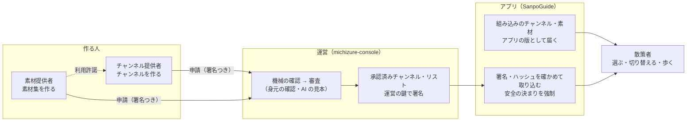

# 関係者と、チャンネルという考え方

| 項目 | 内容 |
|---|---|
| 状態 | 草案（2026-10-12）。呼び方（[1 章](#1-関係者と呼び方)）は開発者が決定済み。[4 章](#4-関係者ごとの課題と対応案)の対応案は未承認 |
| 対象 | SanpoGuide（アプリ）と michizure-console（チャンネル管理システム） |
| 関連 | [ADR-001](adr/ADR-001-third-party-channel-curation.md)・[ADR-002](adr/ADR-002-material-producers.md)、[channels.md](channels.md)、[構造図](architecture.md)、管理システムの[利用ガイド](https://github.com/duwenji/michizure-console/blob/main/docs/guide/README.md) |

本書は、2 つのリポジトリに共通する関係者の呼び方と、関係者それぞれから見た課題をまとめる。呼び方の正本は本書。

## 1. 関係者と呼び方

このシステムの関係者は、**散策者・チャンネル提供者・素材提供者**の 3 者と、3 者のあいだに立って審査と配信をする**運営**。

| 呼び方 | だれか | 何をするか | 何を得るか | コード・契約上の名前 |
|---|---|---|---|---|
| **散策者** | アプリで散歩する人 | チャンネルを選び、切り替えて歩く。組み込みのチャンネルは自分好みに変える | 同じ道でも違う散歩の体験 | `user`（画面・文書では散策者） |
| **チャンネル提供者** | 観光協会・店舗・愛好会など | 語り手・話題・話す場面・頻度と、素材を出すきっかけを決めたチャンネルを作り、申請する | 自分の視点で、散策者に土地を案内できる | `publisher`（アカウントID `sg1…`） |
| **素材提供者** | 観光協会・写真家・語り手など | テキスト・画像・音声・映像を素材集にまとめ、申請する。どのチャンネル提供者に使わせるかを決める | チャンネルを作らなくても、素材を散策者に届けられる | `producer`（アカウントはチャンネル提供者と共通） |
| **運営** | 当面は開発者本人（ADR-001 C-10） | 審査・承認・取り下げ、身元の確認、鍵の管理。承認済みチャンネル・リストに署名して公開する | — | 管理システムの `operator` |

- 運営の中で働く人を指すときは「運営の担当者」と書く（例: 「審査を戻す（ほかの担当者に任せる）」）
- 運営が出す承認済みチャンネル・リストを、散策者から見た単位として**リスト**と呼ぶ。散策者は URL と**リストID**（`sc1…`。ルート鍵の指紋）でリストを足す。リストは関係者ではなく、運営が出すもの。API-002 の `provider` にあたり、役割として言うときは「リストの発行元」と書く
- リストは複数あってよい（内蔵のリスト、散策者が足したリスト、開発用のリスト）。ルート鍵を入れ替えると、リストIDが変わり別のリストになる
- アプリには、アプリ自身が持つ組み込みのチャンネルと、組み込みの素材（AI の解説・話しかけ、Wikimedia の写真、背景音、雰囲気の絵、定型文）もある。これらは運営の審査を通らず、アプリの版として届く
- コード・JSON の項目名・API の名前は変えない（`publisher`・`producer`・`provider` のまま）

前の呼び方との対応（2026-10-12 に変更）:

| 前 | 今 |
|---|---|
| 利用者（アプリを使う人） | 散策者 |
| 配信元 | チャンネル提供者 |
| 制作元 | 素材提供者 |
| 提供元・提供元ID | リスト・リストID（役割として言うときはリストの発行元） |
| 運用者・システム運用者 | 運営（人を指すときは運営の担当者） |

## 2. チャンネルという考え方

チャンネルは、**同じ散歩を違う体験に切り替えるもの**。ラジオやテレビの局のように、散歩の途中でも切り替えられる（コード上の名前 `Station` はこのたとえから）。

- チャンネルが決めるもの: 語り手（人格・口調）、話題、話す場面、話す量、解説の長さ、優先するスポットの種類、トーン、背景音。第三者のチャンネルは、きっかけ（スポット・地点・出来事）と見せ方を決めて素材を出せる
- チャンネルが決められないもの（アプリが必ず守らせる）: 天気の急変・日の入り・施設の案内、AI への共通の指示（`shared/guard`。個人情報を尋ねない、勧誘しない、危険な場所に誘わない など）、見せ方の安全の決まり（歩いている間は全画面を開かない など）、取得の時期と量の上限

| | 組み込みのチャンネル | 第三者のチャンネル |
|---|---|---|
| 作る人 | アプリの開発者 | チャンネル提供者（素材は素材提供者も） |
| 届き方 | アプリの版 | 運営が出すリスト（[API-002](channel-list-api.md)） |
| 確かめ方 | 起動時に `StationValidator`（誤りなら起動しない） | 運営の審査と署名、チャンネル提供者の署名、SHA-256、`StationValidator` |
| 散策者が変えられるか | 頻度・場面・解説の長さ・優先する話題・トーン・背景音 | 変えられない（使う・使わないだけ） |
| AI の費用 | 散策者の API キー | 散策者の API キー（頻度と解説の長さはチャンネル提供者が決める） |

## 3. 関係者ごとの流れ

| 関係者 | 始める | 作る・選ぶ | 確かめる | 続ける・やめる |
|---|---|---|---|---|
| 散策者 | アプリを入れる。第三者のチャンネルはリストを足す | チャンネルを取り込み、選ぶ | — | 新しい版は自動で取り込む。取り下げは理由とともに知らされる |
| チャンネル提供者 | 管理システムに登録し、鍵を紐づける | パッケージを作り、署名して申請する | 機械の確認、試用チケット、審査 | 版を上げて申請し直す。鍵の移し替え、退会 |
| 素材提供者 | 同じアカウントで「素材提供者として始める」 | 素材集を作り、署名して申請する | 機械の確認（外部の素材も）、身元の確認 | 使っているチャンネルの確認、毎日の確認、退会 |
| 運営 | ルート鍵と署名鍵を用意する | — | 審査・承認・差し戻し・取り下げ | 毎日のリストの作り直し、鍵の入れ替え |

## 4. 関係者ごとの課題と対応案

2026-10-12 のレビュー。番号は課題の ID。

### 4.1 散策者

| ID | 課題 | 根拠 | 対応案 |
|---|---|---|---|
| W-1 | 第三者のチャンネルを見つけられない。リストの URL とリストID を手で入れる必要があり、内蔵のリストはまだない | `ChannelsScreen`「リストはまだありません」 | 本番の準備（管理システム T-5・T-7・T-8）を先にし、本番のリストを内蔵する。それまでは QR コード・リンクでリストを足せるようにする |
| W-2 | 選ぶための情報が少ない。一覧に出るのは名前・概要・チャンネル提供者・版だけで、リストにある説明・タグ・地域・アイコンを出していない | `ChannelsScreen.ChannelRow` | チャンネルの詳細の画面（説明・アイコン・素材の有無と素材提供者・宣伝の有無）。今いる地域に合うものを上に並べる |
| W-3 | AI の費用が増えるかどうか分からない（散策者の API キーで、チャンネル提供者が決めた頻度・長さで話す） | ADR-001「費用」 | 取り込む前に、話す量・解説の長さと「標準より費用が増えることがある」を出す |
| W-4 | 問題のあるチャンネルを知らせる手段がない | 審査基準 未決事項 No.4 | 「問題を知らせる」を足す。最初は運営の窓口へのメールの下書きを開くだけ |
| W-5 | 宣伝の表示と、素材提供者の「確認済み」の印が未実装・未定 | ADR-002 T-14、未決事項 No.6 | T-14 と一緒に決める |

### 4.2 チャンネル提供者

| ID | 課題 | 対応案 |
|---|---|---|
| C-1 | 反応が分からない（何人が取り込んだか） | 公開 URL（CloudFront）の記録から、パッケージの取得数を日別・概数で集計し、画面に出す。アプリは変えず、散策者を特定しない |
| C-2 | 作る敷居が高い。JSON とプロンプトを手で書いて ZIP にする。AI の見本は運営しか見られず、試用には開発者モードが要る | ①ひな形の ZIP、②申請の前に自分の API キーで AI の見本を見る（審査の画面の仕組みを流用）、③画面のフォームで作る（次の段階） |
| C-3 | 使える素材集を探せない（公開中の素材集の一覧がない） | 自分が使ってよい（`grants`）素材集を、タグ・地域で探せる一覧 |
| C-4 | 審査にかかる期間、異議の申し立て、審査の費用が未定 | 公開の前に決める（審査基準 未決事項 No.2・3） |
| C-5 | 素材集の更新で中身が変わり、チャンネルの意図とずれる | ADR-002 のリスク。チャンネルから素材集の版を固定できるようにするか検討する |

### 4.3 素材提供者

| ID | 課題 | 対応案 |
|---|---|---|
| M-1 | 想定する素材（観光協会の音声ガイドなど）がまだ届かない。アプリが出せるのは文字と画像（第 1 段）まで | 音声（第 2 段）の時期を TODO に書く。素材提供者ガイドの冒頭に「今届くのは文字と画像」と書く |
| M-2 | チャンネル提供者と出会う場がない | C-3 の一覧が両者の出会いの場になる。組み込みのチャンネルが基準（タグ）で素材集を使う道も検討する |
| M-3 | 反応が分からない | C-1 と同じ集計を素材集ごとにも出す |
| M-4 | 権利の申し立ての窓口と「確認済み」の印が未定 | ADR-002 未決事項 No.6・7。W-4 と同じ窓口で受ける |
| M-5 | 素材のテキストが AI の解説の根拠に使われない | ADR-002 未決事項 No.1。第 2 段の候補に上げる |

### 4.4 運営

| ID | 課題 | 対応案 |
|---|---|---|
| O-1 | 担当者が 1 人で、審査・身元の確認・取り下げ・窓口をすべて受け持つ | 審査期間の目安（C-4）を、担当者 1 人で回せる値にする。W-4・M-4 の窓口は 1 つにまとめる |

## 5. 進め方

| 順 | 内容 | ID |
|---|---|---|
| 1 | 呼び方をそろえる（本書、両リポジトリの文書と画面）。構造図に「チャンネルという考え方」を足す | — |
| 2 | 公開の前に必ず: 本番と内蔵のリスト、通報の窓口、審査期間の目安と費用 | W-1・W-4・M-4・C-4・O-1 |
| 3 | 公開の直後: チャンネルの詳細の画面、取得数の集計、素材集の一覧 | W-2・W-3・C-1・M-3・C-3・M-2 |
| 4 | その後: フォームでの作成、素材を AI の根拠に、素材集の版の固定 | C-2・M-5・C-5 |

## 変更履歴

| 日付 | 版 | 変更内容 |
|---|---|---|
| 2026-10-12 | 0.1 | 草案。呼び方を「散策者・チャンネル提供者・素材提供者・運営」に決めた（開発者） |
| 2026-10-12 | 0.2 | 提供元・提供元ID は「運営」ではなく「リスト・リストID」と呼ぶ（提供元は複数あり、ID はルート鍵の指紋で組織を指さないため。開発者の決定） |
